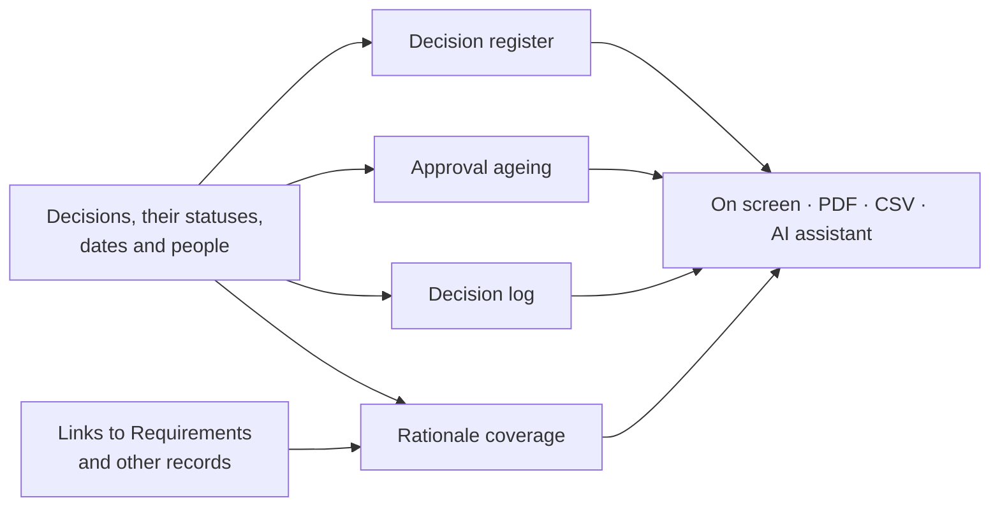

# Reports

Decision Management adds four project-level reports to the project's **Reports** page: a register of every Decision, a view of what is waiting for a verdict, a log of decisions made in a period, and a check that decisions and requirements are tied together. They answer questions such as *what did we decide last quarter?* and *which approvals are stuck?*

Open the project's **Reports** page and choose a report from the **Report** picker; the module's reports appear there only while Decision Management is enabled for the project. How the page works (options, figures, export, branding template) is the same as for every module report; see [Context & Strategy → Reports](../context-strategy-module/reports.md#generating-a-report). A report covers only what you can read, and **Include child projects** adds readable sub-projects that have the module enabled.

## The reports

| Report | Answers | Options |
| --- | --- | --- |
| **Decision register** | Every Decision with its type, status, decision date, decision maker, owner, and which Decisions it supersedes or is superseded by; totals by status and by type | Status, Decision type (by name), Decided from, Decided to, Include archived |
| **Approval ageing** | Proposed and Under review Decisions by days waiting, longest first, with **Overdue** and **No decision maker** lists | Overdue after (days), default 14 |
| **Decision log** | Approved and Superseded Decisions made in a period, with context, chosen option and rationale: the view for a status meeting | Decided from (default 90 days before the end), Decided to (default today) |
| **Rationale coverage** | Live Decisions with no linked record, and Requirements with no linked Decision | none |

Things worth knowing:

- **Days waiting** counts from when the Decision entered its current status (Proposed, or Under review), not from when it was last edited.
- **Overdue** is only a waiting-time threshold, because a Decision has no due date. **No decision maker** lists waiting Decisions whose decision maker is blank.
- **Decision log** lists decisions that were *made*; a Rejected Decision appears in the register, not the log. Free-text fields are cut to 400 characters; open the Decision for the full text.
- **Rationale coverage** counts a link to a Requirement or another record, not a link to another Decision (supersession and "depends on" are not a reason). Rejected and Superseded Decisions are history and are not listed. Links to records you cannot read count as missing, so the gap list can over-report but never reveals a record you cannot see.

## Export and AI assistants

Each report downloads as **PDF** or **CSV** from **Export**; the CSV is the report's first table (the register, the awaiting list, the log, or the Decisions with no linked record). The same four reports are available to an [AI assistant](./mcp-integration.md) as read-only tools.

## Limits

There is no organisation-wide version of these reports yet; Decision Management defines no organisation-level role to control who may run one. Use **Include child projects** to cover a project and its sub-projects.
