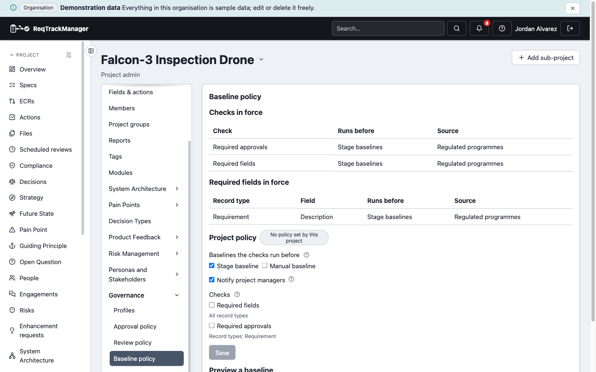
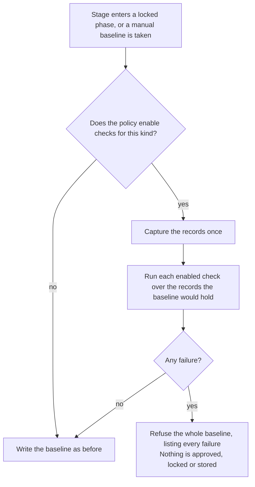
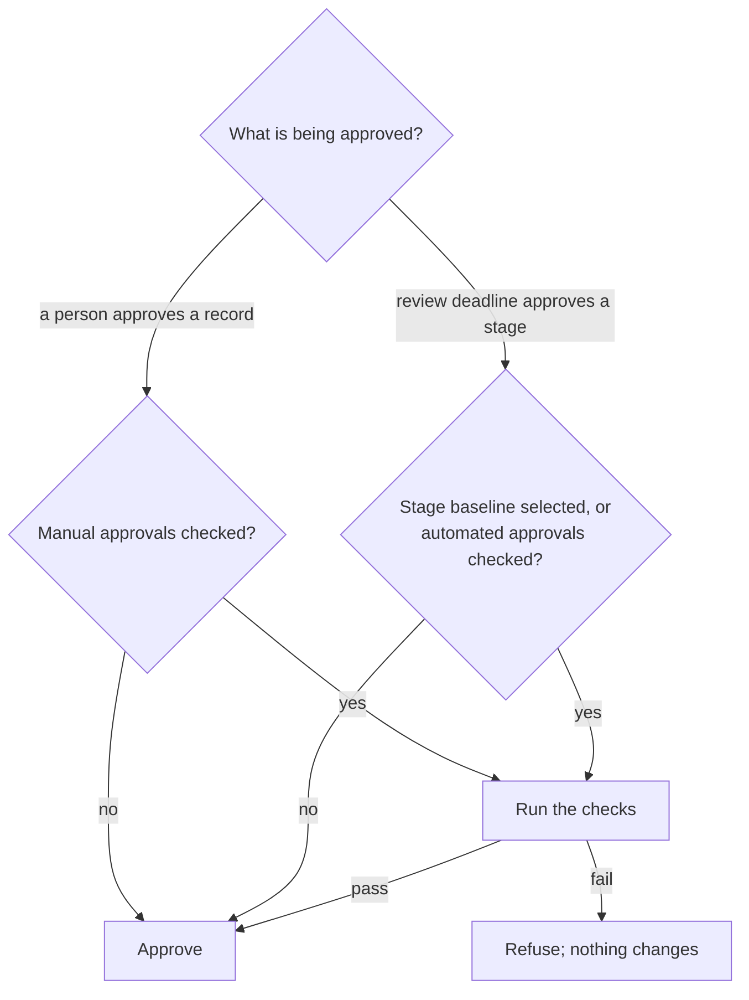
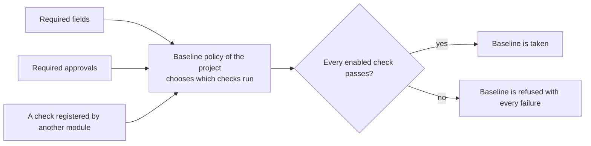

# Baseline policies

A **baseline policy** is a set of checks that must pass before a baseline is taken and, if chosen, before a record is approved. Without a policy no check runs.

| Project admin: Baseline policy |
| --- |
| Checks and required fields in force for the Falcon-3 Inspection Drone project, each naming the profile that supplies it |
|  |

## When the checks run

A check runs before either kind of baseline, as the policy chooses:

| Kind | When | Default |
| --- | --- | --- |
| **Stage baseline** | A stage enters a locked phase | On |
| **Manual baseline** | A person takes a baseline without a stage | Off, because a manual baseline approves and locks nothing |

A failing check refuses the **whole** baseline. The refusal lists every record and check at fault, and nothing is approved, locked or stored.

## Checking approvals

**Check record approvals** also runs the policy's checks when a record is approved. A failing check refuses the approval, names what is wrong and changes nothing.

| Value | The checks also run |
| --- | --- |
| **Off** (default) | Never on an approval |
| **Manual approvals only** | When a person approves one record, including through a change request |
| **Automated approvals only** | When a stage is approved automatically at its review deadline |
| **Manual and automated approvals** | In both cases |

A stage approved at its review deadline is also checked whenever **Stage baseline** is selected. A policy may select approvals with no kind of baseline.

## The checks

| Check | Passes when |
| --- | --- |
| **Required fields** | Every record of a chosen type has each chosen field filled. A field is any column of the type's list, so a project's custom fields are included. |
| **Required approvals** | A stage baseline: the person taking it may approve Requirements, and approval separation lets them approve each draft they created, because the stage baseline is itself the approval. A manual baseline: the Requirements are already approved. It does not judge the approval being made. |
| **Traceability rules** | Every record meets every **Required** [traceability rule](#required-traceability-rules) that applies to it, using links a person added or confirmed. |

A module can register further checks, which then appear in the same list with no change to Governance. A check that names record types applies only to them.

## Settings

| Setting | Effect |
| --- | --- |
| **Baselines the checks run before** | Stage baseline, Manual baseline or both. |
| **Check record approvals** | Which approvals the checks also run before. At least one baseline kind or approval value is required. |
| **Notify project managers** | Tells the project managers when a failing check stops the automatic approval of a stage at its review deadline. On by default. |
| **Checks** | Which checks run. |
| **Required fields** | The record type and field each requirement names. A profile accepts any field, and offers a project's fields when a project is chosen. A project accepts only its own. |

A stage that the review-deadline sweep cannot approve because a check fails stays in review and is retried daily. The managers are notified once for each distinct set of failures.

## Required traceability rules

A traceability rule states the links a record is expected to carry, at one of three levels. Only **Required** rules can refuse anything, and only where the policy enables the **Traceability rules** check; elsewhere a Required rule is reported as not enforced, with the reason. Rules are currently defined and read through the API.

A rule met only by [carried-over links](../../core-features/links-and-traceability.md#carried-over-links) is *inherited*: it fails the check until each link is confirmed or replaced.

## Preview a baseline

**Preview a baseline** at the foot of the page lists the failures that a baseline taken now would be refused over, for a chosen kind of baseline and stage. It writes nothing. It needs **Manage project governance**, because it names the failing records.

## How policies combine

Checks unite across the profiles that apply and the project's own policy; each keeps its own *kinds*. The page lists every check in force with its source. A project that has no policy of its own uses its nearest ancestor project's.

| Action | Permission |
| --- | --- |
| Set a profile's baseline policy | **Manage organisation governance** |
| Set a project's baseline policy, preview a baseline | **Manage project governance** |
| Read the policy in force | Any project member |

See [Stages and baselining](../../core-features/stages-and-baselining.md) for the baseline itself.
