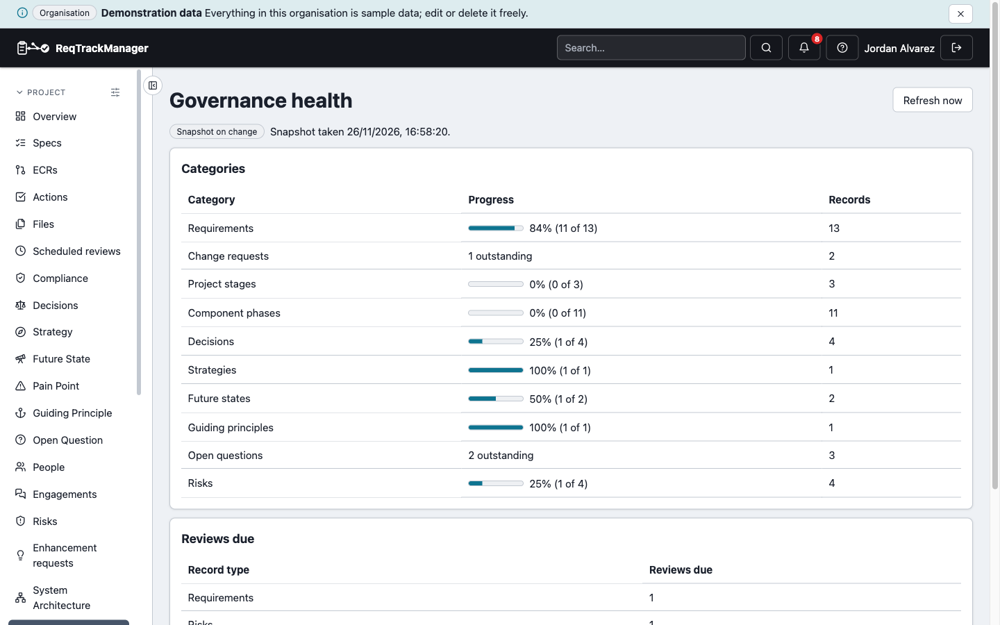
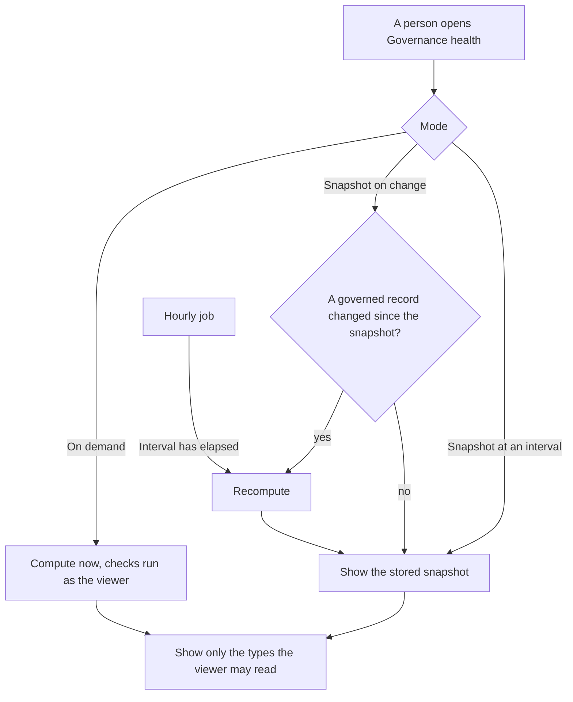

# Governance health

**Governance health** shows what a project has achieved, in three parts: progress per record type, reviews due, and the results of the baseline checks. It is a page in the project's navigation, **Governance Health**, and is read by any project member.

| Governance health |
| --- |
| Progress, reviews due and check results for the Falcon-3 Inspection Drone project, as a snapshot recomputed on change |
|  |

## What it shows

| Part | Content |
| --- | --- |
| **Categories** | One row per record type. A type that is completed shows the share at its settled outcome, rounded down so it never shows 100% before the last record (Requirements approved, Decisions approved, Stages in a Closed phase); a type that is outstanding shows a count still open (Change requests awaiting a decision, Open Questions). |
| **Reviews due** | The number of records past their review date, for each type with a [review schedule](./review-policies.md). |
| **Baseline checks** | For each enabled [baseline check](./baseline-policies.md) and record type, the records checked, how many fail and the share passing. |

A module that is on for the project adds its own record types with no change to Governance.

## Only what you may read

A person sees only the record types they may view. A missing category is therefore not zero. Health holds numbers and keys, never a record's code or title, so one stored figure serves every viewer. The failing records themselves appear only in the baseline preview, which needs **Manage project governance**.

## Modes

Each project chooses a mode under **Project administration, Governance, Health**, and the organisation sets the default under **Organisation administration, Governance, Health**. The project's own choice wins; a project that has none follows the organisation, and the page says which.

| Mode | How it is produced |
| --- | --- |
| **On demand** | Computed for each viewer when the page opens. Nothing is stored. This is the default. |
| **Snapshot at an interval** | A stored snapshot refreshed every 1, 6, 12 or 24 hours, or every 2, 3, 5, 7, 10 or 14 days. |
| **Snapshot on change** | A stored snapshot recomputed on the first read after a governed record or a governance policy changes. |

A snapshot is labelled with the time it was taken. **Stale** appears when the stored snapshot is shown because another refresh is still running. **Refresh now** recomputes a snapshot on request, needs **Manage project governance**, and is offered only in a snapshot mode.

## Baseline checks and who runs them

A check lists records through a person's own view, so it is never run as nobody.

- **On demand:** the viewer runs it.
- **In a snapshot:** the project's **check runner** runs it, an active user who holds a role in the project and is chosen in the health settings. The role is checked at every refresh. A group cannot be the runner.
- **With no runner:** the checks run only when a person presses **Refresh now**. Any other refresh carries the last results forward, labelled with who ran them and when.

The check status states which applies: current, carried forward, not run or runner unavailable. A carried-forward result is older than the snapshot and is not a current result.

## Choosing a mode

With baseline checks enabled, the checks capture every record a baseline would hold, which takes about 3 ms per record. On demand stays within one second up to about **300 records**; at 2,500 records it takes about 8 seconds, so the settings page advises a snapshot mode for a larger project with checks. The figures alone, without checks, stay under half a second at 50,000 records. See [Sizing and performance](../../installation-deployment/sizing-and-performance.mdx).

| Action | Permission |
| --- | --- |
| Read Governance health | Any project member |
| Change a project's mode, interval or check runner; Refresh now | **Manage project governance** |
| Set the organisation's default mode | **Manage organisation governance** |
