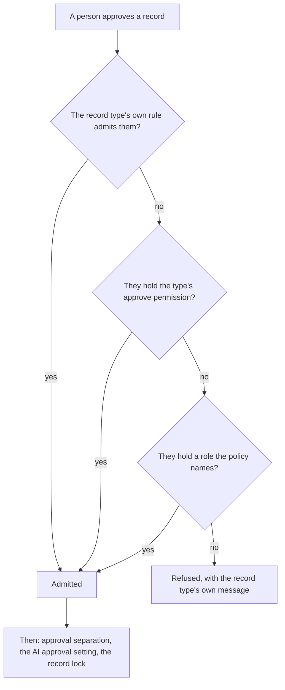

# Lifecycle and approval policies

A **lifecycle policy** controls which states a record passes through. An **approval policy** controls who may approve a record. Both extend settings that already exist; neither replaces a record type's own rules.

## Lifecycle policy

A profile can set three things for the projects it applies to. They are edited on the **Lifecycle** tab of a [profile](./profiles.md).

| Setting | Effect |
| --- | --- |
| **Required states** | An optional state of a record type that every project must keep. The project cannot turn it off. Only an optional state can be required; a start state, an end state and an approval state are never optional. |
| **Forbid skipping steps** | No record in the project can [skip steps](../../core-features/lifecycles.md#skipping-steps-on-one-record), whatever the project's own switch says. |
| **Required stage workflow** | New stages of the project start in the named organisation [stage workflow](../../core-features/stages-and-baselining.md). |

A required stage workflow has two modes:

| Mode | Effect |
| --- | --- |
| Start new stages in it | The project may still use its other workflows. |
| Start new stages in it and allow only the named workflows | The project may use only the workflows its profiles name. |

In both modes the project cannot hide the required workflow, existing stages are not moved, and the organisation cannot delete a workflow that a profile requires.

The project's own **Project administration, Lifecycles** page is where its optional states are turned off. It shows the badge *Required by governance profile* with the profile's name on each state a profile requires, and *Not allowed by governance profile* beside the skip switch when a profile forbids skipping. A project's lifecycle policy is therefore read in the existing [Lifecycles](../../core-features/lifecycles.md) page, not on a second Governance screen.

A required state unites with the states the organisation requires under **Organisation administration, Lifecycles**; no source relaxes another. A project exempt from the organisation's requirement is still bound by an Enforced profile, and an exemption from a profile lifts only that profile.

## Approval policy

Each record type with an approval step has a default rule for who may approve: Requirements and Change requests need a project manager, a Decision needs the permission of its type, a Risk acceptance needs the Risk Acceptor role, and so on. An approval policy **adds approvers**; it never removes one.

A policy names **roles**, never people: a project role, a role contributed by a module, or a custom role. A person holds a role directly or through a group, by effective membership; a role merely composed into a wider one does not count, so an administrator is not admitted by a role they only inherit elsewhere. A role of a module that is off for the project admits nobody.

The Approval policy page lists every record type that has an approval step, the **effective approvers** and their **source**. A person with **Manage project governance** selects **Edit approvers** on a row to name roles for the project. Leaving the value unset follows the nearest ancestor project; setting no roles stops the ancestor's roles applying, but never removes a role a profile names.

Approval policy has these properties:

- **Separation still applies.** [Approval separation](../../core-features/lifecycles.md#who-may-approve-the-creator-or-another-person) (whether the creator may approve), the setting that allows AI approval, and the record lock are applied after the policy and are not changed by it.
- **Requirements and Change requests honour the permission.** A role holding the `approve_baseline` permission for the type is admitted, in addition to project managers.
- **Stage locking.** A holder of a role the policy names for Requirements may also move a stage or a component track into or out of a locked phase, and make no other move. The permission alone does not admit it.
- **Compliance.** The Compliance requirement assessment uses the same policy, in addition to Compliance Officers.

## Permissions

| Action | Permission |
| --- | --- |
| Set a profile's lifecycle or approval policy | **Manage organisation governance** |
| Set a project's approver roles | **Manage project governance** |
| Read either | Any project member |
