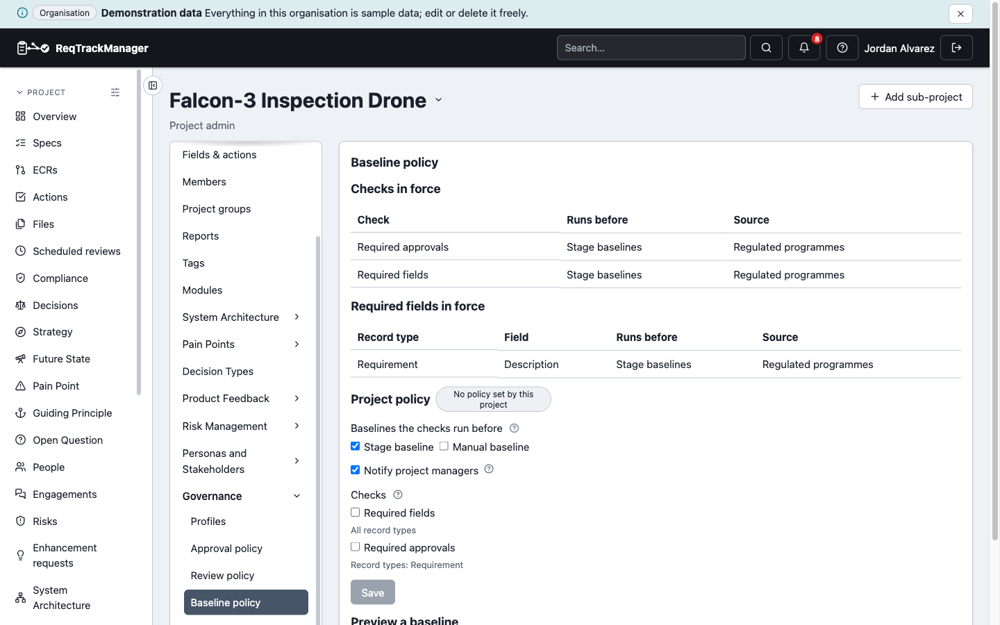
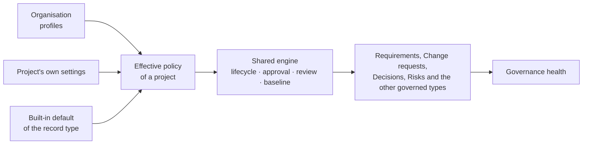

# Overview

The Traceability & Governance module lets an organisation set the rules a project works under, instead of each project configuring them alone. This section covers its **Governance** half: policy for lifecycles, approvals, reviews and baselines, set once by the organisation as **profiles**, and a **Governance health** view of how a project stands against them.

For example, an organisation requires that every project passes a requirement through *Reviewed*, that Stakeholders may also decide change requests, that requirements are reviewed at least every 90 days, and that a stage baseline is refused when a requirement has no description. It writes this once as an Enforced profile; every project follows it, and one named project is exempt.

| Project admin: Baseline policy |
| --- |
| The checks in force for a project and the profile each comes from |
|  |

## What Governance is, and is not

- **It sets and enforces policy.** A policy states who may approve, which states a record must pass through, how often it is reviewed and what must be true before a baseline.
- **It adds to the product's own rules and never removes one.** Without Governance, every record type behaves as it always has; a policy can only add approvers, require states, shorten a review interval or add a baseline check.
- **It is not a second workflow engine.** Each record type keeps its own states, locks and permissions. Governance supplies the policy that the one shared engine applies, so a record type behaves identically whichever module owns it.
- **It does not approve anything.** No policy, tool or setting approves a record on a person's behalf.

## Governed record types

A record type is governed when it uses the shared engine. The built-in default of each type is its behaviour before Governance existed, so a project that configures nothing sees no change.

| Policy | Record types |
| --- | --- |
| Lifecycle | Requirement, Change request, Decision, Strategy, Future State, Guiding Principle, Pain Point, Open Question, Risk, Enhancement request, Persona, Stakeholder, Stakeholder need, Element, Connection, Diagram, State machine diagram, Compliance requirement assessment, Project stage, Component stage |
| Approval | Requirement, Change request, Decision, Strategy, Future State, Guiding Principle, Pain Point, Risk, Compliance requirement assessment |
| Review | Requirement, Risk, Compliance review, Stage phase, Stage review |
| Baseline | Every record type a baseline holds: Requirements and the records of each module that supports baselines |

A module that is not enabled for a project contributes no types to it. A module installed later adds its own types with no change to Governance.

## Parts of the module

The module has nine independently switchable parts, called [sub-components](../overview.md#sub-component-enablement-finer-grained-than-a-whole-module). The five below are the Governance half. When the module is enabled, all its parts are on; an administrator switches off those not wanted.

| Sub-component | What it provides |
| --- | --- |
| Lifecycle policies | Required states, a ban on skipping steps and a required stage workflow, in [profiles](./profiles.md) |
| Approval policies | Roles that may also approve a record type |
| Review policies | Review interval, reminder lead and default owner |
| Baseline policies | Checks that run before a baseline |
| Governance health | The Governance health page and its settings |

The other four parts belong to the Traceability half, which has no screens yet; see [Known limitations](./known-limitations.md). A part switched off hides its screens and tools and keeps its data.

## Enabling the module

Traceability & Governance is **not** enabled by default. A server administrator makes it available to an organisation, and an organisation administrator turns it on, in the same way as every module (see [Modules → Overview](../overview.md#gating-entitlement--enablement--overrides)). Disabling the module hides its screens and ends the enforcement of its policy, and deletes no data.

## Roles and permissions

The module contributes four roles and five permissions, in addition to the core roles.

| Role | Scope | Permission granted |
| --- | --- | --- |
| **Organisation Governance Manager** | Organisation | Manage organisation governance (profiles and organisation-level policy), and manage project governance in every project |
| **Governance Manager** | Project | Manage project governance (a project's approval, review and baseline policy, its profile choices and its health settings) |
| **Organisation Traceability Manager** | Organisation | Reserved for the Traceability half |
| **Traceability Manager** | Project | Reserved for the Traceability half |

Organisation administrators hold the organisation permission, and project administrators and managers hold the project permission within their project. Any project member can read a project's governance policy and health. Roles are described in [Roles, groups and access control](../../concepts/roles-groups-and-access-control.md) and [Role management](../../core-features/role-management.md).

## In this section

- [Profiles](./profiles.md): Enforced, Default and Opt-in, targets and exemptions.
- [Lifecycle and approval policies](./lifecycle-and-approval-policies.md): required states, skipping, stage workflows and approver roles.
- [Review policies](./review-policies.md): interval, reminder lead and default owner.
- [Baseline policies](./baseline-policies.md): the checks that run before a baseline.
- [Governance health](./governance-health.md): progress per record type, reviews due and check results, in three modes.
- [AI assistant (MCP) integration](./mcp-integration.md): the tools an AI assistant can call.
- [Known limitations](./known-limitations.md): what the module does not do yet.

## Where this fits

See [Modules → Overview](../overview.md) for the module system, [Lifecycles](../../core-features/lifecycles.md) for the project-level and organisation-level lifecycle settings that profiles extend, and [Stages and baselining](../../core-features/stages-and-baselining.md) for the baseline that the checks protect.
