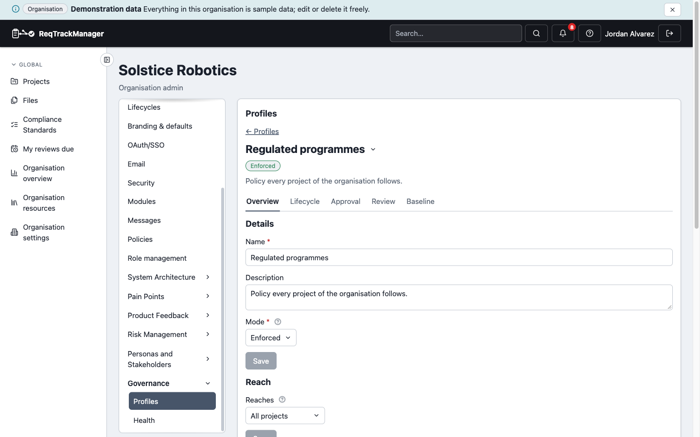
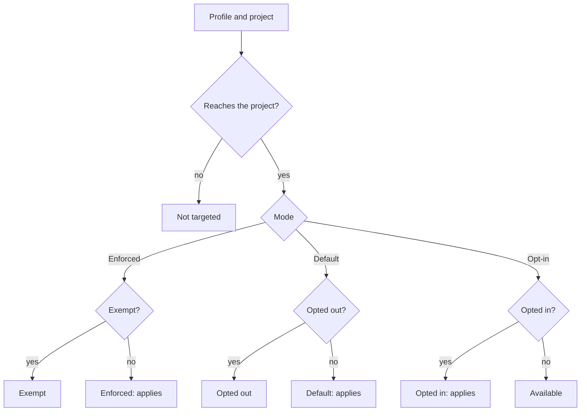

# Profiles

A **profile** is a named set of policy that an organisation applies to projects. It holds the lifecycle, approval, review and baseline policy of the [policies](./lifecycle-and-approval-policies.md) pages, together with a **mode** and a **target**. The profile screens are under **Organisation administration, Governance, Profiles**; a project reads its profiles under **Project administration, Governance, Profiles**.

| Organisation admin: a profile |
| --- |
| The Regulated programmes profile, Enforced and reaching all projects, with the tabs for each kind of policy |
|  |

## Modes

| Mode | Applies to a project it reaches | The project may |
| --- | --- | --- |
| **Enforced** | Always, unless the project is exempt | Nothing. Only the organisation can exempt a project |
| **Default** | Unless the project opts out | Opt out |
| **Opt-in** | Only where the project opts in | Opt in |

Use Enforced for a control the organisation must be able to show is in force, Default for good practice a project may reasonably leave, and Opt-in for policy that suits only some projects, such as a safety case.

## Targets

A profile reaches **All projects** of the organisation, or **Selected projects**. Each selected project can include its **nested child projects**, so one entry covers a programme and its sub-projects. A profile may be created before it reaches any project.

A project's own choice never covers its children. Reach down the hierarchy is the organisation's decision, so a manager of a parent project cannot decide for children they do not manage.

## Exemptions

An Enforced profile can **exempt** a project, optionally with its nested projects. Each exemption records the **project** and a **reason** kept for audit, for example the approval or the accepted risk. An exemption lifts only that profile; the organisation's other profiles and the project's own settings still apply. Only an organisation administrator or an Organisation Governance Manager can add or remove an exemption.

## What a project sees

A project is told only about the profiles that reach it. Each profile shows its **outcome** for the project:

Enforced, Default and opted-in profiles apply. A project with **Manage project governance** chooses for a Default or Opt-in profile with the **Applies to this project** switch; an Enforced profile shows no choice. A choice or exemption left from an earlier mode is ignored and kept, so changing a profile's mode back restores it.

The **Overview** tab of a profile lists, for every project in the organisation, the outcome, whether the profile applies and the project's choice.

## How policy combines

A project's effective policy is built in this order, for each kind of policy:

1. The **Enforced** profiles that reach the project.
2. The Default and opted-in profiles that apply to it.
3. The project's **own** settings, or those of its nearest ancestor project when it has none.
4. The built-in default of the record type.

Policy only adds. Required states unite across every source, the shortest review interval and the longest reminder lead win, approver roles unite, and baseline checks unite. A project's own setting never relaxes a profile, and every page names the source of each value, as a profile name, *This project* or *Parent project*.

## Changing and removing a profile

Every profile change is recorded as one audit event carrying keys, modes and counts, never a description or a reason. Deleting a profile removes its policy from every project it reached, so an Enforced profile is deleted with a confirmation.

A profile travels in the organisation's export with its targets, exemptions and policy. A project's choices travel in its own export, and a project created from a [template](../../core-features/project-templates.md) copies them. An import never relaxes an Enforced profile: a project import carries no exemption and cannot choose away an Enforced profile.

## Permissions

| Action | Permission |
| --- | --- |
| Create, change and delete a profile, set targets, add or remove an exemption | **Manage organisation governance**, with the module on. A server administrator has no bypass |
| Opt a project in or out of a profile | **Manage project governance** |
| Read the profiles that reach a project | Any project member |
