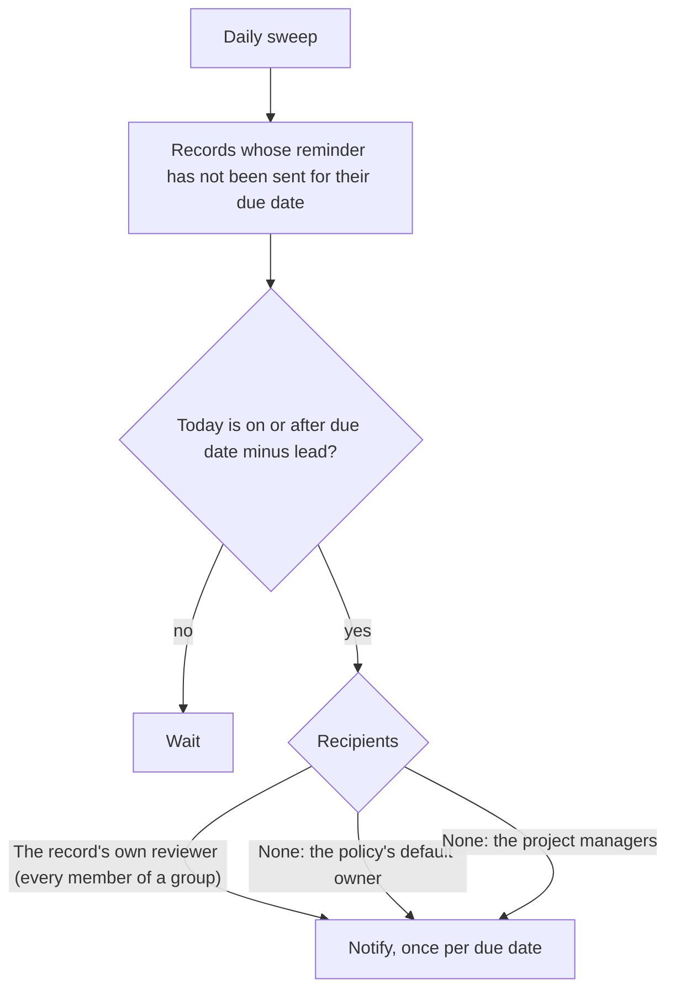

# Review policies

A **review policy** sets how often records of a type are reviewed, how early a reminder is sent, and who is reminded when a record has no reviewer. It applies to every record type that has a review schedule.

| Record type with a review schedule | What is reviewed |
| --- | --- |
| Requirement | The requirement's review date |
| Risk | The risk's next review date |
| Compliance review | A project's compliance review |
| Stage phase | A phase's expected start (upcoming) and expected end (overdue) |
| Stage review | A stage's review deadline |

## Settings

| Setting | Effect |
| --- | --- |
| **Interval (days)** | The longest gap between reviews, from 1 to 3650 days. A review date set further ahead is refused, so a requirement or risk cannot be left unreviewed for longer. The interval is measured from the day the date is set. |
| **Reminder lead (days)** | How many days before a review is due the reminder is sent, from 0 to 365. Without a policy the lead is the project's own default, normally 7 days. |
| **Default owner** | A user or a group reminded when a record has no reviewer of its own. A default owner can also record the review of a record that has no reviewer, and nothing else. A profile may name a user or an organisation group; a project's own policy may also name a project group. |

A setting left empty is not set. The page names the source of every setting, as a profile name, *This project* or *Parent project*.

## Who is reminded

One reminder is sent for each due date, so a rescheduled review sends again. A Risk and a stage phase send a second, *overdue* notice once the date has passed. A project in which the owning module is off is not reminded.

## How policies combine

Review policy only tightens. Across the profiles that apply and the project's own setting, the **shortest interval**, the **longest reminder lead** and the **first default owner** in precedence order win. A project's own setting never relaxes a profile.

## Dates

A review date is a calendar date, so it means the reviewer's own day. A page that lists reviews due compares the date with the viewer's day. The daily sweep has no viewer, so it compares with the UTC date; a review counts as recorded once the due date has begun anywhere in the world, so a requirement reviewed on its due morning in Sydney is not left overdue.

## Where to set it

A profile holds a policy per record type on its **Review** tab; a project holds its own under **Project administration, Governance, Review policy**, where **Edit review settings** opens a row. Setting the project's value to *Use inherited value* follows the nearest ancestor project again.

| Action | Permission |
| --- | --- |
| Set a profile's review policy | **Manage organisation governance** |
| Set a project's review policy | **Manage project governance** |
| Read it | Any project member |

See [Notifications and email](../../core-features/notifications-and-email.md) for how each person receives the reminders, and the [Risk reviews](../risk-management-module/reviews-and-notifications.md) and [Compliance reviews](../compliance-module/reviews-and-notifications.md) pages for the notices of those modules.
