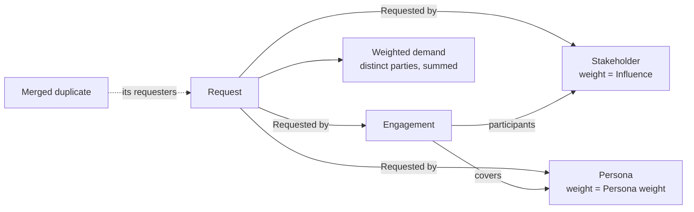
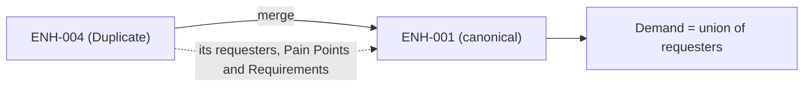

# Demand and merging

**Demand** is how much weight stands behind a request. It comes from who asked, not from a number someone types in, so it stays honest as people are added and duplicates are merged.

## Requesters

A request's requesters are Stakeholders, Personas and [Engagements](../stakeholders-personas-module/engagement.md) linked to it with the **Requested by** link type. Add them from the **Add requester** button on the Demand section, from the **Requested by** field on the create or edit form, or from the Links panel; all three write the same link.

| Requester | Counts as | Weight |
| --- | --- | --- |
| **Stakeholder** | One person or group | Their [Influence](../stakeholders-personas-module/stakeholder.md#influence--interest) level |
| **Persona** | One archetype | The Persona's weight in this project |
| **Engagement** | Everyone it covers: its participants and the Personas it covers | Each one's own weight |

The Demand section shows each requester's weight and where it comes from (an Influence level, the Persona's own weight, or this project's or a parent project's override of it); open the requester to change it. Someone reached twice (asking directly and through an Engagement, or on two merged requests) counts once. A party with no weight counts as 1, so demand never silently drops someone. **Weighted demand** is the sum of the weights.

The Demand section shows the heaviest requesters first, 25 at a time with **Show more**; the headline count and weight cover every requester. Each row says where the requester came from (directly, through an Engagement or through a merged duplicate) and has a **✕** to remove a direct link. A requester reached only through an Engagement or a merged duplicate has a dimmed ✕ whose tooltip says what to remove instead.

A requester you are not allowed to view appears as "A requester you can't view": it still counts, but is not named.

### Channel per ask

Each requester can record **how they asked**: an Engagement, a support ticket, a call, an email and so on. Set it with the pencil beside the channel in the Demand section. A merged duplicate's requesters keep their own channel, so a request asked for through several routes shows all of them. A requester reached through an Engagement shows **Engagement** without a choice to make. See [External references and channels](./external-references-and-channels.md#request-channels) for the list.

## Merging duplicates

Two requests that ask for the same thing should count once. A triager merges a request into another:

1. Open the duplicate and choose **Merge into another request…** from its menu.
2. Pick the canonical request. The picker offers open requests of the same owner (the same project, or the same inbox) that are not themselves duplicates.
3. Add a note saying why. It is kept on the merge history and the duplicate's version history.

The duplicate becomes **Duplicate**, shows "merged into ENH-001", and drops out of lists that show open work. The canonical request's demand is the **union** of its own and its duplicates' requesters, and its Pain Point and Requirement counts include theirs.

A merge is **reversible**: **Undo merge** on the duplicate restores its previous status and takes its requesters back out of the canonical request's demand. The canonical request lists its merged duplicates, and **Merge history** keeps the ended merges and their notes.

A request cannot be merged into a duplicate, a request with duplicates merged into it cannot be merged away, and a request in a merge cannot be moved out of the inbox.

## Where this fits

See [Scoring](./scoring.md) for how demand becomes a score, and [Stakeholders & Personas](../stakeholders-personas-module/overview.md) for the people and their weights.
