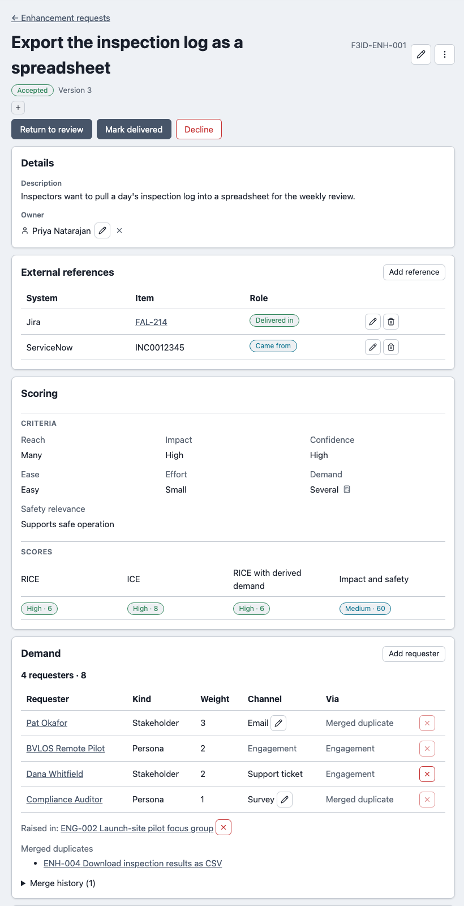
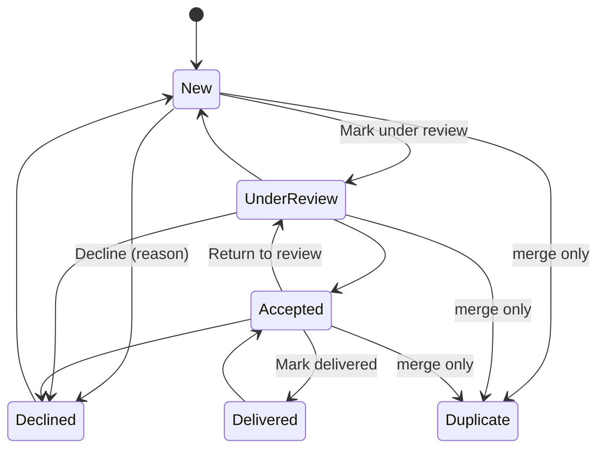
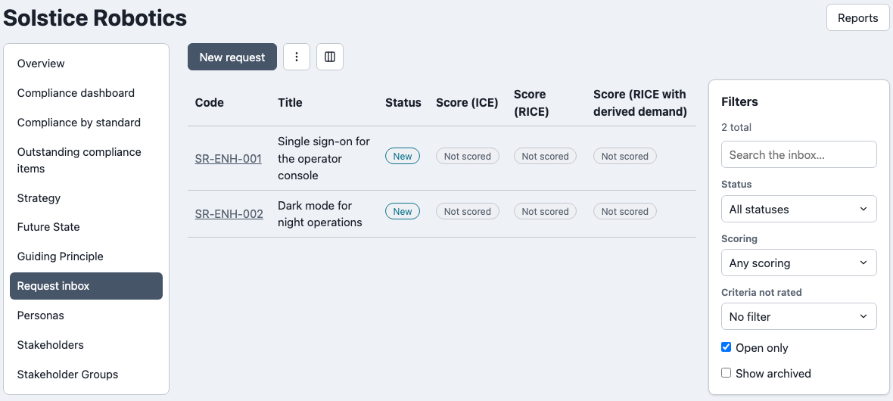

# Enhancement requests

A request belongs to a **project**, or to the **organisation's inbox** when it arrives before anyone knows which project it is for. Both hold the same record. Each request has a code (`ENH-001` in a project, and the organisation's own `ENH-001` in the inbox), a title, a description, an owner (a user or a group), tags and, optionally, a level on each [scoring](./scoring.md) criterion and any number of [external references](./external-references-and-channels.md).

Content is never locked. Every edit saves a new **version**, and the request page lists them with the change note you gave. A request page holds these sections:

| Section | Shows |
| --- | --- |
| **Details** | Description and owner. |
| **External references** | Items in outside tools, by system and role. |
| **Scoring** | The levels you set and the score under each enabled model. |
| **Demand** | Requesters, their weight and channel, merged duplicates. |
| **Close the loop** | Who was told the outcome (delivered or declined requests). |
| **Versions** | The full history. |
| **Evidence** | Attached files. |
| **Comments** | The discussion. |

The side panel holds the request's **Links** and **Activity**.

| A request page |
| --- |
| Status actions at the top; details, references, scoring and demand below; links beside |
|  |

**Arrange sections…** (on the page's menu) sets your own order for these sections. A project administrator can set a default order for the project; your own choice wins, and any section the order does not mention follows in the standard order.

## Lifecycle

- **Declining needs a reason**, which is kept and shown on the request.
- **Duplicate** is set only by [merging](./demand-and-merging.md#merging-duplicates), never by a status button, and can be undone.
- **Delivered is your decision.** When every linked Requirement is complete, an accepted request shows a **Ready to deliver?** prompt, but nothing moves it automatically.

## The list

The project list (**Enhancement requests** in the navigation) shows code, title and one score column per scoring model you choose. The **Columns** control adds Status, Demand and Owner (Demand and Owner start hidden) and one **Score** column per model; your choice is kept per person.

| Filter | Does |
| --- | --- |
| Search, Status, Tags, **Open only**, **Show archived** | The usual narrowing. |
| **Scoring** | **Unscored** or **Scored** under the first chosen model. |
| **Criteria not rated** | **Any criterion**, or one named criterion, with no level yet. A derived criterion such as Demand never counts as missing. |
| **Show records from** | Widens the list to related (child) projects you can open. |

Triagers also get a **Grid** view for editing several requests at once, so you can filter to **Unscored** and rate them in bulk.

**Export** (CSV, PDF, Word) and **Import** work from the list and follow the filters on the page. The CSV is also the import file: a row with a code updates that request, a blank code creates one. Imports set content (title, description, owner, external references and the criteria levels), never status. Requesters, weighted demand, channels, score and score band are export-only.

## The organisation inbox

An organisation's own requests are on **Organisation overview → Request inbox**. It is for asks that arrive with no project yet. Inbox requests are triaged like any other, but cannot be linked to other records or have requesters, so they have no demand figure.

| The organisation inbox |
| --- |
| Two requests awaiting triage, scored under the organisation's models only |
|  |

An organisation administrator can switch the inbox off (the **Organisation-level request inbox** sub-component) without affecting any project. A triager moves a request into a project with **Move to a project…** on its menu: the request keeps its history and gets the project's next `ENH-nnn` code, its tags move to the project's tag list and its files become the project's. This is one-way, and is refused for a request that already has links or is part of a merge.

## Who may submit

By default any project member can submit a request. A project administrator can restrict this to triagers in **Project admin → Product Feedback**. Editing, changing status, merging, moving and recording who was told always need the Feedback Triager role.

## Where this fits

See [Demand and merging](./demand-and-merging.md) for who asked, and [Reports](./reports.md) for the cross-request views. Requests travel in the project and organisation [bundles](../../core-features/zip-export-import.md), including the section-order default and the lists of external systems and channels.
