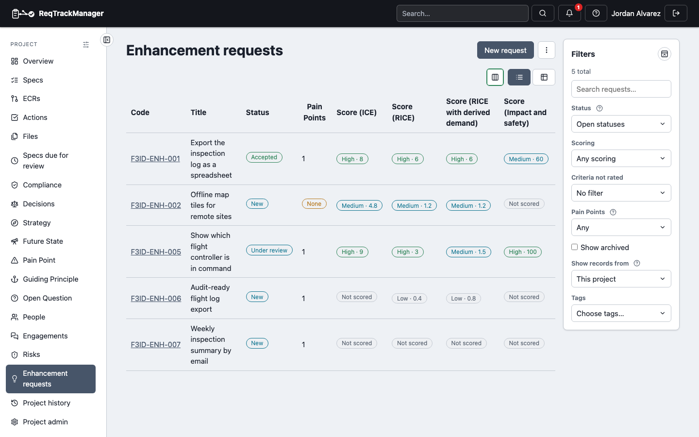
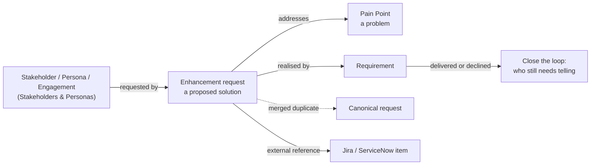

# Overview

The Product Feedback module is a place for **enhancement requests**: things people ask the product to do, from stakeholders, staff and support. It keeps each ask as a versioned record with a triage lifecycle, adds up who stands behind it, scores it, ties it to the problem it solves and the Requirement that delivers it, and tells you who still has to be told the outcome. Delivery itself stays in your tracker (Jira, ServiceNow and so on); a request carries references to it.

A request is a **solution**, not a problem. A Pain Point (from [Context & Strategy](../context-strategy-module/pain-point.md)) is the problem; a request is one proposal to fix it. Ranking proposals only by how many people asked rewards the loudest voice, so a request with no linked Pain Point shows a **No Pain Point** warning and appears in the [Unlinked requests](./reports.md#unlinked-requests-f2) report. It is a warning, never a block.

| Enhancement requests for the Falcon-3 project |
| --- |
| Status and a score per scoring model on each row (the optional Pain Points column flags a request with none) |
|  |

## What it covers

| Page | Covers |
| --- | --- |
| [Enhancement requests](./enhancement-request.md) | The record, its lifecycle, the list, the organisation inbox and who may submit. |
| [Demand and merging](./demand-and-merging.md) | Requesters, weighted demand, the channel each person asked through, merging duplicates. |
| [Scoring](./scoring.md) | Reach, Impact, Confidence, Ease, Effort and Demand; ICE, RICE and your own models. |
| [Relationships and closing the loop](./relationships-and-closing-the-loop.md) | Pain Points, Requirements, Engagements, and telling requesters the outcome. |
| [External references and channels](./external-references-and-channels.md) | Jira and ServiceNow items on a request; the two lists behind them. |
| [Reports](./reports.md) | Demand ranking, Unlinked requests, Close the loop, Triage ageing, Problem demand. |
| [AI assistant (MCP) integration](./mcp-integration.md) | The tools an AI assistant can call. |
| [Known limitations](./known-limitations.md) | What it does not do. |

## Enabling the module

Product Feedback is **not** enabled by default. An organisation administrator opts in from **Organisation admin → Modules**, the same mechanism every module uses (see [Modules → Overview](../overview.md#gating-entitlement--enablement--overrides)). Enabling it gives the organisation default lists of external systems and request channels. Turning the module off hides it and deletes nothing.

The module works on its own. It links to Stakeholders, Personas, Engagements, Pain Points and Requirements when those are available, and the offer to link to a disabled module's records simply does not appear.

Three [sub-components](../overview.md#sub-component-enablement-finer-grained-than-a-whole-module) can be switched on or off per organisation and per project:

| Sub-component | Switching it off |
| --- | --- |
| **Enhancement requests** | Hides the project list, and the module's reports. |
| **Organisation-level request inbox** | Hides the organisation's inbox without touching any project's requests. |
| **External references** | Hides the references card, the form section and the **External Systems** settings; stored references are kept and return when it is switched back on. |

## Roles

| Role | Scope | Grants |
| --- | --- | --- |
| **Feedback Triager** | Project | Edits, moves, merges, archives and attaches evidence to the project's requests, changes their status and records who was told. |
| **Organisation Feedback Triager** | Organisation | The same for the organisation's inbox, and edits the organisation's scoring scheme. |
| **Feedback List Admin** | Organisation | Edits the organisation's external system and request channel lists. |

Submitting a request needs no role: any project member can, unless a project administrator restricts submission to triagers (see [Who may submit](./enhancement-request.md#who-may-submit)). A server administrator, an organisation administrator, and for project roles the Project Manager, can do everything a module role can. Every other member can read the module once it is enabled.

## Where this fits

See [Modules → Overview](../overview.md) for how modules work, [Stakeholders & Personas](../stakeholders-personas-module/overview.md) for the people whose demand is counted, and [Context & Strategy](../context-strategy-module/overview.md) for Pain Points.
