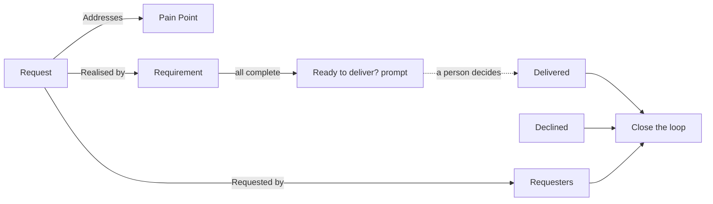

# Relationships and closing the loop

A request connects to the problem behind it, the Requirement that delivers it, and the people who asked. All of these are ordinary [links](../../core-features/links-and-traceability.md), added from the request's **Links** panel or the create form's **Link to** field.

| Link | From a request to | Meaning |
| --- | --- | --- |
| **Requested by** | A Stakeholder, a Persona or an Engagement | Who asked, and where the ask was raised. This is what [demand](./demand-and-merging.md) counts. |
| **Addresses** | A Pain Point | The problem this solution is for. |
| **Realised by** | A Requirement | The Requirement that delivers it. |

An Engagement as evidence is a **Requested by** link to that Engagement, so there is no separate evidence link. A merged duplicate's Pain Points and Requirements count for its canonical request, and an inbox request cannot be linked until it is moved into a project.

A request with no Pain Point is flagged **None** in the list's optional **Pain Points** column (a count otherwise) and **No Pain Point linked** on its page. It is a prompt to find the problem, not a rule: you can accept, score and deliver it regardless. The list's **Pain Points** filter narrows to requests with none or at least one. All of this appears only where Pain Points are enabled for the project.

You do not need to leave the request to make the Pain Point: **Create new → New Pain Point** in its Links panel opens the Pain Point form and links the new record with **Addresses** (choose another relationship from the same menu if one applies).

## Ready to deliver?

When an accepted request's linked Requirements are all complete, the request shows a **Ready to deliver?** banner beside the **Mark delivered** action. It only suggests; moving to Delivered stays a person's choice, because a Requirement being complete does not always mean the ask is met.

## Closing the loop

People who asked should hear the outcome. Once a request is **Delivered** or **Declined**, its **Close the loop** section lists every requester, including those from merged duplicates, with a checkbox, a date and a note for each. A triager tells each person by the usual means (an email, a conversation) and ticks them off. **Mark all told** ticks everyone at once, and unticking withdraws it.

- **Nothing is sent.** The module does not email requesters, and external people never receive anything from it; this records that someone told them.
- A requester added after the request was closed shows as still to tell.
- The list badge shows how many are still to tell, and the [Close the loop](./reports.md#close-the-loop-f3) report lists every request with someone outstanding.
- Requester names appear only to people allowed to see that Stakeholder or Persona.

Recording who was told needs the Feedback Triager role, and is refused until the request is delivered or declined.

## Where this fits

See [Reports](./reports.md) for the views across every request, and [Context & Strategy → Pain Point](../context-strategy-module/pain-point.md) for the problems requests address.
