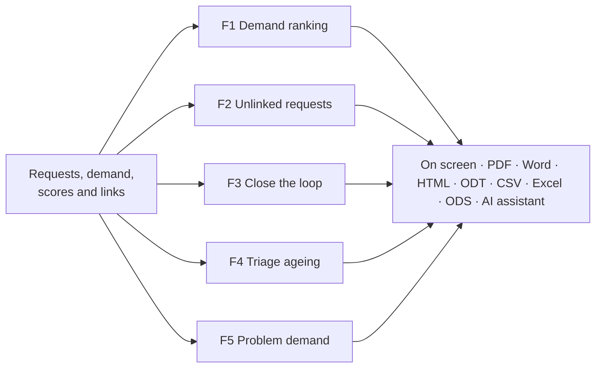
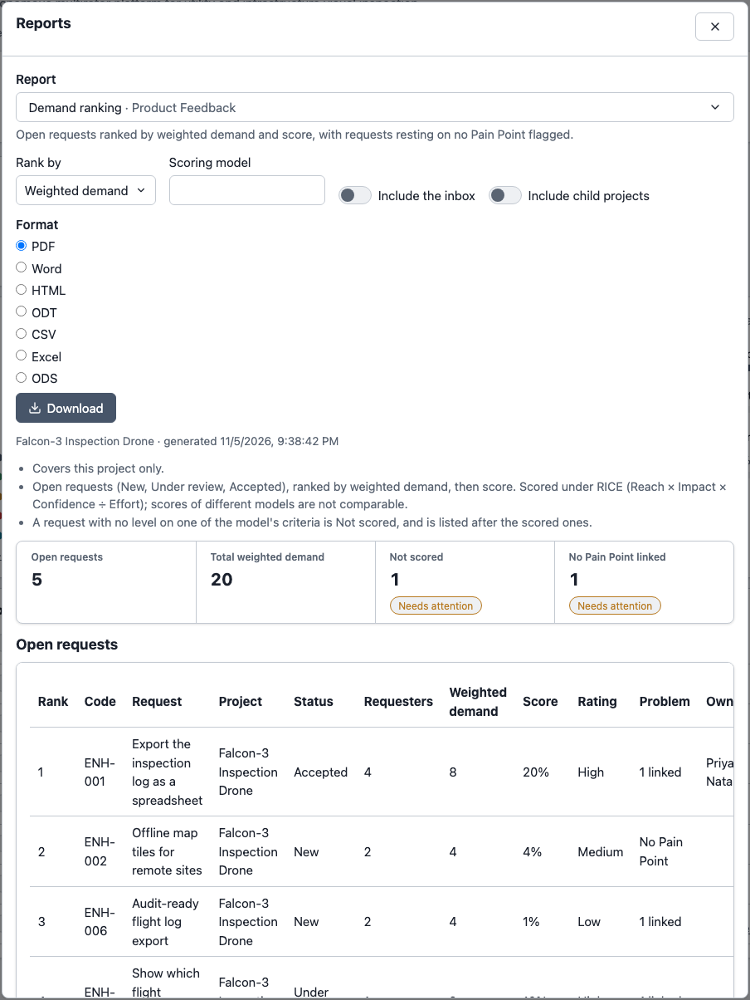
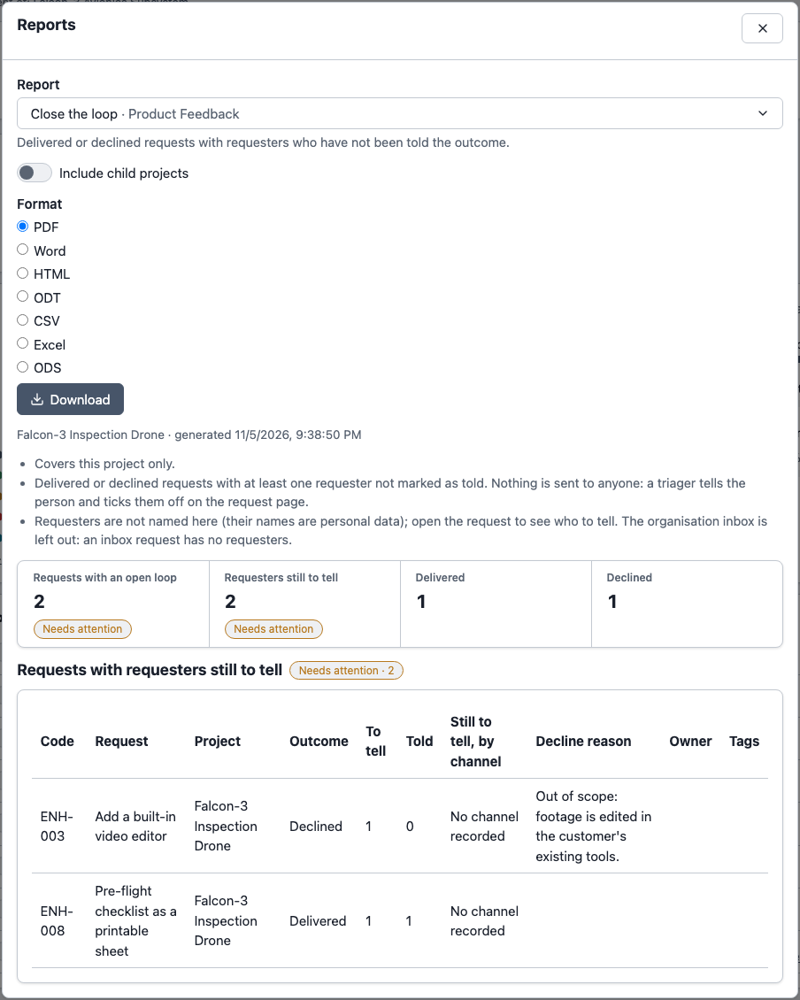

# Reports

Product Feedback adds five reports to the **Reports** page. They answer the questions a product owner is asked most: *what do people want most?*, *which asks rest on no problem?*, *who still needs telling?*, *what is waiting too long?* and *which problems are most asked about?*

Click **Reports** on the project overview and pick a report; they appear while the **Enhancement requests** sub-component is on. How the page works (formats, report look) is the same for every module report: see [Context & Strategy → Reports](../context-strategy-module/reports.md#generating-a-report). **Include child projects** adds readable sub-projects that also have the module on.

An **organisation-wide** version of each report is on the Organisation overview's **Reports** button, for people with the Organisation Feedback Triager role (or an organisation administrator). Each report covers only what you may read, and every figure matches the request page, because both use the same definitions.

| Report | Answers | Options |
| --- | --- | --- |
| **Demand ranking** (F1) | Open requests by weighted demand or score | Rank by, Scoring model, Include the inbox |
| **Unlinked requests** (F2) | Solutions with no stated problem | Include delivered and declined |
| **Close the loop** (F3) | Delivered or declined requests with people still to tell | none |
| **Triage ageing** (F4) | Requests waiting for a decision | Waiting longer than (days), Include the inbox |
| **Problem demand** (F5) | Pain Points by how many people ask for a fix | none |

Archived requests and merged duplicates never appear (a duplicate's demand and links belong to its canonical request). **Include the inbox** applies to organisation-wide runs only.

### Demand ranking (F1)

Open requests (New, Under review, Accepted) ranked by weighted demand, then score, or by score, then demand (**Rank by**). The report says which model it scored under. A request with a missing level is **Not scored** and listed after the scored ones, never as zero. A project run scores under the project's own models; an organisation-wide run scores everything under the organisation's models, since one project's own model says nothing across projects. A request with no Pain Point is flagged.

| Demand ranking |
| --- |
| Five open requests with the headline counts of unscored and unlinked ones |
|  |

### Unlinked requests (F2)

Requests that address no Pain Point, loudest first, with how many Requirements realise them and how long they have existed. It totals the demand that rests on no problem. **Include delivered and declined** adds closed requests.

### Close the loop (F3)

Delivered or declined requests with requesters not yet told, by outcome, with how many are still to tell and a channel mix (for example "Email x2, Support ticket"). **It names no one**: a requester's name is personal data. Open the request to see who to tell.

| Close the loop |
| --- |
| Two requests with an open loop: a declined one with its reason, and a delivered one |
|  |

### Triage ageing (F4)

Requests waiting in New or Under review longer than **Waiting longer than (days)** (default 14), oldest first, and a count by status. The wait runs from when the request **entered its current status**, not from its last edit, so an edit does not reset the clock.

### Problem demand (F5)

Pain Points that at least one request addresses, ranked by the number of requests and then by the distinct people asking (someone asking through two requests counts once), with whether a Requirement exists for it, either linked directly or through a request that realises it. A Pain Point with no Requirement yet is highlighted. Pain Points you may not view are counted in a note, never named.

## Where this fits

See [Relationships and closing the loop](./relationships-and-closing-the-loop.md) for the links these reports read, and [Scoring](./scoring.md) for the model F1 ranks on.
