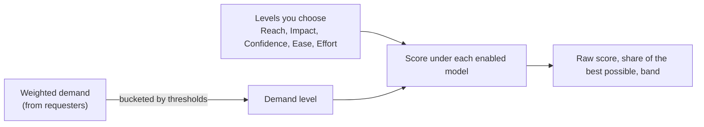

# Scoring

A request's score is **derived**, never typed in. You choose a level on each criterion and the module works out a score under each scoring model your organisation has switched on. It uses the same configurable scoring mechanism as [Pain Points](../context-strategy-module/pain-point-scoring.md) and [Risks](../risk-management-module/scoring.md). Request scoring is a *solution* score: Ease and Effort describe building the thing, which is why it differs from Pain Point scoring.

## Criteria and models

| Criterion | Asks | Starting levels (weight) |
| --- | --- | --- |
| **Reach** | How many people affected would notice it | Few (1), Some (2), Many (3), Most (4), Everyone (5) |
| **Impact** | How much it improves things for each person | Minimal (0.25), Low (0.5), Medium (1), High (2), Massive (3) |
| **Confidence** | How sure you are of reach and impact | Low (0.5), Medium (0.8), High (1) |
| **Ease** | How easy it is to deliver; higher raises the score | Very hard (1) to Very easy (5) |
| **Effort** | How much work it takes; higher *lowers* the score | Trivial (0.5), Small (1), Medium (2), Large (4), Huge (8) |
| **Demand** | Weighted demand from the requesters; derived | Single voice (1) to Widespread (5) |

| Model | Combines |
| --- | --- |
| **ICE** | Impact × Confidence × Ease |
| **RICE** (the default) | Reach × Impact × Confidence ÷ Effort |
| **RICE with derived demand** | Demand × Impact × Confidence ÷ Effort |

An organisation uses whichever of Ease or Effort it already estimates. A score is **Not scored** until every manual criterion the model needs has a level, and is never shown as zero. Scores from different models are not comparable.

## Demand is derived, and shown beside the score

**Demand** is not rated manually. The weighted demand is bucketed into a level by thresholds (starting at 0, 3, 8, 15 and 30) that an administrator can edit. A project can set its own thresholds (see [Demand thresholds per project](#demand-thresholds-per-project)). A level you choose manually always wins: pick one on the form to override, and clear it to go back to the derived level. A calculator icon beside the level explains where it came from. Reach stays a manual level, so the two can be compared.

## Demand thresholds per project

The same weighted demand can mean different things in different products: 20 weighted requesters may be **Many** in a small product and only a few in a large one. A project administrator can therefore set the project's own thresholds for the Demand levels, at **Project admin → Request Scoring → Levels → Demand**. The level names and weights stay the organisation's, so a level means the same thing everywhere; only the point at which a project reaches it changes.

- The **Organisation** column keeps the organisation's values beside the project's **From (this project)** column.
- A project sets a threshold for every level, and each must be above the one before. **Use inherited values** clears them.
- A child project with none of its own uses its nearest parent project's, then the organisation's.
- If the organisation adds or deletes a Demand level, the projects' own thresholds for it are cleared, and each project uses the organisation's values until it sets its own again.
- Thresholds are scoring configuration, so (like rating bands) they do not travel in a project export.

## Reading and setting scores

- The create and edit forms list the criteria and show the scores live as you choose levels. Each `(?)` lists every level with its guidance, so you can compare before choosing.
- The request page shows **Criteria** (levels, shared by the models) and then **Scores** (one badge per model, with the share of the best possible score on hover).
- The list has one score column per model, chosen in **Columns**; the first chosen model drives the **Unscored** filter and the Score sort.
- **Criteria not rated** finds requests missing one criterion, or any criterion.

## Administering the scheme

An organisation administrator (or Organisation Feedback Triager) edits scoring at **Organisation admin → Request Scoring**, and a project administrator at **Project admin → Request Scoring**:

- **Models shown**: which models are enabled and score every request side by side.
- **Levels**: names, weights and guidance, and the Demand thresholds.
- **Criteria**: add your own criteria and models. A model either multiplies criteria (with a divisor and an exponent for each) or takes a **weighted sum** (an importance percentage per criterion, with a "lower is better" option that inverts one). A weighted sum scales each criterion to its top level first, so the best possible score is always 100%.
- **Hide and restore**: the built-in criteria and models can be hidden, never deleted.

A project's criteria are an **additive layer** over the organisation's, so a software, a hardware and a services team can each score differently without a copy of the whole scheme. A child project with none of its own shows its nearest ancestor's. The organisation inbox uses the organisation's models only, since a project's own model means nothing across projects.

Deleting a level, criterion or model that requests use asks you to reassign them first. Scoring definitions travel in the project and organisation bundles.

## Where this fits

See [Demand and merging](./demand-and-merging.md) for where the Demand figure comes from, and [Reports](./reports.md#demand-ranking-f1) for ranking by score.
