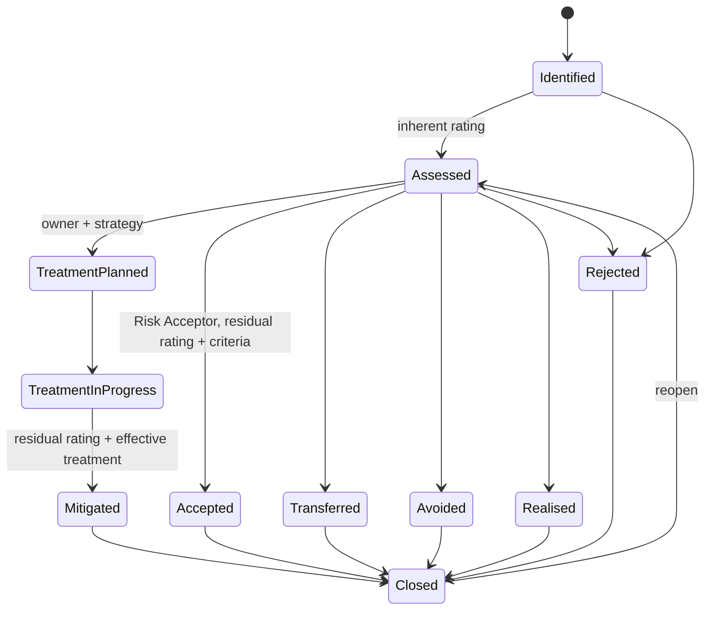
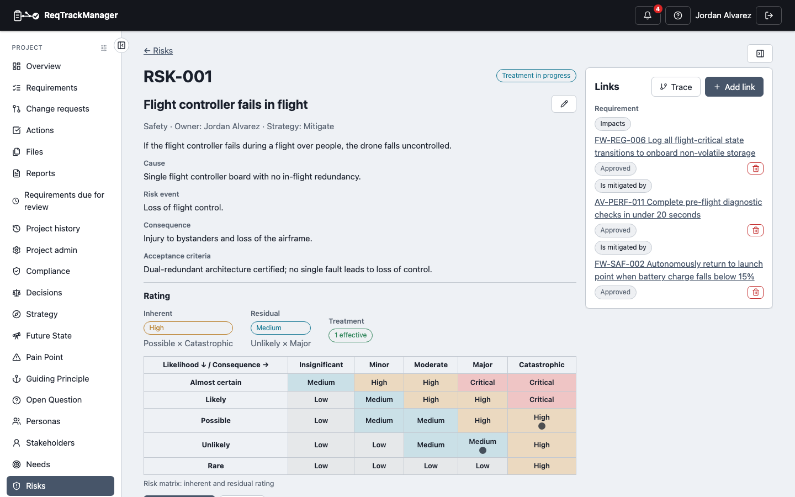

# Data model and lifecycle

This page covers what a Risk record holds, the Risk types that categorise it, and the status flow it moves through. See [Overview](./overview.md) for when to use a Risk and who may do what.

## What a Risk holds

| Field | Holds |
| --- | --- |
| Code | Project-scoped identifier such as `RSK-003`, assigned automatically. |
| Title | Short name for lists and links. |
| Statement | The risk in one sentence, usually "If … then …". |
| Cause, Risk event, Consequence | The three parts of a well-formed risk, kept apart so each can be read and challenged on its own. |
| Type | An optional category (see below). Optional so a risk can be captured quickly and categorised later. |
| Owner | The user accountable for the Risk. |
| Treatment strategy | The intended response: **Mitigate**, **Transfer**, **Avoid** or **Accept**. This is the plan; the status says how far it has got. |
| Acceptance criteria | What must hold for the remaining risk to be acceptable. Required to accept a Risk. |
| Inherent and residual levels | The Likelihood, Consequence and (optionally) Detectability levels *before* and *after* treatment. The ratings are derived from these and never typed in; see [Scoring](./scoring.md). |
| Review date | When the Risk is next due for review; see [Reviews and notifications](./reviews-and-notifications.md). |
| Status | The lifecycle state, below. |

A Risk also carries a comment thread and file attachments for evidence. Residual levels are set by a person, not recalculated automatically when treatments change.

### Versions

Every change, including every status change and review date change, creates a new **version**. The Risk page lists them (status, ratings, who and when, and the change note), so "what did we think the risk was last quarter" always has an answer.

### Risk types

A **Risk type** categorises a Risk. An organisation starts with twelve: Safety, Technical, Reliability, Performance, Security, Compliance, Operational, Schedule, Cost, Supply chain, Integration and Environmental.

- A **Risk Type Admin** edits the organisation's list under **Organisation admin → Risk Types**.
- A project can rename, reorder or disable types for itself and add its own, under **Project admin → Risk Types**. A [child project](../../concepts/organisations-and-projects.md) sees the organisation's list, the same as any other project, rather than inheriting its parent's customisations.

## Lifecycle

The main line is *Identified → Assessed → Treatment planned → Treatment in progress → Mitigated → Closed*. A Risk can instead reach an outcome such as **Accepted**, **Transferred**, **Avoided**, **Realised** or **Rejected**, and each of those leads to **Closed**.

The diagram shows the usual forward moves and the reopen. The outcomes are also reachable from *Treatment planned* and *Treatment in progress*; a Mitigated, Accepted or Transferred Risk can still become **Realised** if the event happens; and a reassessment can move a Risk back to an earlier working state. A wrongly Rejected Risk returns to Identified.

| A Risk's detail page |
| --- |
| The Risk's content, inherent and residual ratings, and the matrix with both plotted; **Change status** below offers only the moves legal from the current status |
|  |

### What a move requires

A move is refused, naming what is missing, until the Risk has the facts the **target** status needs:

| Moving to | Requires |
| --- | --- |
| Assessed | An inherent rating (every level the project's scoring model needs). |
| Treatment planned | An owner and a treatment strategy. |
| Mitigated | A residual rating and at least one treatment judged **Effective** (see [Treatment and relationships](./treatment-and-relationships.md)). |
| Accepted | A residual rating and acceptance criteria, and the **Risk Acceptor** role. |

**Why a link isn't enough for Mitigated:** a Risk is mitigated by something that works, not by something that was merely attached to it.

### Accepted is locked

Once a Risk is **Accepted**, its levels, acceptance criteria and treatment strategy can't be edited in place. To change them, move the Risk back to Assessed first. Otherwise a Risk Manager could change the residual rating after the acceptor had signed it off, which would defeat having a separate acceptor.

### Archiving

An archived Risk keeps its history but is hidden from the register unless **Show archived** is ticked, and can't change status until unarchived.

## Where this fits

See [Scoring](./scoring.md) for how ratings are derived, and [Reviews and notifications](./reviews-and-notifications.md) for keeping a Risk current.
