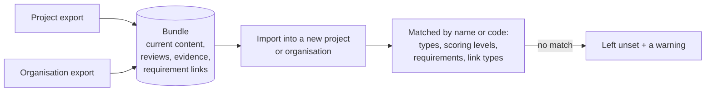

# Export and import

Risks travel with the platform's [zip export and import](../../core-features/zip-export-import.md): exporting a project or organisation that has Risk Management enabled includes its Risks, and importing the bundle recreates them. It is meant for backup, offboarding and migration, not for syncing two live projects.

## What is carried

| Level | Carried |
| --- | --- |
| Organisation | The Risk types (a type the new organisation already has is skipped, so the defaults are not doubled). |
| Project | The project's own Risk types and overrides, and each Risk: its current content, status, owner, review date and **original code** (`RSK-007` stays `RSK-007`), evidence attachments, the full review history, archived state, and its links to Requirements with the **verdict** on each. |

New Risks created after an import carry on from the highest imported code.

## What is not

- **Version history and comments.** A Risk arrives as version 1, attributed to the importer when its author cannot be matched. Reviews are the exception: they are the record of what was assessed and when, so every review, with its rating snapshot, is kept.
- **Scoring configuration.** Levels, bands and pinned cells are not part of a bundle. Ratings are derived, so they are never exported either.
- **Links to anything but Requirements in the same project.** Actions, Decisions, other Risks and records in other projects are not in the bundle, so those links are dropped rather than imported half-resolved.
- **People who don't exist in the target.** An owner or reviewer is matched by email; one that can't be matched is left blank (or becomes the importer).

## How matching works

Nothing in a bundle is matched by database id. The import matches each reference by something portable and, where it cannot, **leaves it unset and tells you** instead of guessing:

| Reference | Matched by | If there is no match |
| --- | --- | --- |
| Risk type | Name | The Risk is left untyped, with a warning. |
| Scoring level (Likelihood, Consequence, Detectability) | Axis and level name | That level is left unset, so the Risk reads **Not rated** on that axis, with a warning. |
| Linked Requirement | Requirement code in the new project | The link is skipped, with a warning. |
| Link type | Name, among those the project can use | The link is skipped, with a warning. |

A verdict travels with its link exactly as it was, including **Needs reassessment** and its reason, so a bundle never quietly turns an unresolved doubt into trust.

**Why levels are matched by name:** a project exported from an organisation that renamed "Catastrophic" will warn on import into one that did not. Rename the level (or set the Risk's levels by hand) and the rating returns; nothing is silently re-rated in the meantime.

## Where this fits

See [Zip export/import](../../core-features/zip-export-import.md) for the bundle as a whole and how to run it, and [Scoring](./scoring.md) for the levels a Risk references.
