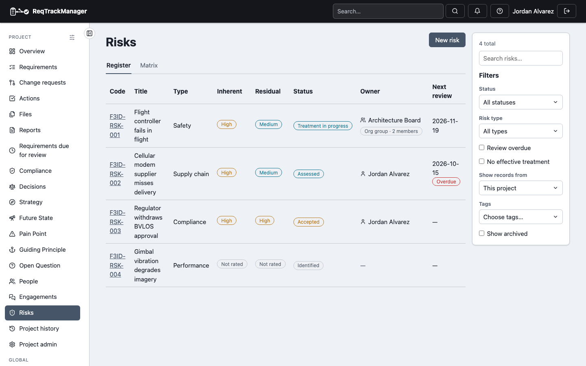
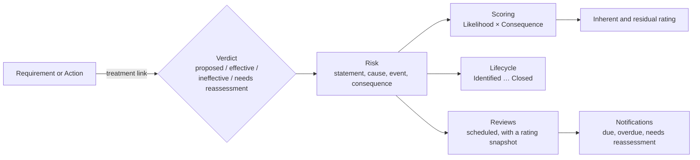

# Overview

The Risk Management module records what could go wrong on a project as a first-class **Risk**, instead of a sentence buried in a Requirement's rationale. Each Risk has an owner, a rating derived from your organisation's own scoring matrix, a lifecycle, treatments that can be shown to work (or not), and a review schedule. Every edit is kept as a version.

For example, "Flight controller fails in flight" is recorded as Risk RSK-001: Safety type, owned by the project manager, rated *High* before treatment because a Possible failure with a Catastrophic consequence sits in a High cell of the matrix. A pre-flight diagnostics Requirement is linked as a treatment and judged *Effective*, which is what lets the Risk move to *Mitigated* later and brings its residual rating down to *Medium*.

| A project's Risk register |
| --- |
| Falcon-3's four Risks with inherent and residual ratings, status, owner and next review; one review is overdue |
|  |

The register opens on the Risks still being managed (Identified through Mitigated, and Accepted): **Open only** is ticked, and clearing it adds the Transferred, Avoided, Realised, Rejected and Closed ones. A link that names a status opens the register with that status and **Open only** off.

## When to use a Risk

Use a Risk for an uncertain event that would hurt the project if it happened: a supplier that may be late, a regulator that may withdraw an approval, a design that may fail in the field. It is not a defect (that has already happened) and not a Requirement (that says what the product must do). A Requirement often exists *because* of a Risk, and the module keeps that reason recorded and checkable.

## How the pieces fit

## Enabling the module

Risk Management is **not** enabled by default. An org admin opts in per organisation from the organisation's Modules settings, the same entitlement and enablement mechanism every module uses (see [Modules → Overview](../overview.md#gating-entitlement--enablement--overrides)). Enabling it gives the organisation the default [Risk types](./data-model-and-lifecycle.md#risk-types) and the [Risk scoring scheme](./scoring.md). Disabling the module hides its navigation and endpoints but deletes no data.

The module has one [sub-component](../overview.md#sub-component-enablement-finer-grained-than-a-whole-module), **Risks**, which a project can switch off without turning the whole module off.

## Roles

Any project member can **propose** a Risk: they create it, and it starts as *Identified*. The module adds three roles of its own, rather than additions to the core role set:

| Role | Scope | Grants |
| --- | --- | --- |
| **Risk Manager** | Project | Edits and archives the project's Risks, moves them through the lifecycle (except accepting), attaches evidence, assesses treatments, records reviews, and manages the project's Risk types. |
| **Risk Acceptor** | Project | Moves a Risk to **Accepted**, which means signing off its residual risk. Kept separate from Risk Manager on purpose: the person who manages a Risk should not also be the only one who can decide it is acceptable. |
| **Risk Type Admin** | Organisation | Manages the organisation's Risk types, and the scoring levels, default model, rating bands and cell ratings. |

Each composes with roles that already carry equivalent authority: a server admin, an org admin, or (for project roles) the project's Project Manager can do what the module role can. A Risk Manager cannot accept a Risk unless they also hold Risk Acceptor (or are a Project Manager or admin). Every other project member can read Risks once the module is enabled, and comment on them.

## Groups as owners

A Risk's **Owner** can be a user, an organisation group or a project group, so a team can stand behind a Risk instead of one nominee who may leave. The register, the Risk page and the version history show the group's name, its kind (Org group or Project group) and how many people it stands for.

- **What the owner can do is unchanged.** The owner, or any member of an owner group, may [assess treatments](./treatment-and-relationships.md) and [record reviews](./reviews-and-notifications.md). A group gives no other right: editing, archiving and moving the Risk along its lifecycle still need the Risk Manager role.
- **Notifications reach every member.** A review notice or a treatment-needs-reassessment notice goes to each active member of an owner group; a group with nobody to notify falls back to the project's Risk Managers and Project Managers.
- **Reports print the kind.** The [risk register](./reports.md) shows a group owner as `Name (Org group)`, so a team is never mistaken for a person.
- **Deleting an owner group** asks the admin to hand its Risks to a user or another group, or to leave them without an owner (the owner is optional; moving a Risk to *Treatment planned* still needs one).

## In this section

- [Data model and lifecycle](./data-model-and-lifecycle.md) — fields, Risk types, versions, and the status flow with its guards.
- [Scoring](./scoring.md) — the Likelihood × Consequence matrix, how a rating is derived, and how to configure it.
- [Treatment and relationships](./treatment-and-relationships.md) — linking a Risk to Requirements, Actions and Decisions, and the difference between *linked* and *effectively treated*.
- [Reviews and notifications](./reviews-and-notifications.md) — scheduled reviews, the overdue sweep, and what happens when a linked Requirement changes.
- [Reports](./reports.md) — the risk register, exposure, treatment coverage and review schedule.
- [Export and import](./export-and-import.md) — what travels in a project or organisation bundle, and what is matched by name.
- [AI assistant (MCP) integration](./mcp-integration.md) — the tools an AI assistant can call.
- [Known limitations](./known-limitations.md) — what this module doesn't do yet.

## Where this fits

See [Modules → Overview](../overview.md) for how the module system works, and [Links and traceability](../../core-features/links-and-traceability.md) for the link mechanism Risk relationships use.
