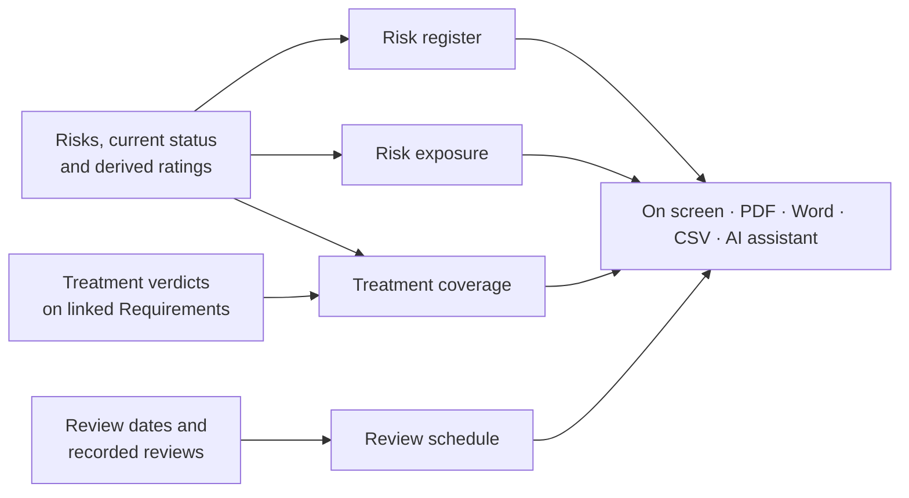
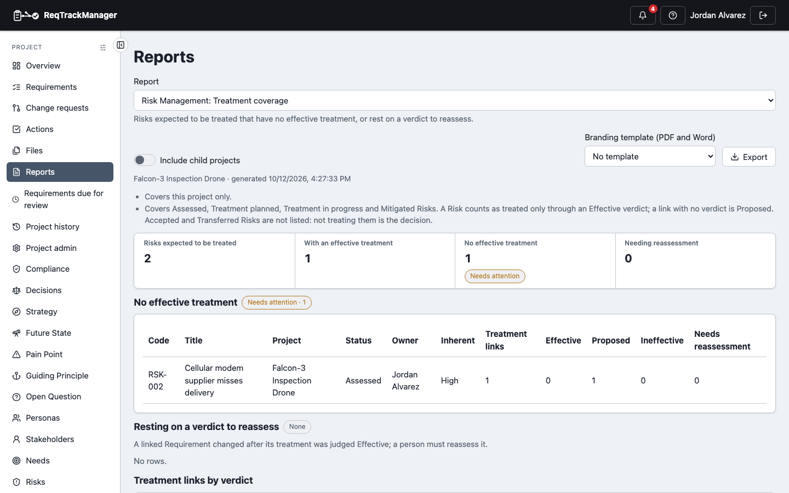

# Reports

Risk Management adds four project-level reports to the project's **Reports** page. They answer the questions a Risk Manager is asked most: *what is our exposure?*, *which Risks have nothing proven against them?* and *which reviews have slipped?*

Open the **Reports** menu at the top of the project overview, choose **Choose a report…**, and pick a report from the **Report** picker; the module's reports appear there only while Risks are enabled for the project. How the page works (options, figures, export, branding template) is the same as for every module report; see [Context & Strategy → Reports](../context-strategy-module/reports.md#generating-a-report). A report covers only what you can read, and **Include child projects** adds readable sub-projects that have Risks enabled. Each project is rated by its own matrix, so a sub-project with its own bands or pinned cells is never rated by its parent's.

## The reports

| Report | Answers | Options |
| --- | --- | --- |
| **Risk register** | Every Risk with its type, status, owner, treatment strategy, inherent and residual rating, effective treatments and next review; totals by status and by rating | Status, Risk type (by name), Include archived |
| **Risk exposure** | How much treatment has reduced the exposure: Risks by inherent and residual rating side by side, the highest remaining Risks, and Risks with no rating | none |
| **Treatment coverage** | Risks expected to be treated that have no effective treatment, those resting on a verdict to reassess, and the treatment links by verdict | none |
| **Review schedule** | Overdue reviews, reviews due soon, and assessed Risks with no review date, each with when it was last reviewed | Due within (days), default 30 |

| Treatment coverage |
| --- |
| The report on the demo project, listing the Risks that have no effective treatment as a gap table |
|  |

Things worth knowing:

- Rows that name a record lead with its code and end with its tags; see [Reports and export → How reports name records](../../core-features/reports-and-export.md#how-reports-name-records).
- **Ratings are shown as labels** (High, Medium, …), not scores, because bands are yours to configure. In the PDF and Word files each rating cell is filled in its band's colour (and each Status and Verdict cell in its badge colour), and the Risk exposure report adds a Likelihood × Consequence matrix (once for inherent, once for residual ratings) with the number of Risks in each cell. A project rated under the three-axis model has no such matrix. They are derived when the report runs, so they follow the current matrix. A review's recorded rating is its own snapshot and is not what the report shows.
- **Exposure** counts Risks from Identified to Transferred. Closed and Rejected Risks are history, and Avoided and Realised ones have left the exposure picture, so counting them would distort the residual column. Residual ratings are set by a person and are not recalculated when treatments change, so the report shows what was assessed, not a forecast.
- **Treatment coverage** covers Assessed, Treatment planned, Treatment in progress and Mitigated Risks. Accepted and Transferred Risks are not listed: not treating them is the decision. A link with no verdict counts as **Proposed**.
- **Review schedule** lists an assessed Risk with no review date as a gap, since nobody is due to look at it again. Identified Risks are exempt until they have been assessed.
- Links to records you cannot read still count as treatments but are never named: the report names only the Risk.

## Export and AI assistants

Each report downloads as **PDF**, **Word** or **CSV** from **Export**; the CSV is the report's first table (the register, the untreated Risks, the highest residual Risks, or the overdue reviews). The same four reports are available to an [AI assistant](./mcp-integration.md) as read-only tools.

## Limits

There is no organisation-wide version of these reports yet; use **Include child projects** to cover a project and its sub-projects. For moving Risks between projects or organisations see [Export and import](./export-and-import.md).

## Where this fits

See [Treatment and relationships](./treatment-and-relationships.md) for verdicts and [Reviews and notifications](./reviews-and-notifications.md) for the schedule these reports read.
