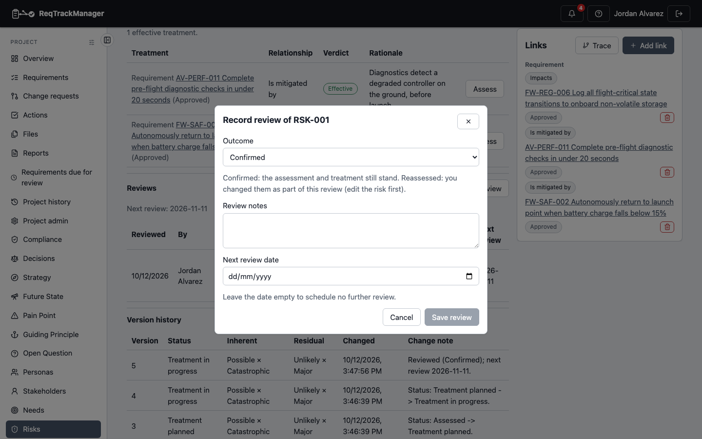
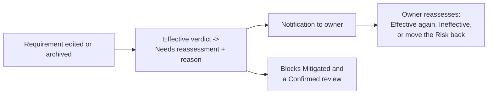

# Reviews and notifications

A Risk's rating and treatments go stale quietly. This page covers how a Risk is reviewed on a schedule, the notifications that prompt a review, and what happens when something a treatment depends on changes.

## Scheduling and recording a review

A Risk has a **review date**. When the date comes, the owner (or any Risk Manager) records a **review** from the Risk's page with **Record review**:

| Field | Meaning |
| --- | --- |
| **Outcome** | **Confirmed**: the assessment and treatment still stand. **Reassessed**: you changed them as part of this review (edit the Risk first, then record it). |
| **Review notes** | What was checked and concluded. Required. |
| **Next review date** | When it is next due. Must be in the future; leave empty to schedule none. |

| Record review |
| --- |
| The Record review dialog on RSK-001 |
|  |

Each review is kept permanently with a **snapshot** of the Risk at that moment: its status, inherent and residual rating, the number of effective treatments, the date it answered and the next date set. Later changes to the scoring matrix never rewrite what a past review concluded. Recording a review moves the Risk's review date to the next date.

Rules:

- A review can't be recorded on an archived or Closed Risk.
- **Confirmed** is refused while any treatment *needs reassessment*: reassess it first, or record the review as **Reassessed**.
- Reviews can't be edited or deleted.

## Notifications

| Notification | Sent when | To |
| --- | --- | --- |
| **Review due** | A Risk's review date is within 7 days. | The Risk's owner. |
| **Review overdue** | The review date has passed. | The Risk's owner. |
| **Treatment needs reassessment** | A Requirement behind an Effective verdict changed. | The Risk's owner. |

If a Risk has no owner, the notification goes to the project's Risk Managers and Project Managers instead, so an unowned Risk still reaches someone accountable. Due and overdue notices come from a sweep that runs daily; each is sent once per review date, so a rescheduled review re-arms itself. Selecting a Risk notification opens the Risk. Delivery follows each person's settings; see [Notifications and email](../../core-features/notifications-and-email.md).

The register flags overdue reviews with an **Overdue** marker and a **Review overdue** filter.

## When a linked Requirement changes

If a Requirement that an **Effective** treatment rests on is edited or archived, the module doesn't guess what that means for the Risk. It:

1. moves that treatment's verdict to **Needs reassessment**, with the reason;
2. notifies the owner once, however many edits follow; and
3. stops the Risk from being **Mitigated** or having a review **Confirmed** until a person reassesses.

Only **Effective** verdicts are moved: a Proposed link makes no claim to invalidate, and an Ineffective one isn't made wrong by a change. Reassessing is a human call, and the Risk's existing lifecycle already allows moving it back to an earlier status if the answer is "this is no longer treated".

## Where this fits

See [Treatment and relationships](./treatment-and-relationships.md) for verdicts, and [Known limitations](./known-limitations.md) for what triggers change detection today.
