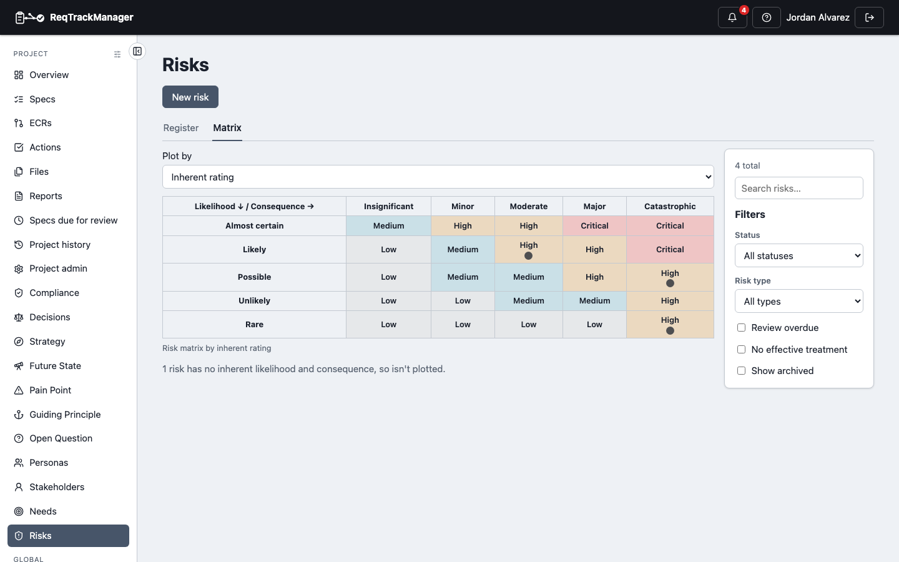
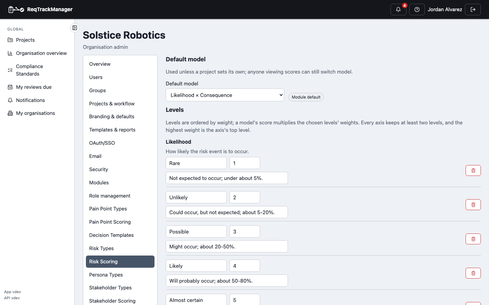

# Scoring

A Risk's rating is **derived**, never typed in. You choose a Likelihood level and a Consequence level (and, in the three-axis model, a Detectability level); the module looks up the rating in a matrix your organisation controls. This is the same configurable scoring mechanism [Pain Points](../context-strategy-module/pain-point-scoring.md) use, registered here with Risk's own axes, so the matrix can match the one your organisation already uses rather than a fixed one.

## Axes and models

| Axis | Starting levels (weight) |
| --- | --- |
| **Likelihood** | Rare (1), Unlikely (2), Possible (3), Likely (4), Almost certain (5) |
| **Consequence** | Insignificant (1), Minor (2), Moderate (3), Major (4), Catastrophic (5) |
| **Detectability** | Detected immediately (1), Detected early (2), Detected before impact (3), Detected late (4), Undetectable (5) |

Detectability runs the way FMEA does: a *higher* weight means the problem is *harder* to notice, so a higher score is always a worse Risk.

Two **models** choose which axes count:

| Model | Axes | Use it for |
| --- | --- | --- |
| **Likelihood × Consequence** (default) | 2 | The standard risk matrix. |
| **Likelihood × Consequence × Detectability** | 3 | FMEA-style analysis where being unable to detect a failure raises the risk. |

A Risk records its inherent levels (before treatment) and its residual levels (after). A model that needs an axis the Risk has no level for leaves that rating **Not rated**.

## From levels to a rating

Out of the box, the rating comes from **bands**: the product of the two weights, as a share of the maximum, falls in Low, Medium, High or Critical.

| Likelihood ↓ / Consequence → | Insignificant | Minor | Moderate | Major | Catastrophic |
| --- | --- | --- | --- | --- | --- |
| **Almost certain** | Medium | High | High | Critical | Critical |
| **Likely** | Low | Medium | High | High | Critical |
| **Possible** | Low | Medium | Medium | High | High |
| **Unlikely** | Low | Low | Medium | Medium | High |
| **Rare** | Low | Low | Low | Low | Medium |

Real matrices are rarely that regular. A catastrophe that is only Rare is still not a *Medium* risk to most organisations. **Cell ratings** let you pin any cell of the two-axis model to a band. In the example project, Rare × Catastrophic is pinned to High, so the grid the team sees is:

| Matrix with a pinned cell |
| --- |
| Falcon-3's matrix: Rare × Catastrophic reads High because it was pinned; each dot is a Risk plotted by its inherent rating |
|  |

- A cell names an existing band, so a band can't be removed or renamed while cells still use it.
- A cell rating changes the band only, never the underlying score.
- The three-axis model has no single grid, so it uses the threshold bands only.

## Where ratings appear

The **Register** tab shows each Risk's inherent and residual rating as a coloured badge. The **Matrix** tab plots every Risk on the grid, by inherent or residual rating; selecting a cell filters the register to that cell's Risks. A Risk's own page shows both ratings, its effective-treatment count, and the matrix with both positions marked.

## Configuring scoring

| Setting | Organisation (**Organisation admin → Risk Scoring**) | Project (**Project admin → Risk Scoring**) |
| --- | --- | --- |
| Levels per axis (name, weight, guidance) | Edit, add, delete (at least two per axis; deleting an in-use level asks where to move its Risks) | Read-only |
| Default model | Set, or reset to the module default | Override, or use the inherited value |
| Rating bands per model | Set, or reset to the module defaults | Override, or use the inherited value |
| Cell ratings per two-axis model | Pin cells, or reset | Override, or use the inherited value |

| Organisation scoring settings |
| --- |
| The organisation's Risk Scoring page: default model, then editable Likelihood levels with name, weight and guidance |
|  |

A project that hasn't overridden a setting inherits it, nearest parent project first, then the organisation, then the module default; the settings page says where each value comes from. Only a **Risk Type Admin** (or an organisation admin) edits organisation levels; a project manager, project administrator or organisation admin overrides a project's model, bands and cells.

Changing a level's weight or a band later re-rates existing Risks on their next view, because the rating is never stored. Historic versions keep the *levels* they recorded, so the history stays truthful about what was chosen.

## Where this fits

See [Data model and lifecycle](./data-model-and-lifecycle.md) for the facts a status move needs, and [Pain Point scoring](../context-strategy-module/pain-point-scoring.md) for the shared mechanism's other consumer.
