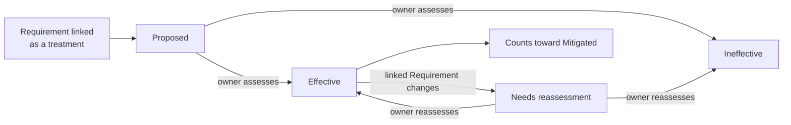
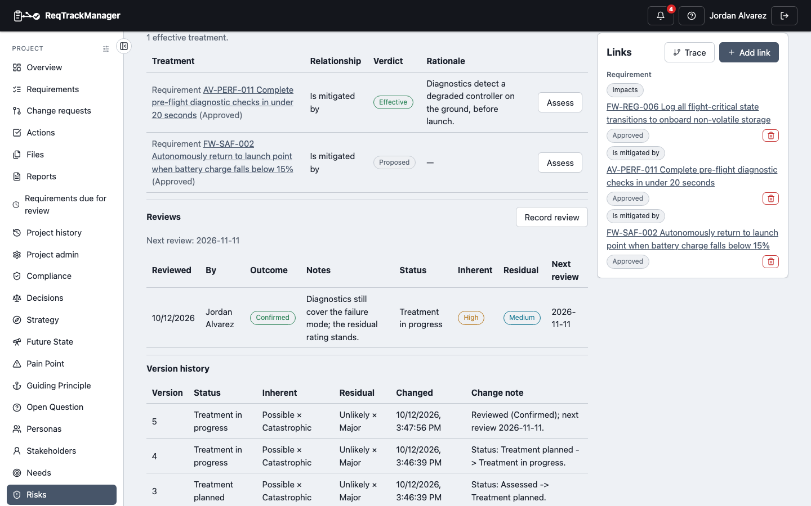

# Treatment and relationships

A Risk register is only useful if it connects to the work that deals with each Risk. This page covers the links a Risk can have, and the module's central distinction: a Requirement being **linked** to a Risk is not the same as it **effectively treating** that Risk.

## Linking is not treating

Anyone who can edit links can attach a Requirement to a Risk, and an attachment proves nothing about whether the Requirement reduces the Risk. So each *treatment* link carries a **verdict**, recorded by the Risk's owner or a Risk Manager:

| Verdict | Meaning |
| --- | --- |
| **Proposed** | Linked, but nobody has judged it. A link with no verdict is Proposed. |
| **Effective** | The owner attests this really reduces the risk. Only Effective treatments count. |
| **Ineffective** | Judged, and it does not reduce the risk enough. |
| **Needs reassessment** | A verdict that may no longer hold, because the linked Requirement changed. See [Reviews and notifications](./reviews-and-notifications.md#when-a-linked-requirement-changes). |

Choosing **Effective** or **Ineffective** needs a written rationale, so the reasoning travels with the verdict. A Risk counts as **treated** only through Effective verdicts, and **Mitigated** is refused until at least one exists.

| Treatments and reviews on a Risk |
| --- |
| RSK-001's two treatments: one judged Effective with its rationale, one still Proposed; the review history sits below |
|  |

To assess a treatment, open the Risk and choose **Assess** on its row.

On the register, tick **No effective treatment** to list the Risks that have nothing proven against them yet, the question a Risk Manager asks most often.

## Relationship types

Relationships are made, listed and removed with the same **Links** panel every record uses (see [Links and traceability](../../core-features/links-and-traceability.md)); the module adds no separate screens for them. Links read from either end, so a Requirement's own page also shows the Risks it mitigates.

| Link type | Between | Carries a verdict |
| --- | --- | --- |
| **Mitigates** (shown on the Risk as *Is mitigated by*) | Requirement → Risk | Yes |
| **Treated by** | Risk → Action | Yes |
| **Verified by** | Risk → Action (a test or review) | No |
| **Impacts** | Risk → Requirement | No |
| **Related to** | Risk → Compliance requirement | No |
| **Addresses** | Decision → Risk | No |

Notes:

- Only *Mitigates* and *Treated by* assert that something reduces the Risk, so only they carry a verdict. *Verified by* and *Impacts* are traceability, not treatment.
- *Mitigates*, *Verified by* and *Related to* are standard link types every organisation has. *Treated by* and *Impacts* are added by this module when it is enabled, and the module also lets Decision Management's *Addresses* point at a Risk.
- A treatment that points at a record you aren't allowed to see is counted, but not named.
- **Design** and **System Element** targets are reserved for the Engineering Design module and appear only once it is installed. See [Roadmap](../roadmap.md).
- The Decision link is available when [Decision Management](../decision-management-module/overview.md) is enabled.

## Where this fits

See [Data model and lifecycle](./data-model-and-lifecycle.md) for how the verdict gates **Mitigated**, and [Reviews and notifications](./reviews-and-notifications.md) for how a verdict is kept honest.
