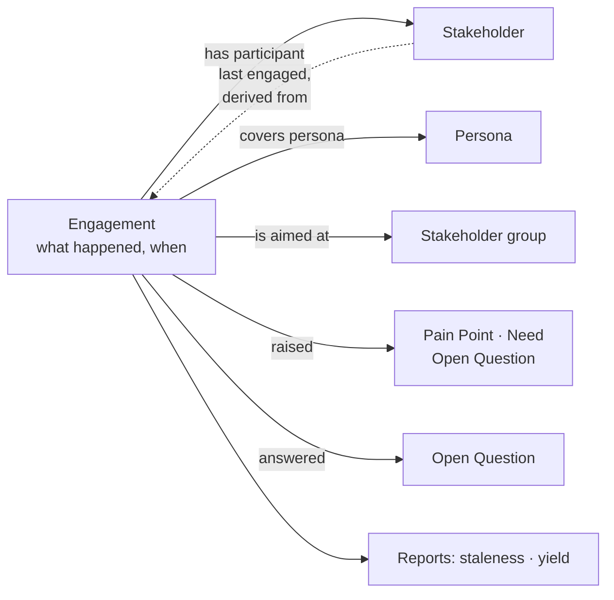
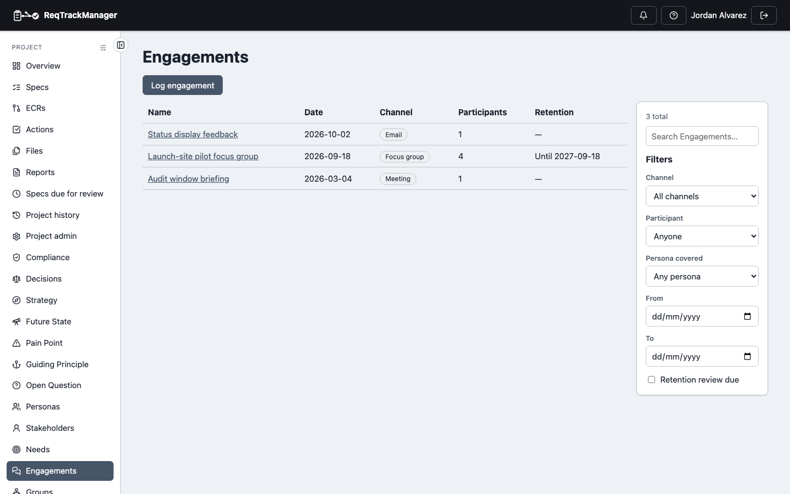
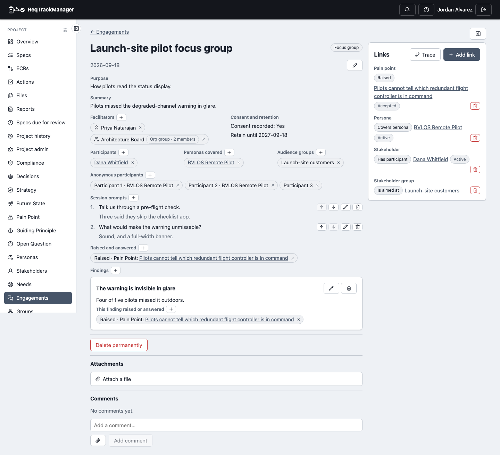

# Engagement

An Engagement is a dated record of a contact with the people a project is for: an email, a call, a meeting, a workshop, an interview, a focus group, a usability test or a survey. Logging them in one place keeps the evidence behind a Stakeholder's or Persona's claims traceable, and lets ReqTrackManager tell you who you have **not** spoken to lately.

Engagements are **always available** while the module is on: there is no separate switch. The richer [research extras](./research-extras.md) (session prompts, anonymous participants, findings) are an optional sub-component.

An Engagement belongs to **one project**. There is no organisation-wide Engagement, so one project's contact history never reaches another project that shares an organisation Stakeholder.

## Fields

| Field | What it holds |
| --- | --- |
| Title | What happened, for example "Quarterly review with the regulator". |
| Channel | Email, Call, Meeting, Workshop, Interview, Focus group, Usability test or Survey. |
| Date | When it took place. |
| Purpose, summary, notes | Why it happened, a line or two on the outcome, and the detailed notes. |
| Consent recorded | Tick once participants have agreed to being recorded here. |
| Retain until | A date after which the record should be reviewed for disposal; see [Retention and deletion](#retention-and-deletion). |
| Facilitators | Who ran or logged it: any number of users, organisation groups or project groups. Set from the Engagement's page. |
| Participants, Personas covered, outcomes | Set from the detail page; see below. |

Comments and file attachments (for example an exported email) sit on the Engagement as they do on other records. An Engagement has no version history and no approval step. It is edited in place and every change is audit-logged.

## Logging an Engagement

Open **Engagements** in the project's navigation and choose **Log engagement**. The form asks for the title, channel, date, purpose, summary and notes, consent and a retain-until date. People are added afterwards on the detail page, so the form stays short.

The list shows the date, channel, title, number of participants (named and anonymous) and retention state. Filter it by **Participant**, **Persona covered**, a **From / To** date range, or **Retention review due**.

| The project's Engagements |
| --- |
| Falcon-3's three Engagements, with channel, participant count and retention, and the filters beside them |
|  |

### Quick add: Log contact

A Stakeholder's or Persona's own page (opened from a project) has an **Engagements** panel with **Log contact**. It opens a short form (title, channel, date, summary) and attaches that Stakeholder or Persona for you, so recording "I spoke to Dana today" takes a few seconds. The panel lists that person's Engagements as a timeline. A Stakeholder or Persona opened from the organisation, rather than a project, shows no timeline, because an Engagement belongs to a project.

## Who took part

On the Engagement's page, each list has a **(+)** beside its heading that opens the picker, and an **x** on each item removes it (after a confirmation for linked records). **Facilitators** work the same way: add as many people or groups as ran it, and remove one with its x (no confirmation, since it only changes the list).

- **Participants.** Add any Stakeholder visible to the project. A Stakeholder [hidden from the project](./stakeholder.md#hiding-an-organisation-stakeholder-from-a-project) cannot be added.
- **Personas covered.** The Personas the session was about, even when no one represents them in person.
- **Audience groups.** Choose one or more [Stakeholder groups](./stakeholder-groups.md) from the tree. Everyone in the group, and in the groups beneath it, who is not archived or hidden is added as a participant.

:::note
A group's members are **copied at the moment you add it**. The group is recorded as the audience, but people who join the group later are not added, and **removing the audience keeps the participants** it brought in. Anyone already taking part is not added twice, and the confirmation tells you how many were added and how many were already there.
:::

| An Engagement opened from the list |
| --- |
| A focus group with a group audience, anonymous participants, session prompts and a finding, with its Links panel on the right |
|  |

## What it led to

**Outcomes** link the Engagement to the records it produced: it **raised** a Pain Point, a Stakeholder Need or an Open Question, or **answered** an Open Question. These are ordinary [relationships](./relationships.md), so the Pain Point or Need shows where it came from, and [Engagement & research yield](./reports.md#engagement--research-yield-s5) can count Engagements that reached the backlog against those that did not. Pick the type first, then the record; only records of that type in this project are offered.

## Last engaged

A Stakeholder's **Last engaged** date is the date of their most recent Engagement in *this project* as a participant. It shows on the Stakeholder list and their page ("Never" if there is none) and drives [Engagement staleness](./reports.md#engagement-staleness-s4). Engagements dated in the future do not count, and neither do other projects' Engagements, so a shared organisation Stakeholder is judged per project.

## Retention and deletion

An Engagement can hold personal data (names, opinions, quotes, files), so it has a disposal path.

- **Retain until** flags the Engagement as **Review due** in the list once the date is reached. **Nothing is deleted automatically**: disposal on that date is a person's decision.
- **Delete permanently** (on the Engagement's page) is a two-step confirmation that requires typing the Engagement's exact title, and cannot be undone. It removes the record, its notes, participants and covered Personas, its comments and the files themselves, every link touching it, and, with the research extras, its prompts, anonymous participants and findings. The audit trail records only that a deletion happened and who did it, not what was said.
- Permanently deleting a [Stakeholder](./stakeholder.md#permanent-deletion) removes their participation in every Engagement, not the Engagements themselves.

Deletion is available only in the app, never through an AI assistant.

## Who can do what

The project role **Engagement Owner** logs, edits, links and permanently deletes Engagements, and manages their prompts, anonymous participants and findings. The Project Manager, an organisation admin or a server admin can do the same. Every other project member can read Engagements while the module is on. Like the module's other roles, this one covers Engagements only: it grants nothing over Stakeholders, Personas or Needs.

## Where this fits

See [Research extras](./research-extras.md) for structured research sessions, [Reports](./reports.md) for what is computed from Engagements, and [AI assistant (MCP) integration](./mcp-integration.md) for logging them through an assistant.
