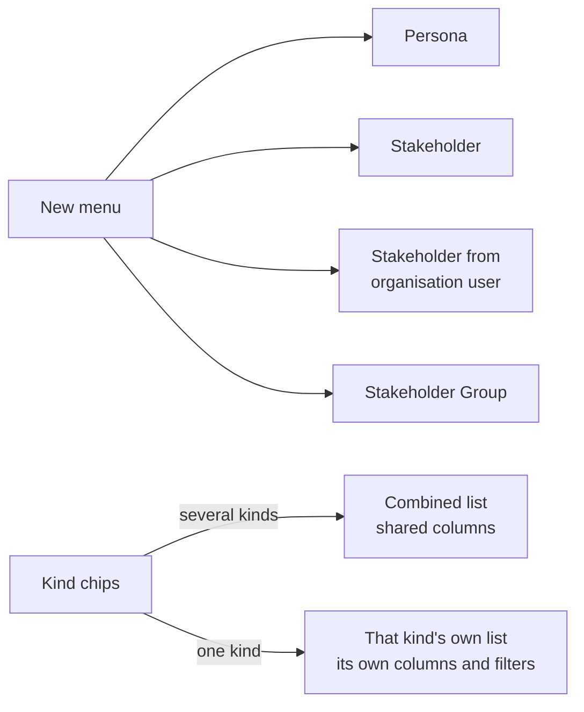

# The People page

Personas, Stakeholders and Stakeholder groups share one page, **People**, in the project's navigation. One list and one **New** menu cover all three, so you do not hunt through separate pages for "the people we are designing for or with". Each row opens its own record, exactly as before; only the list and the way you create records changed. Stakeholder Needs are not people, so they have their own **Needs** tab beside People (see [Needs](#needs)). Engagements keep their own page.

## Choosing what to list

The chips above the list (Personas, Stakeholders, Groups) turn each kind on or off; all of them are on to begin with. The choice is kept in the page address, so a link or bookmark opens the same view, and at least one kind always stays on.

- **Several kinds** share one table: Name, Code, Kind, Details (a role or short description), Type and Status. **Scope** is available but not shown until you choose it (see [Choosing columns](#choosing-columns)); an organisation's record is already told apart by its code prefix. Each name has a small icon for its kind (a mask for a Persona, a handshake for a Stakeholder, a group of people for a Stakeholder group); hover over it, or read it with a screen reader, to get the kind's name. The chips carry the same icons.
- **One kind** shows that kind's own list. Stakeholders keep their Influence, Interest, Cadence, Last engaged and Groups columns and the [group filters](./stakeholder-groups.md#using-groups-in-the-list); Personas keep their Weight column; Groups open the group manager.

A kind whose [sub-component](./overview.md#enabling-the-module) is switched off for the project is not a chip and not in the New menu. The **People** entry itself goes from the navigation only when every sub-component it serves is off.

Old links to the Personas and Stakeholders pages still work: they open People with that kind selected. An old link to Needs on People (`?kind=need`) opens the Needs tab.

## Choosing columns

The **Choose columns** button beside the list's actions menu opens a list of the columns you can show or hide. **Name**, **Code** and **Status** are always shown; every other column (Kind, Details, Type, **Scope** and a kind's own columns such as Role or Influence) can be switched off, and Scope starts switched off. **Show the default columns** returns the list to how it began. Your choice is kept for you on each list, and follows you to another browser.

- **Name** keeps a readable width: a long name wraps rather than being squeezed, and the other columns give way first. When the list has little room (a narrow window with the filter panel open), the columns after Name, Code, Type and Status are left out until there is more room; collapse the filter panel to widen the list.
- Hiding a column changes the screen only: **Sort by** still offers it, and **Export** still includes it.

## Needs

The **Needs** tab beside **People** lists the project's Stakeholder Needs on their own, with their own filters and a **New Stakeholder Need** button. Needs, their detail page and the needs a Stakeholder holds are unchanged. If a project has switched Needs off there is no tab; if it has switched off every kind of person, **People** in the navigation opens the Needs tab.

## Creating records

The **New** menu offers Persona, Stakeholder, Stakeholder from organisation user and Stakeholder Group; a Need is created from the Needs tab. Each opens the same form it always had.

## Save and activate

A Persona, Stakeholder or Need is created as a **Draft** and moved to **Active** in a separate step. When you are allowed to create one you are also allowed to activate it, because the same role covers both and none of these records has an approval step. The create form therefore offers **Save and activate** beside **Save**: it creates the record already Active.

It is one step, not two clicks: the record is created and activated together, both events appear in its history under your name, and if either fails neither is kept. **Save** still leaves a Draft.

Records that need a second person's approval (Requirements, Change Requests, Decisions, Strategies and the like) have no such button, because it would skip the approval. See [Lifecycle](./persona.md#lifecycle) for the states.
