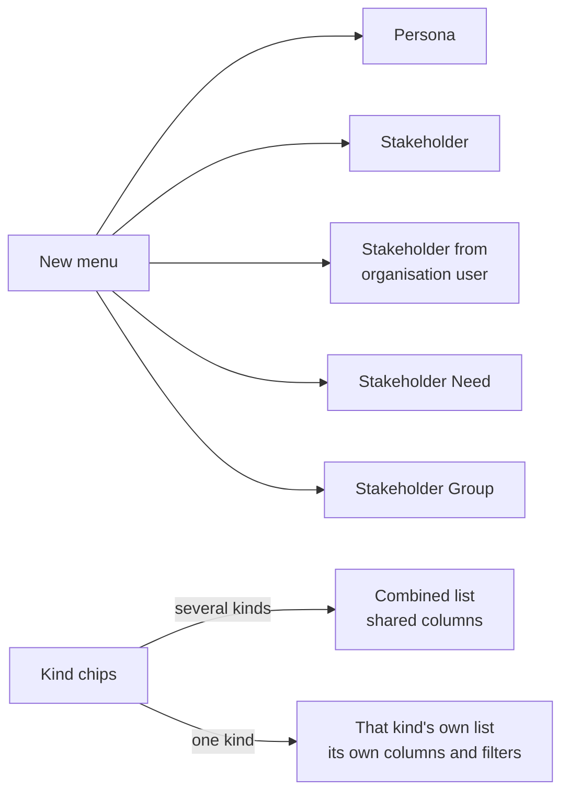

# The People page

Personas, Stakeholders, Stakeholder Needs and Stakeholder groups share one page, **People**, in the project's navigation. One list and one **New** menu cover all four, so you do not hunt through separate pages for "the people we are designing for or with". Each row opens its own record, exactly as before; only the list and the way you create records changed. Engagements keep their own page.

## Choosing what to list

The chips above the list (Personas, Stakeholders, Needs, Groups) turn each kind on or off; all of them are on to begin with. The choice is kept in the page address, so a link or bookmark opens the same view, and at least one kind always stays on.

- **Several kinds** share one table: Name, Code, Kind, Details (a role or short description), Type, Scope and Status.
- **One kind** shows that kind's own list. Stakeholders keep their Influence, Interest, Cadence, Last engaged and Groups columns and the [group filters](./stakeholder-groups.md#using-groups-in-the-list); Personas keep their Weight column; Groups open the group manager.

A kind whose [sub-component](./overview.md#enabling-the-module) is switched off for the project is not a chip and not in the New menu. The **People** entry itself goes from the navigation only when every sub-component it serves is off.

Old links to the Personas, Stakeholders and Needs pages still work: they open People with that kind selected.

## Creating records

The **New** menu offers Persona, Stakeholder, Stakeholder from organisation user, Stakeholder Need and Stakeholder Group. Each opens the same form it always had.

## Save and activate

A Persona, Stakeholder or Need is created as a **Draft** and moved to **Active** in a separate step. When you are allowed to create one you are also allowed to activate it, because the same role covers both and none of these records has an approval step. The create form therefore offers **Save and activate** beside **Save**: it creates the record already Active.

It is one step, not two clicks: the record is created and activated together, both events appear in its history under your name, and if either fails neither is kept. **Save** still leaves a Draft.

Records that need a second person's approval (Requirements, Change Requests, Decisions, Strategies and the like) have no such button, because it would skip the approval. See [Lifecycle](./persona.md#lifecycle) for the states.
