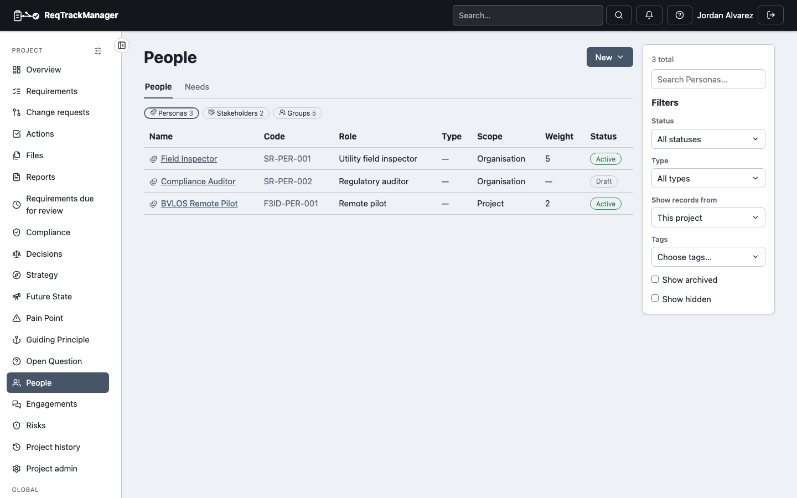
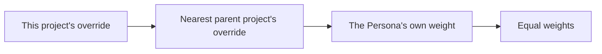
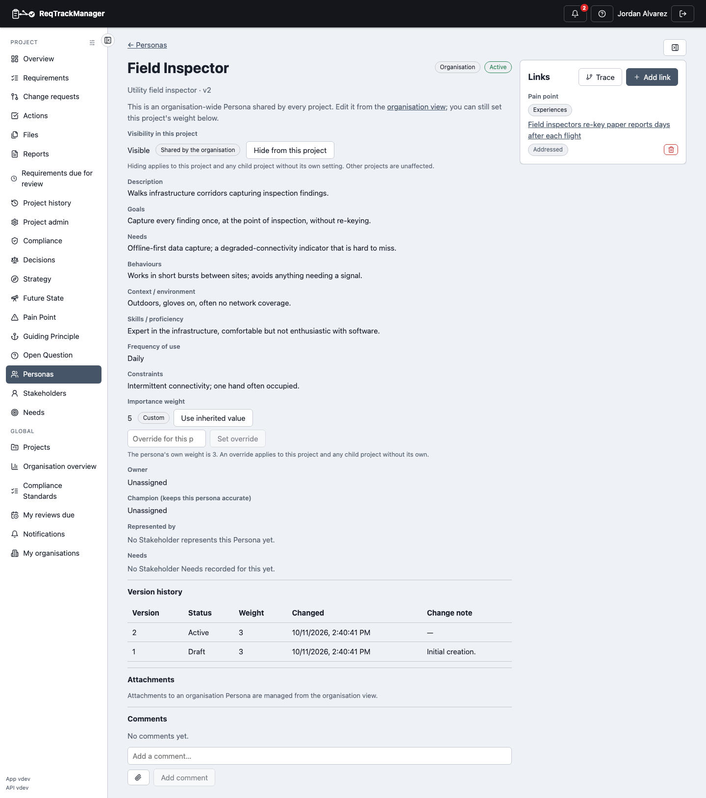

# Persona

A Persona is a representative user archetype — a "Field Inspector", a "Compliance Auditor" — recorded so a project designs for a defined person rather than an average one. It is descriptive only: a Persona never grants anyone permissions, and it is not a user account.

| A project's Personas |
| --- |
| Falcon-3's Personas, including two shared from the organisation |
|  |

## Fields

| Field | What it holds |
| --- | --- |
| Code | The record code, `PER-001`: numbered within the organisation for one the organisation owns and within the project for a project's own, and never reused. Where it is shown outside its own project, an organisation-owned Persona reads `ACME-PER-001` (the organisation's code in front), so it is never mistaken for a project's `PER-001`. |
| Name, description | Who the Persona is, in a sentence or two. |
| Type | Primary, Secondary or Negative (an anti-persona: someone the product must *not* be designed for) by default; see [Types](#persona-types). |
| Role / job title | The role the Persona represents. |
| Goals, needs, behaviours | What they are trying to achieve, what they need, how they work. |
| Context / environment, skills / proficiency, frequency of use, constraints | The conditions they work under and how skilled and how often they use the product. |
| Importance weight | A positive number used to weight this Persona when scores are rolled up per Persona; see [Weight](#importance-weight-and-the-project-override). |
| Owner, champion | The owner maintains the record; either may be a user or a group (see [Groups as owners](#groups-as-owners)). The **champion** is the colleague accountable for keeping the Persona accurate — often the person closest to the real users. |

## Scope

An **organisation** Persona is one shared record: every project in the organisation can see and link to it, and edits are made once, from the organisation view. A **project** Persona belongs to one project. A project opening an organisation Persona sees it read-only, apart from the project's own weight override below.

## Hiding an organisation Persona from a project

A project can **hide** an organisation Persona it has no use for: open the Persona from that project and choose **Hide from this project**. It works exactly like [hiding a Stakeholder](./stakeholder.md#hiding-an-organisation-stakeholder-from-a-project), including the child-inherits-the-nearest-setting rule and **Show hidden** in the list's filters. Only that project's view changes; the shared Persona, its links and its weights are untouched.

While hidden, the Persona is left out of the project's Personas list, can't be linked to a Need or relationship or chosen as a Persona a Stakeholder represents, and is not offered as a scoring target for the project. Links it already had stay recorded and reappear when it is shown again. A project's own Personas can't be hidden — archive them instead.

## Importance weight and the project override

The weight says how much this Persona matters when something is scored per Persona. A Persona may have no weight, in which case every Persona counts equally.

An organisation Persona has one weight, but different projects may care about it differently, so each project can set its **own override**. The weight a project actually uses is the first of these that is set:

A child project with no override of its own therefore inherits its parent project's. The Persona page shows the weight in use, whether it is the project's own ("Custom") or inherited, and offers **Set override** and **Use inherited value**.

[Pain Point scoring](../context-strategy-module/pain-point-scoring.md#how-personas-combine) uses the weight in use when it combines per-Persona scores, and [Persona validation](./reports.md#persona-validation-s2) shows it beside each Persona's evidence.

| A Persona opened from a project |
| --- |
| An organisation Persona with this project's weight override, and its Pain Point link in the Links panel |
|  |

## Groups as owners

The **Owner** and **Champion** of a Persona, the **Owner** of a [Stakeholder](./stakeholder.md) and the **Owner** of a [Need](./stakeholder-need.md) can each be a user, an organisation group or a project group, so a team can stand behind a record instead of one nominee who may leave. The record shows the group's name, its kind (Org group or Project group) and how many people it stands for. A group never gives anyone a right they do not already have; the Owner roles above still decide who can edit.

- A project group can be named only on a record that belongs to that project. An organisation-level Persona or Stakeholder is shared by every project, so it can name users and organisation groups only.
- The version history lists who owned each version. If a group is later deleted, older versions show it as a deleted group.
- Deleting a group that still owns records asks the admin to hand them to a user or another group, or to leave them without an owner. Every owner here is optional, so leaving them empty is allowed.
- Exports record a group by name. On import, a group the target organisation or project lacks is left empty and reported in the import warnings.

## Lifecycle

A Persona moves **Draft → Active → Retired**, and a Retired Persona can be reactivated. There is no approval step: the Persona Owner makes each change directly, with an optional comment. Every edit creates a new version, so the full history of a Persona is kept. **Archive** is separate from Retired: it hides a Persona from the default list without changing its status, and is reversible.

## Persona types

Persona types are a two-tier list. The organisation maintains a shared list (a Persona Type Admin manages it); each project can rename, reorder, disable or add to it for itself, and hide an organisation type it does not want (the delete button on an organisation type hides it in this project; **Add organisation defaults** shows it again), without affecting other projects. Personas that already use a hidden type keep it. A type that a Persona currently uses can't be deleted.

## Where this fits

A Persona is linked from a [Stakeholder](./stakeholder.md#representing-personas) who represents it, can have a [Stakeholder Need](./stakeholder-need.md), and can have [relationships](./relationships.md) to Pain Points and Requirements. See [Overview](./overview.md) for the three record types together.
