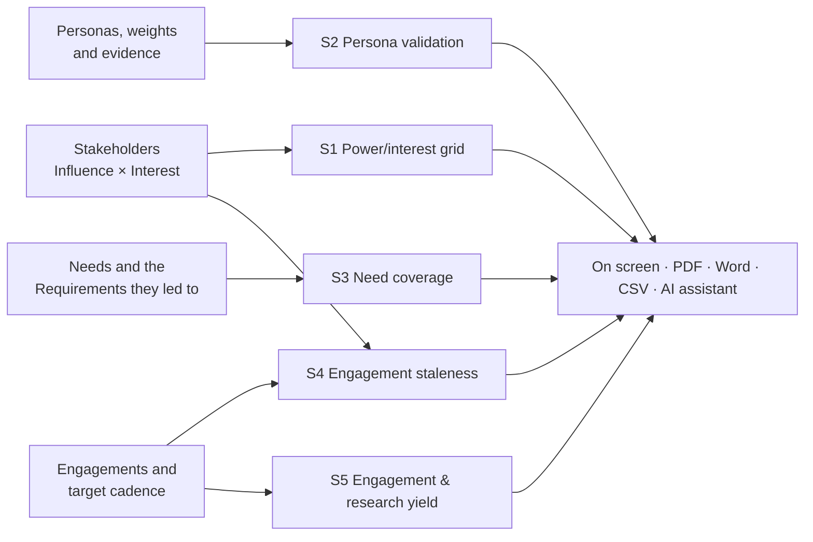
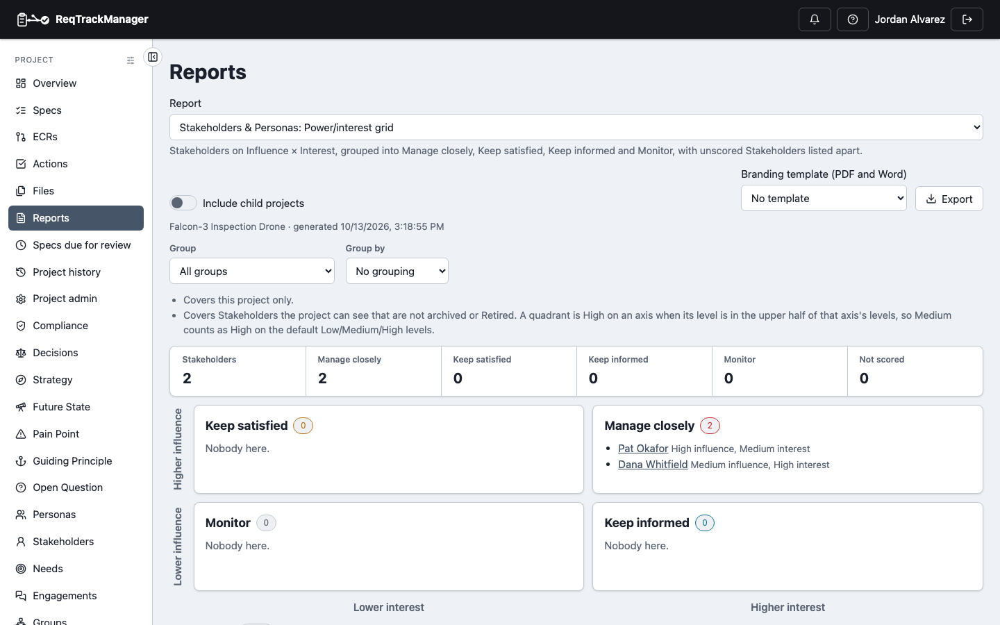
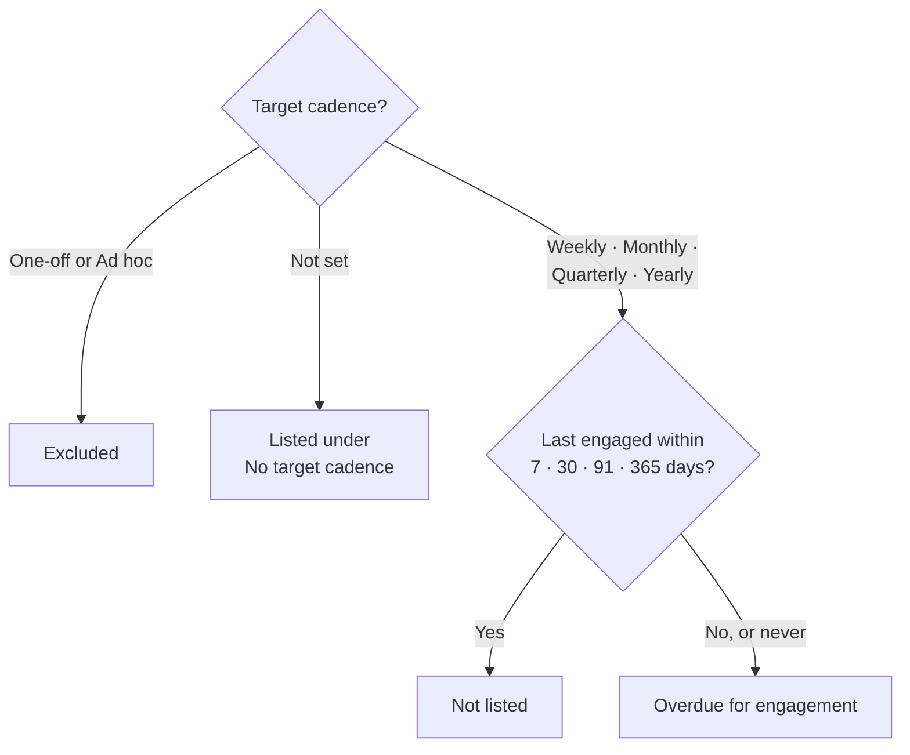
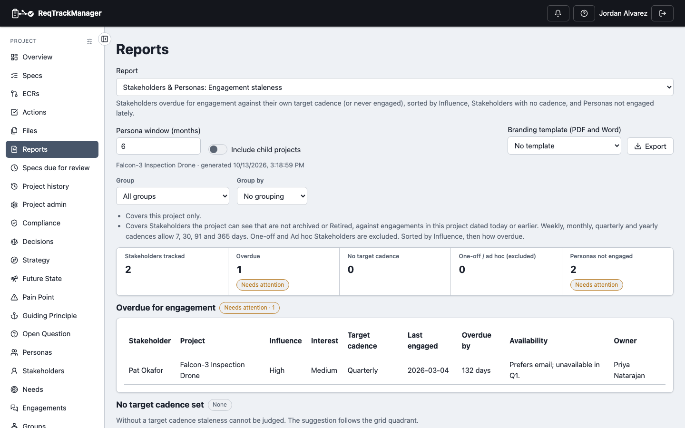

# Reports

Stakeholders & Personas adds five project-level reports to the project's **Reports** page. They answer the questions a stakeholder manager is asked most: *who matters most?*, *which Personas are only assumptions?*, *which Needs went nowhere?*, *who haven't we spoken to?* and *did our research change anything?*

Open the project's **Reports** page and choose a report from the **Report** picker; the reports appear while the module is enabled for the project. How the page works (options, export, branding template) is the same for every module report; see [Context & Strategy → Reports](../context-strategy-module/reports.md#generating-a-report). **Include child projects** adds readable sub-projects that also have the module on. Each report covers only what you can read, and there is no organisation-wide version.

## The reports

| Report | Answers | Options |
| --- | --- | --- |
| **Power/interest grid** (S1) | Where every Stakeholder sits on Influence × Interest | Group, Group by |
| **Persona validation** (S2) | What evidence supports each Persona, and which are assumptions | none |
| **Need coverage** (S3) | Needs no Requirement came from, and Requirements with no stated origin | none |
| **Engagement staleness** (S4) | Who is overdue for contact against their own cadence | Group, Group by, Persona window (months) |
| **Engagement & research yield** (S5) | What Engagements produced | Since |

Across all five, **retired, archived and project-hidden** Stakeholders and Personas are left out, so a report never shows what the project has [hidden](./stakeholder.md#hiding-an-organisation-stakeholder-from-a-project). Engagement evidence is the project's own and counts only Engagements dated today or earlier. Contact details are never included.

### Power/interest grid (S1)

The four standard positions from [Influence × Interest](./stakeholder.md#influence--interest): **Manage closely**, **Keep satisfied**, **Keep informed** and **Monitor**, drawn as a two-by-two grid. Each Stakeholder links to its page. Stakeholders missing either rating are listed separately as **Not scored**, since they have no place on the grid.

- **Group** limits the report to a [Stakeholder group](./stakeholder-groups.md) and its sub-groups.
- **Group by** names a top-level group and adds a **Branch** column, ordering Stakeholders by the branch they belong to under it, so "Acme's people, by division" is one report.

A group the project cannot see (another project's, or another organisation's) is refused rather than ignored.

| Power/interest grid |
| --- |
| Falcon-3's two Stakeholders, both in Manage closely, with the Group and Group by controls above the grid |
|  |

### Persona validation (S2)

For each Persona: its status, the **weight** in use in this project (and whether it is the project's own override or inherited), the real Stakeholders who represent it, the Engagements that cover it, anonymous participants and findings tagged with it, and its last Engagement. A Persona with **no linked Stakeholder and no Engagement** is flagged an **assumption**, with its weight, because a weight still shapes [Pain Point scoring](../context-strategy-module/pain-point-scoring.md) whether or not anyone has validated the Persona. Anonymous participants and findings are counted only where the [research extras](./research-extras.md) are on.

### Need coverage (S3)

Two gaps, until a dedicated coverage report exists:

- **Needs with no Requirement**: active Needs that no Requirement has come from.
- **Requirements tracing to no Need, Stakeholder or Persona**: nobody is recorded as the reason they exist. A Requirement counts as traced when a Need gave rise to it, or a Stakeholder or Persona **provides** it or is **affected by** it. Approving or reviewing a Requirement is not where it came from, so those links do not count.

### Engagement staleness (S4)

Compares each Stakeholder's [last engaged](./engagement.md#last-engaged) date with the [target cadence](./stakeholder.md#engagement-cadence-and-availability) you set for them.

- **Overdue for engagement** shows the last engaged date, how many days overdue ("Never engaged" if none), and the Stakeholder's availability constraints, sorted by Influence and then by how overdue. The availability column explains why a gap may be their limit rather than neglect.
- **No target cadence set** lists Stakeholders that cannot be judged, with the cadence the grid would [suggest](./stakeholder.md#engagement-cadence-and-availability), instead of silently skipping them.
- **Personas with no engagement in N months** lists Personas whose last Engagement (covering them, or with an anonymous participant tagged with them) is older than the **Persona window**, by default 6 months, heaviest weight first. Months are counted as 30 days.
- **Group** and **Group by** work as in S1.

| Engagement staleness |
| --- |
| The regulator last engaged in March, 132 days past their quarterly cadence, with their availability shown |
|  |

### Engagement & research yield (S5)

What the contact log produced: Engagements by channel and by Persona, Pain Points, Needs and Open Questions raised, Open Questions answered, and findings. **Engagements with no outcome** lists those that raised or answered nothing and recorded no finding, "the contact has not reached the backlog". **Since** narrows to Engagements on or after a date. The findings and anonymous-participant counts appear only where the [research extras](./research-extras.md) are on.

## Export and AI assistants

Each report downloads as **PDF**, **Word** or **CSV** from **Export**; the CSV is the report's first table. All five are also available to an [AI assistant](./mcp-integration.md) as read-only tools.

## Who can see them

Anyone who can read the project and has the module on. The reports are limited to what the person can read, and are read-only: running one changes nothing.

## Where this fits

See [Engagement](./engagement.md) for where the cadence and yield data comes from, [Stakeholder](./stakeholder.md) and [Persona](./persona.md) for the records they report on, and [Known limitations](./known-limitations.md) for what the reports do not cover.
