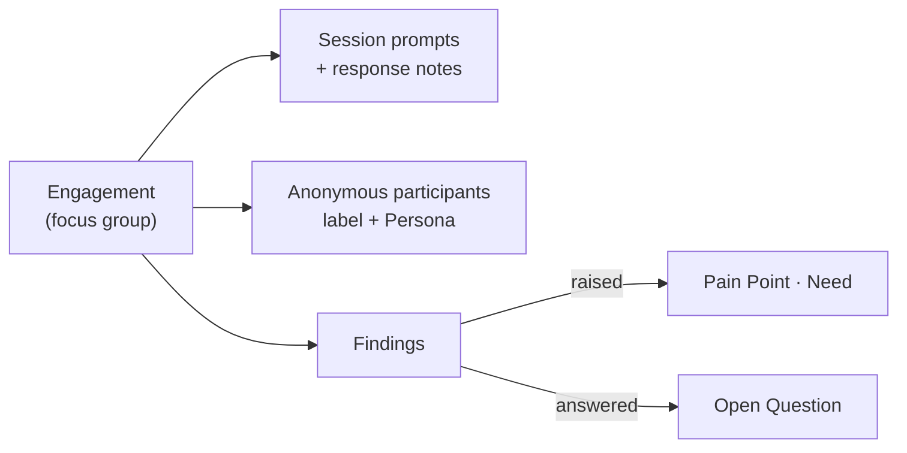
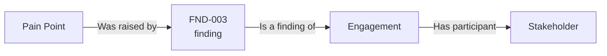

# Research extras

The research extras add structure for sessions where you ask set questions and learn something from the answers, such as an interview, a focus group or a usability test. They are a sub-component of the module, **off by default**, because the plain [Engagement](./engagement.md) log is enough for most projects.

| Extra | Use it to record |
| --- | --- |
| **Session prompts** | The questions or tasks you put to participants, in order, each with response notes. |
| **Anonymous participants** | People who took part but should not be named: a label such as "Participant 2", and optionally the Persona they represent. |
| **Findings** | What the session taught you, each linkable to the Pain Points, Needs and Open Questions it raised or answered. |

## Turning it on

An organisation admin switches **Research extras** on or off from the organisation's Modules settings, and a project can switch it for itself, the same as the module's other [sub-components](../overview.md#sub-component-enablement-finer-grained-than-a-whole-module). While it is off, the extras are hidden everywhere and the Engagement log still works. Switching it off deletes nothing.

## On an Engagement's page

With the extras on, three more blocks appear on an [Engagement](./engagement.md):

- **Anonymous participants.** Press **(+)** and enter a label and, optionally, the **Persona represented**. They count towards the participant total and towards the Persona's evidence in [Persona validation](./reports.md#persona-validation-s2). Use a label, not a name: the record is anonymous only if you keep it so.
- **Session prompts.** Press **(+)** to add a prompt, then edit it to record **response notes**. Use the arrows to reorder.
- **Findings.** Press **(+)** to add a finding with a title and description. Each gets a project-scoped code (**FND-001**, never reused, even after a delete). A finding has its own **Links** panel with the same **Add link** dialog as every other record: link what it **raised** or **answered**, or anything else the project allows. A finding can quote participants.

## Finding a finding

A finding is named by its code and title ("FND-003 Technicians skip the checklist offline"), so it can be found from the other side: the **Add link** dialog on a Pain Point, Need, Open Question or any other record offers findings by title, with the Engagement they came from. A finding is always linked to its Engagement ("Is a finding of"), made when the finding is, and it cannot be removed; so a [trace](../../core-features/links-and-traceability.md) that reaches a finding continues to its Engagement. Opening a finding from a link or trace takes you to its card on the Engagement's page. On the Engagement's own Links panel the **Research finding** group starts collapsed (every group has a toggle), since the findings are listed in full on the page.

## Findings are deleted with their Engagement

Findings, prompts and response notes can contain what people said, possibly with names. They therefore have no comments or files of their own and are **permanently deleted with their Engagement**, so erasing an Engagement cannot leave its quotes behind. See [Retention and deletion](./engagement.md#retention-and-deletion).

## Who can do what

The same roles as for Engagements: the **Engagement Owner**, Project Manager, organisation admin or server admin. A finding can also be managed through a fine-grained access grant on findings, which does not allow managing the Engagement it belongs to.

## Where this fits

Findings feed [Engagement & research yield](./reports.md#engagement--research-yield-s5), which counts them against the backlog they produced.
