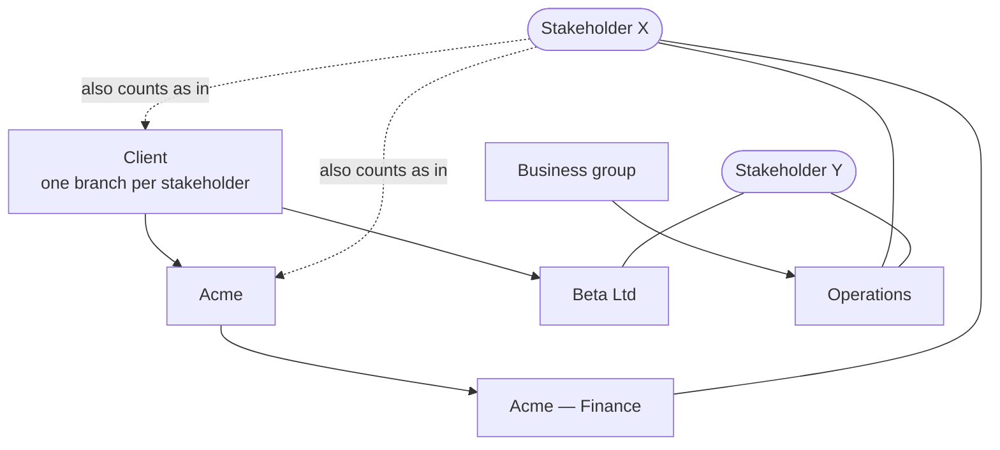

# Stakeholder groups

A **Stakeholder group** classifies Stakeholders — by client, business group, region, anything a team sorts by. Groups form a tree, and a Stakeholder can be in any number of them. A group is only a label for organising people: it holds no permissions and is not a user group or project group.

## How groups work

- **Nested.** A group has at most one parent. Being in *Acme — Finance* also counts as being in *Acme* and *Client* when you filter.
- **Many at once.** Stakeholder X is in both *Acme — Finance* and *Operations*.
- **A top-level group is a column.** *Client* and *Business group* act as the dimensions you sort and group the list by. Tick **One branch per stakeholder** on a group and a Stakeholder can be in only one of its direct child groups, so it behaves like a single-valued column: putting Stakeholder X in *Beta Ltd* as well is refused with a message naming the branch they are already in.

## Where groups live

| | Organisation group | Project group |
| --- | --- | --- |
| Managed in | Organisation overview → **Stakeholder Groups** | The project's **Groups** page |
| Parent can be | An organisation group | An organisation group, or a group of the same project |
| Members can be | Organisation Stakeholders only | Organisation Stakeholders and the project's own |
| Seen by | Every project in the organisation | That project only |

A project sees the organisation's groups read-only and can nest its own groups under them, so a project can add "Acme — Pilot plant" under the organisation's *Acme* without touching it. Another project never sees it. A Stakeholder [hidden from a project](./stakeholder.md#hiding-an-organisation-stakeholder-from-a-project) is left out of that project's view of a group and can't be added to one there.

## Managing groups

Create a group from **New group** or the **+** beside an existing one; **Edit** renames it, changes its description and the "one branch" setting, and moves it by choosing a new parent (a group can't be moved under itself or its own descendants, and trees are limited to 10 levels). The up and down arrows reorder siblings. Select a group to see its members, including those in groups beneath it, and to add or remove Stakeholders directly.

**Delete** removes the group's memberships and moves its child groups up one level. No Stakeholder is deleted. The confirmation states how many memberships and child groups are affected. Deletion is refused if moving a child up would give it the same name as one of its new siblings — rename one first.

## Group codes

Every group has a code, `SGP-001`, shown beside its name in the tree. Organisation groups are numbered within the organisation and a project's groups within the project; where a code is shown outside its own project, an organisation group reads `ACME-SGP-001` (the organisation's code in front) so it is not mistaken for a project's `SGP-001`. A code is never reused after its group is deleted.

## Putting a Stakeholder in groups

When creating a Stakeholder, choose its groups in the **Groups** picker. On a Stakeholder's page, the **Groups** field shows its groups (hover for the full path) and a picker to change them; **Save groups** applies the whole set at once, so a refused change saves nothing. From an organisation page you change the organisation groups; from a project page, that project's groups. Group membership is classification, not part of a Stakeholder's version history.

## Using groups in the list

The Stakeholders list gains:

- a **Groups** column — click a group badge to filter to it;
- a **Group** filter, which includes Stakeholders in that group's descendants unless **Directly in the group only** is ticked;
- **Group by**, listing the top-level groups. Choosing one adds a column named for it showing each Stakeholder's branch and orders the list by branch, with Stakeholders outside it last.

The same filters are available to an AI assistant through the `group_id` and `direct_only` options on `list_stakeholders`.

## Creating groups from the free-text field

Stakeholders already have a free-text **Organisation / group**. **Create from Organisation / group text** lists its distinct values (matched ignoring case) with how many Stakeholders use each. Untick any you don't want, and confirm: an **Organisation / group** parent with *one branch per stakeholder* is created, a child group per value, and the matching Stakeholders are added. Running it again tops up rather than duplicating. The free-text field itself is never changed.

## Permissions and audit

Viewing needs only the Stakeholders sub-component to be on. Creating, changing, deleting and assigning needs the same rights as managing Stakeholders: **Stakeholder Owner** in a project, **Organisation Stakeholder Owner** for organisation groups (or the equivalent admin roles, or a fine-grained grant on Stakeholder Groups). Each change is audit-logged with ids only, never names. Permanently deleting a Stakeholder removes it from every group.

Stakeholder groups can be the target of a relationship from other records, and are included in organisation and project exports and imports; an import skips, with a warning, a group whose organisation parent or a member it can't find.

## Where this fits

See [Stakeholder](./stakeholder.md) for the fields groups classify, and [AI assistant (MCP) integration](./mcp-integration.md) for the group tools.
