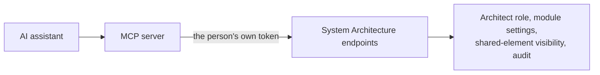

# AI assistants

An AI assistant connected through the [MCP server](../../api-integrations/ai-assistants-mcp/overview.md) can read a project's architecture and, when writes are enabled, change it. Every tool calls the same endpoint as the screen, so the assistant sees and changes only what the person who connected it could.

## What an assistant can do

| Area | Read | Change (needs write mode and the Architect role) |
| --- | --- | --- |
| Types | Element types, connection types | None; types are managed on the settings pages |
| Elements and ports | List with filters, one element with its ports, shared elements | Create (ports in the same call), edit, change status, archive, restore, delete; add, edit and delete ports |
| Connections | List (by element, type or status), one connection | Create, edit, change status, archive, restore, delete, set the outer connections it realises |
| Block diagrams | List, one diagram, the elements and lines it shows | None; the layout is edited on screen |
| State machine diagrams | List, one diagram with all states, transitions and validation issues, Mermaid text, states list | Create, edit, change status, archive, restore, delete; add, edit and delete states and transitions |
| Reports | The seven [reports](./reports-and-interchange.md#reports) | None |

## Rules an assistant follows

- **Roles and gates.** A change needs the Architect role in the project. A member without it can read and is refused a change, as on the screen.
- **Shared elements.** An element another project or the organisation shares is read only, and only while a grant gives the project access. An end the person may not read appears as a placeholder.
- **Links.** Links to requirements, risks and decisions use the general link tools, not tools of this module.
- **Version check.** An edit quotes the version it read. If someone changed the record first, the change is refused and the assistant reads it again.
- **Delete or archive.** Archiving can be undone; deleting cannot. A state machine diagram cannot be made active while its validation reports an error.
- **Not offered.** Sharing collections and grants, symbol upload and the type vocabularies are left to people, because they widen who can read or change the model.

The [agent skill](../../api-integrations/ai-assistants-mcp/agent-skill.mdx) carries the full tool list and the workflow an assistant follows.
