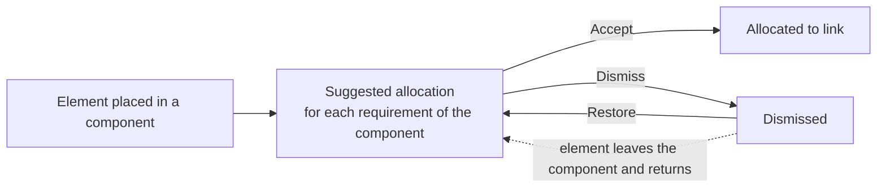

# Allocation

**Allocation** records which element of the architecture answers a requirement. An allocation is an ordinary link of the type **Allocated to**, so it appears in the requirement's Links panel, in the element's page, in traceability reports and in a project export.

## Suggested allocations

Placing an element in a project component makes every requirement of that component a **suggested allocation** for it. A suggestion is calculated, never stored: it appears and disappears with the placement, and it becomes a link only when a person accepts it.

Only elements the project owns are suggested, because a component belongs to one project. An element shared from another owner is allocated from the Links panel. A retired or archived element, an archived requirement, and a pair that is already linked are not suggested.

## Where allocation appears

| Place | Shows |
| --- | --- |
| Requirement page, **Architecture** card | The elements the requirement is allocated to, the suggested elements and the dismissed ones |
| Element page, **Requirements** card | The requirements allocated to the element, the suggested requirements and the dismissed ones |
| Project overview, **Allocation coverage** | The percentage of requirements allocated, the requirements not allocated and the suggestions awaiting a decision |

A card is not drawn while it has nothing to list. **Accept**, **Accept all**, **Dismiss** and **Restore** are offered to a person who may change the requirement's links. An approved requirement follows the project's rule for its links: where a change request is required, accepting that pair is refused with that reason, and the other suggestions in the same request still apply.

The coverage figures are also available as overview metrics (Requirements allocated, Requirements not allocated, Elements with no requirement and Suggested allocations), for a tile or gauge on a customised overview.

## Dismissals

A dismissal hides one suggestion and records who made it. It applies while the element stays in the requirement's component. If the element is removed from the component and placed there again, it is suggested afresh. Dismissals travel in a project export and import, and are not copied into a project created from a template.
