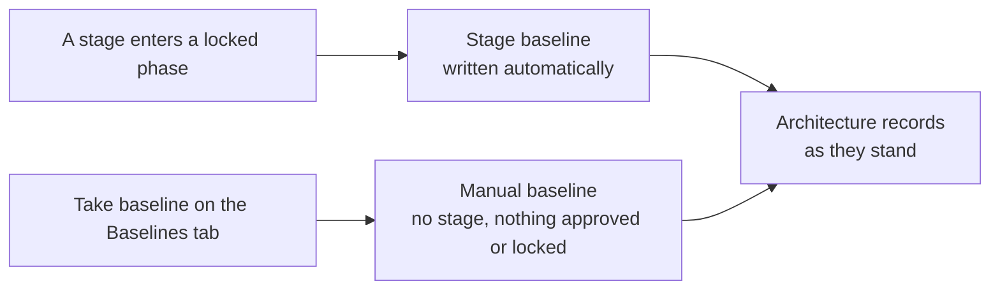

# Baselines

A **baseline** of the architecture is a permanent copy of the project's elements, connections, diagrams and state machine diagrams as they stood at one moment. It answers "what did the architecture look like when it was agreed", even after the model has changed or the records have been removed.

## What a baseline holds

| Held | Detail |
| --- | --- |
| Elements | Name, description, type, parent, status, ports, tags and places in the component tree |
| Connections | Type, protocol, both ends and their ports, status, the connections it realises |
| Diagrams | Boxes, notes, line ends, boundary boxes and view switches |
| State machine diagrams | The element described, its states and its transitions |

A baseline never contains comments, the people who created or archived a record, or an element's owner. Archived records are not captured. A connection end that belongs to another project or to the organisation is recorded by its owner and code only, and only when the project itself can read that element.

## Taking a baseline

- A **stage baseline** is written when a stage enters a locked phase. It holds the requirements of the stage and the whole project's architecture.
- A **manual baseline** is taken from the **Baselines** tab of System Architecture with **Take baseline**. It records the architecture only; it does not approve or lock anything. It needs the Architect role.
- A component's own stage baseline holds no architecture, since elements and diagrams belong to the project as a whole.

## Reading a baseline

The **Baselines** tab lists the baselines that hold architecture records, with their kind, stage, who took them and how many records. Opening one lists its records by type. Choosing a record shows every field as it stood.

## Comparing

**Compare with** on a baseline shows what differs from the live model, or from another baseline.

| Result | Meaning |
| --- | --- |
| Added | A record only in the other side |
| Removed | A record only in the baseline being viewed |
| Changed | A record in both whose fields differ; a list field such as ports shows the entries gained and lost |

Records match by code. A baseline restored from a project export keeps the codes of its source project, so it compares meaningfully only with baselines of that source, not with the live records of the project it was imported into, which are numbered afresh.
