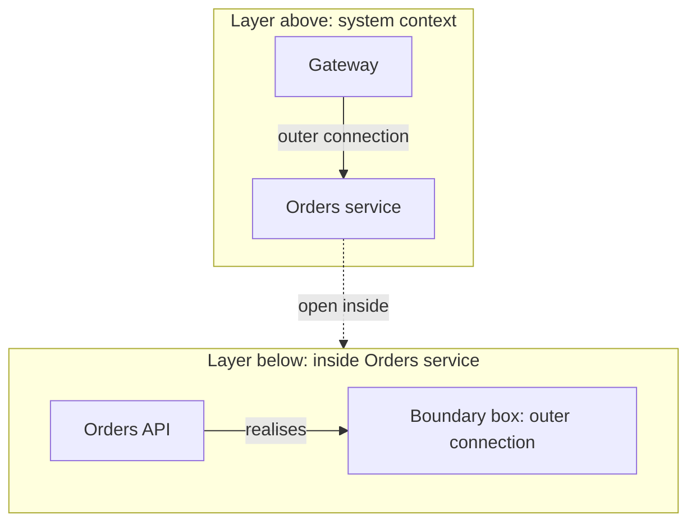

# Block diagram editor

A **block diagram** draws elements as boxes and their connections as lines. The editor has four tabs: **Drawing**, **Outline**, **Comments** and **Configuration**. Everything drawn is a real record: a box is an [element](../../reference/glossary.md#element) and a line stands for one or more [connections](../../reference/glossary.md#connection).

## Terms used here

| Term | Meaning |
| --- | --- |
| [Attach point](../../reference/glossary.md#attach-point) | One of eight points on a box where a line meets it |
| [Vertex](../../reference/glossary.md#vertex) | A point a line passes through between its ends, so it can go round another box |
| [View switch](../../reference/glossary.md#view-switch) | An on/off control that shows or hides a group of elements and connections |
| [Bridged line](../../reference/glossary.md#bridged-line) | A dashed line standing in for a hidden element |
| [Roll-up](../../reference/glossary.md#roll-up-rolled-up-line) | A line drawn between boxes for connections between elements inside them |
| [Boundary box](../../reference/glossary.md#boundary-box) | A box for a connection crossing the diagram's element boundary |
| [Realises](../../reference/glossary.md#realises) | Marks a connection as part of an interface the layer above declares |
| [Display note](../../reference/glossary.md#display-note) | A short line inside an element's box |

## Building a diagram

Choose **Add to diagram**; its entries are grouped, and a group opens in place when its row is chosen (Right arrow opens it from the keyboard). Clicking elsewhere, pressing Escape or Tab closes the menu. Choose an element type to create an element at once with a default name, **Add existing elements** to place elements already in the model, or **Add note**. The new box is selected and its name is ready to type over in the **Selection** card, which edits the box in place. Drawing a line from one box to another creates a connection at once, with a type chosen from the elements' suggestions, to adjust in the card.

A line meets a box at an **attach point**. A box draws its points only while the pointer is near it, while it is selected and while a line is being drawn near it, so a drawing is not covered in dots; start a line by moving the pointer to the box's edge and dragging from a point. Switch on **Always show attach points** in the settings button to draw them on every box all the time; the choice is kept in your account and applies to both editors. Left automatic, the line uses the point nearest its other end; drag the end of a selected line to use another point on the same box. The settings button holds **Connection detail** (lines drawn with type, protocol and colour), **Line hops** (see below), **Show notes** (the display note inside each box), the comment layer and **Snap to grid**.

A straight line can cross a box you would rather route around. Select the line: a small dot appears on the middle of each segment. Drag it to add a **vertex**, drag a vertex to move it, and double-click it (or focus it and press Delete) to remove it; with snap to grid on, a vertex lands on the grid. The Selection card's **Vertices** list gives the same control without a pointer: each point has X and Y fields (applied when you leave the field), **Add vertex** and **Reset vertices** buttons, and a **Smooth curve** switch that draws one curve through the line's ends and every vertex. With vertices, an automatic end uses the point of its box nearest the vertex next to it. The route belongs to the line between two boxes, so several connections drawn as one line share it, and a line to a boundary box cannot have vertices. Vertices are stored when you save the diagram, are part of undo and redo, travel with a project export and a template, and are drawn in PNG and SVG exports; Mermaid lays the lines out itself and leaves them out. The Outline's **Vertices** column counts them.

Where two lines still cross, switch on **Line hops** in the settings button so the crossing is not read as a junction: the line that sorts later (by its identifier) is drawn with a small arc over the other. Connections and note leaders are one set of lines. No arc is drawn near the end of either line, between two lines that share an end, or where the arc would not fit between two vertices of the line that hops, and two arcs never overlap. Unlike snap to grid, **Line hops** is a setting of the diagram (off by default, stored with it and changed with the same version check as Connection detail): everyone who opens the diagram sees the same arcs, and the PNG and SVG exports draw them; Mermaid has none. See [Line hop](../../reference/glossary.md#line-hop).

**Undo** and **Redo** act on the unsaved layout. The keys are Cmd+Z and Cmd+Shift+Z on a Mac, and Ctrl+Z with Ctrl+Shift+Z or Ctrl+Y elsewhere. They work when the cursor is not in a text box and no dialog is open; in a text box the key undoes the typing. An element or connection added from the diagram is created at once, so Undo does not remove it.

## Layers

An element's own diagram shows its children. Double-click a box, or choose **Open inside**, to open its inside; elements added there become its children. The diagram of the system context shows the top-level elements.

A connection that crosses the diagram's element boundary is drawn as a **boundary box**. Its outline shows the direction: a point on the right is an input, on the left an output, and both sides a two-way connection. Drawing a line from an inner element to a boundary box creates a connection that **realises** the outer one. The boundary box then shows as Covered, and the **Boundary coverage** report lists any connection of the layer above that nothing realises.

## View switches

A **view switch** shows or hides elements and connections by rule (type, domain or tag) or by choice, for example "Security devices". Anyone viewing the diagram can flip a switch without saving. Where an element is hidden between two others, a **bridged line** (dashed) joins the two. A line between boxes that stands for connections between elements inside them is a **roll-up**.

## Outline

The **Outline** lists what the drawing shows as text: the elements as a tree or a table (type, parent, display note, description and the state machine diagrams of each), the outer connections with their direction and coverage, the notes, and the lines with their direction, type, the number of connections each stands for and its **Route**:

| Route | Meaning |
| --- | --- |
| Direct | A connection between these two boxes |
| Rolled up | A connection between elements inside the boxes, shown at this level |
| Bridged | Stands in for an element hidden by a view switch |

Selecting a row selects the matching box or line on the drawing.

## Notes, comments and export

A note is text placed on this diagram only, with a tone and any number of **leaders**. A note can have a **Title**, up to 120 characters, drawn in bold above its text. The line breaks you type in **Note text** are kept, so a note can hold several paragraphs, and a line longer than the note still wraps between words. **Alignment** (Left, Centre or Right) sets how the title and the text sit in the note. **Size** is Automatic or Manual. An Automatic note (the default for a new note) is drawn only as large as its title and text need, wrapping a long line at 320 units, so a leader that ends at the note ends next to the words; the box follows the text as you type. A Manual note keeps the size you gave it. Dragging a handle of an Automatic note, or resizing it with Alt and an arrow key, makes it Manual at that size; choosing Manual in the card keeps the size it is drawn at, and choosing Automatic again fits it to the text. A note with no text and no title keeps its stored size. Full justification is not offered, because the PNG and SVG exports cannot draw it the same way as the screen. The PNG and SVG exports draw the title in bold and each typed line; Mermaid writes the title in bold and the lines, and centres them, so alignment is not written. **Leaders** are lines from the note to a box, a connection or a spot. To draw a leader, drag from an attach point of the note onto empty canvas (a free end where you release), onto a box or onto a line (it attaches and follows it); the new leader is selected. A selected leader shows **Points at**, **Starts at** (an attach point of the note, or Automatic), a **Start style** and an **End style** (None, Arrow or Dot) and the same **Vertices** and **Smooth curve** as a connection line; drag its end to aim it elsewhere. A note's own card lists its leaders, with **Add leader** for use without a pointer. Deleting what a leader points at removes that leader and keeps the note. In the Mermaid export a leader to a box is a dotted link (a dot end is written as a plain end); a leader to a line or a spot is not written. A tone of **None** draws the words alone, with no box, for a plain label on the drawing; a faint outline shows only while you hover over the note, select it or leave it empty, and it is not in any export. Turn on **Note** in the toolbar, beside **Comment**, and each click on empty canvas places a note there with the cursor in its text; Escape or the same button turns the mode off. Note and Comment are never on together. **Add note** in the Add to diagram menu places one without the pointer. It differs from a display note, which belongs to an element. Comments are anchored to a box or a line and are listed on the Comments tab. A diagram exports as PNG, SVG or Mermaid (Mermaid chooses its own line routes).

A block whose element has state machine diagrams shows a small badge that opens one; see [State machine diagrams](state-machine-diagrams.md).
