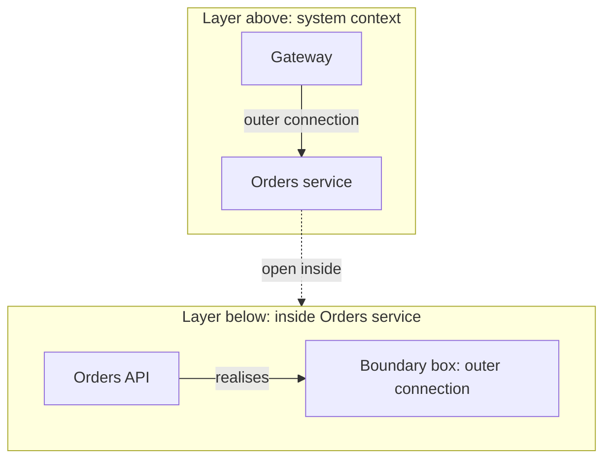

# Block diagram editor

A **block diagram** draws elements as boxes and their connections as lines. The editor has four tabs: **Drawing**, **Outline**, **Comments** and **Configuration**. Everything drawn is a real record: a box is an [element](../../reference/glossary.md#element) and a line stands for one or more [connections](../../reference/glossary.md#connection).

## Terms used here

| Term | Meaning |
| --- | --- |
| [Attach point](../../reference/glossary.md#attach-point) | One of eight points on a box where a line meets it |
| [View switch](../../reference/glossary.md#view-switch) | An on/off control that shows or hides a group of elements and connections |
| [Bridged line](../../reference/glossary.md#bridged-line) | A dashed line standing in for a hidden element |
| [Roll-up](../../reference/glossary.md#roll-up-rolled-up-line) | A line drawn between boxes for connections between elements inside them |
| [Boundary box](../../reference/glossary.md#boundary-box) | A box for a connection crossing the diagram's element boundary |
| [Realises](../../reference/glossary.md#realises) | Marks a connection as part of an interface the layer above declares |
| [Display note](../../reference/glossary.md#display-note) | A short line inside an element's box |

## Building a diagram

Choose **Add to diagram**; its entries are grouped, and a group opens in place when its row is chosen (Right arrow opens it from the keyboard). Clicking elsewhere, pressing Escape or Tab closes the menu. Choose an element type to create an element at once with a default name, **Add existing elements** to place elements already in the model, or **Add note**. The new box is selected and its name is ready to type over in the **Selection** card, which edits the box in place. Drawing a line from one box to another creates a connection at once, with a type chosen from the elements' suggestions, to adjust in the card.

A line meets a box at an **attach point**. A box draws its points only while the pointer is near it, while it is selected and while a line is being drawn near it, so a drawing is not covered in dots; start a line by moving the pointer to the box's edge and dragging from a point. Switch on **Always show attach points** in the settings button to draw them on every box all the time; the choice is kept in your account and applies to both editors. Left automatic, the line uses the point nearest its other end; drag the end of a selected line to use another point on the same box. The settings button holds **Connection detail** (lines drawn with type, protocol and colour), **Show notes** (the display note inside each box), the comment layer and **Snap to grid**.

**Undo** and **Redo** act on the unsaved layout. The keys are Cmd+Z and Cmd+Shift+Z on a Mac, and Ctrl+Z with Ctrl+Shift+Z or Ctrl+Y elsewhere. They work when the cursor is not in a text box and no dialog is open; in a text box the key undoes the typing. An element or connection added from the diagram is created at once, so Undo does not remove it.

## Layers

An element's own diagram shows its children. Double-click a box, or choose **Open inside**, to open its inside; elements added there become its children. The diagram of the system context shows the top-level elements.

A connection that crosses the diagram's element boundary is drawn as a **boundary box**. Its outline shows the direction: a point on the right is an input, on the left an output, and both sides a two-way connection. Drawing a line from an inner element to a boundary box creates a connection that **realises** the outer one. The boundary box then shows as Covered, and the **Boundary coverage** report lists any connection of the layer above that nothing realises.

## View switches

A **view switch** shows or hides elements and connections by rule (type, domain or tag) or by choice, for example "Security devices". Anyone viewing the diagram can flip a switch without saving. Where an element is hidden between two others, a **bridged line** (dashed) joins the two. A line between boxes that stands for connections between elements inside them is a **roll-up**.

## Outline

The **Outline** lists what the drawing shows as text: the elements as a tree or a table (type, parent, display note, description and the state machine diagrams of each), the outer connections with their direction and coverage, the notes, and the lines with their direction, type, the number of connections each stands for and its **Route**:

| Route | Meaning |
| --- | --- |
| Direct | A connection between these two boxes |
| Rolled up | A connection between elements inside the boxes, shown at this level |
| Bridged | Stands in for an element hidden by a view switch |

Selecting a row selects the matching box or line on the drawing.

## Notes, comments and export

A note is text placed on this diagram only, with an optional line pointing at a box, a connection or a spot, and a tone. It differs from a display note, which belongs to an element. Comments are anchored to a box or a line and are listed on the Comments tab. A diagram exports as PNG, SVG or Mermaid.

A block whose element has state machine diagrams shows a small badge that opens one; see [State machine diagrams](state-machine-diagrams.md).
