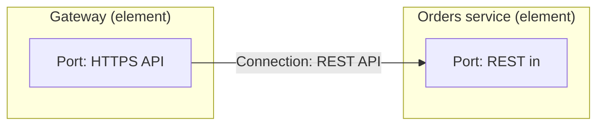
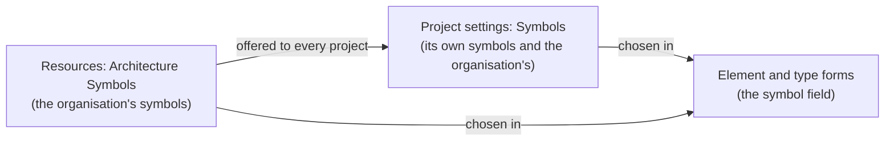

# Elements, ports and connections

The architecture of a product is recorded as **elements** (its parts) and **connections** (how the parts talk to each other). Each is a coded record that can be linked, tagged, commented on and searched, and each is listed on its own tab of **System Architecture**.

## Terms used here

| Term | Meaning |
| --- | --- |
| [Element](../../reference/glossary.md#element) | A part of the product, such as a service or a board (`ELM-001`) |
| [Port](../../reference/glossary.md#port) | A named point where a connection meets an element |
| [Connection](../../reference/glossary.md#connection) | A link between two elements (`CON-001`) |
| [Connection type](../../reference/glossary.md#connection-type) | The kind of interface, such as REST API or I2C bus |
| [Domain](../../reference/glossary.md#domain) | A name an element type or connection type can be in, such as Software or Hardware |
| [Display note](../../reference/glossary.md#display-note) | A short line drawn inside an element's box on every diagram |
| [Symbol](../../reference/glossary.md#symbol) | A drawing from the symbol library, shown in an element's box |

## Elements

An element has a name, a description, a type (which sets how it is drawn), an optional parent, an owner and a status. Elements, connections, diagrams and state machine diagrams move through Draft, Proposed, Active and Retired (or Rejected); a project can turn off Proposed under **Project administration, Lifecycles**, and an organisation can require it (see [Lifecycles](../../core-features/lifecycles.md)). Parents form a tree up to 12 levels deep: a diagram can show a parent as one box, or open it to show its children. An element belongs to a project or to the organisation; an organisation element can be shared with projects through collections.

The **symbol** field chooses the drawing shown in the element's box; left empty, the element uses its type's symbol. The field is one button showing the current drawing and name; it opens a panel with a **Search** field above, the symbols in the middle and view buttons below. **List** shows the symbol names, **Gallery** a scrolling grid that shows every drawing, and **Upload** (offered only to a person who may change the library) adds a new drawing and chooses it. Both choices include **None**, which returns to the default. The List or Gallery choice is remembered in the browser. The arrow keys move between rows or tiles, Enter or Space chooses, and Escape closes the panel.

A person with the Architecture Admin role (Architecture Org Admin for an organisation's elements and types) also sees **Upload a symbol** under the field. The file is sanitised, added to the shared symbol library of the project (or organisation) for everyone, and chosen in the form; the choice is saved with the form. The panel also links to the symbol library (**Manage symbols**), where a symbol is renamed, filed or removed later. Everyone else sees the field without the upload, and the server refuses an upload from them.

The **display note** is one line, up to 500 characters, drawn inside the element's box. It is separate from the description, which is for the record, reports and search.

## The symbol library

The organisation's symbols are listed under **Architecture Symbols** in **Resources**; a project's own symbols, with the organisation's symbols it can use, are under **Symbols** in the project's settings (System Architecture). Both are the same page.

- **Upload symbols** adds drawings to the library. Choose several files at once; each is checked on its own, so a refused file is listed with its reason and the others still upload. They are filed in the folder open on the page, or the one chosen in the dialog.
- The **filter panel** narrows the list by name, **Source** (Built-in or Uploaded), **Used** (an element type or an element refers to the symbol), **File type** (SVG, and EPS or PDF where conversion is available) and **Folders**. Switch between a table and tiles with the view buttons; sort a table on Name, Source or Folder.
- **Used by** names the projects that use a symbol when there are one or two, otherwise it shows the number of records; select it to see each owner, how many element types and elements use the symbol and the element type names. A symbol that something uses cannot be deleted.
- **Folders** organise the library only; they never change a diagram or an element. Make, rename and delete folders from the page's actions menu; choose a folder in the filter panel to list its symbols. The ten built-in symbols stay at the top level. In a project, the organisation's symbols are listed read-only under their organisation folder; **Delete symbol** hides one in the project, and **Add organisation defaults** in the actions menu shows it again.

## Ports

A **port** is a named point where a connection meets an element, one for each interface, for example "CAN bus" or "Power in". Ports are optional: an element with none still takes connections, and a port only lets a connection say which interface it uses.

| Direction | Meaning |
| --- | --- |
| In | Traffic arrives at the element |
| Out | Traffic leaves the element |
| Both | Traffic crosses either way, as on a bus |

A port may also name the connection type it expects. This is guidance: a connection may still use the port with another type.

## Connections

A connection joins a source element to a target element, which must differ. Each end may name one of its element's ports. A connection has a type, an optional [protocol](../../reference/glossary.md#protocol) (for example HTTPS/1.1 or SPI mode 0) and a description. A connection of a one-way type runs from source to target; a two-way type shows no arrow and the order of its ends is for display only.

Connection types are organised in groups: a type such as I2C can sit under Serial bus and under Board-to-board, and choosing a group also reaches every type beneath it when connections are filtered. When a connection is created, the type list offers the types that suit both elements first: a type suits an element when the two share a [domain](../../reference/glossary.md#domain), or when either is in no domain.

**Adding a type.** In the System Architecture settings (for the organisation or for one project), **Element Types** and **Connection Types** each have one **Add element type** or **Add connection type** button above the list. It opens the same form as **Edit** (domains, shape or line style, colours, symbol or the types it sits under, one-way, default protocol), so a type is complete when it is created. In a project, an organisation default that was hidden is brought back from the list's actions menu with **Add organisation defaults**.

**Default protocol.** A connection type can carry a **Default protocol** (set in the type's form under **Connection Types** in the System Architecture settings, for the organisation or for one project). A new connection of that type starts with it in its **Protocol** field, whether it is created from a list, from an element, from a diagram's Selection card or at once from a diagram. Changing the type of a connection replaces the protocol with the new type's default only while the protocol is empty or still the previous type's default, so a protocol that was typed is never overwritten. The default only pre-fills: it is stored on the connection, changing it later leaves existing connections alone, and any protocol can still be typed. A client of the API that leaves the protocol out of a new connection receives the type's default; an empty value means none.

## Domains

A **domain** is a name that element types and connection types can be in, such as Software, Hardware or Mechanical. A new organisation has Software and Hardware; add the domains your teams work in under **Domains** in the System Architecture settings, for the organisation or for one project. A type can be in several domains, or in none, which means it fits every domain.

Domains narrow the choices; they never forbid one:

- The connection type list offers the types that share a domain with both elements, and a type that does not fit can still be chosen, with a warning that names the domains.
- **Add to diagram** lists an element type under each domain it is in (for example **New hardware element**), and a type in no domain under **New element**.
- The **Domain** filter of **Add existing elements** shows the elements whose type is in the domain, or in none.
- A view switch can match by domain: it matches the elements and connections whose type is in any chosen domain.

The two tiers work as for the types: an organisation's domains are offered in every project, a project can add its own and hide an organisation default it does not use (**Add organisation defaults** brings it back), and a child project without domains of its own shows the nearest parent's. A domain that a type is in, or that a view switch names, cannot be deleted. Hiding a domain stops new use only: a type already in it keeps it.

Either end may be an element the project can read from elsewhere: another project's element shared with it, or an organisation element. The connection belongs to the project that created it.
