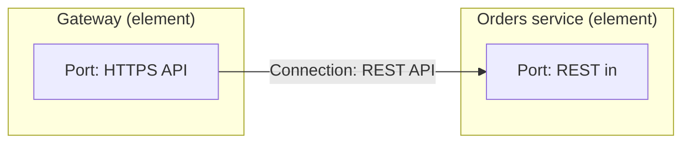

# Elements, ports and connections

The architecture of a product is recorded as **elements** (its parts) and **connections** (how the parts talk to each other). Each is a coded record that can be linked, tagged, commented on and searched, and each is listed on its own tab of **System Architecture**.

## Terms used here

| Term | Meaning |
| --- | --- |
| [Element](../../reference/glossary.md#element) | A part of the product, such as a service or a board (`ELM-001`) |
| [Port](../../reference/glossary.md#port) | A named point where a connection meets an element |
| [Connection](../../reference/glossary.md#connection) | A link between two elements (`CON-001`) |
| [Connection type](../../reference/glossary.md#connection-type) | The kind of interface, such as REST API or I2C bus |
| [Display note](../../reference/glossary.md#display-note) | A short line drawn inside an element's box on every diagram |

## Elements

An element has a name, a description, a type (which sets how it is drawn), an optional parent, an owner and a status. Parents form a tree up to 12 levels deep: a diagram can show a parent as one box, or open it to show its children. An element belongs to a project or to the organisation; an organisation element can be shared with projects through collections.

The **display note** is one line, up to 500 characters, drawn inside the element's box. It is separate from the description, which is for the record, reports and search.

## Ports

A **port** is a named point where a connection meets an element, one for each interface, for example "CAN bus" or "Power in". Ports are optional: an element with none still takes connections, and a port only lets a connection say which interface it uses.

| Direction | Meaning |
| --- | --- |
| In | Traffic arrives at the element |
| Out | Traffic leaves the element |
| Both | Traffic crosses either way, as on a bus |

A port may also name the connection type it expects. This is guidance: a connection may still use the port with another type.

## Connections

A connection joins a source element to a target element, which must differ. Each end may name one of its element's ports. A connection has a type, an optional protocol (for example HTTPS/1.1 or SPI mode 0) and a description. A connection of a one-way type runs from source to target; a two-way type shows no arrow and the order of its ends is for display only.

Connection types are organised in groups: a type such as I2C can sit under Serial bus and under Board-to-board, and choosing a group also reaches every type beneath it when connections are filtered. When a connection is created, the type list offers the types that suit both elements first.

Either end may be an element the project can read from elsewhere: another project's element shared with it, or an organisation element. The connection belongs to the project that created it.
