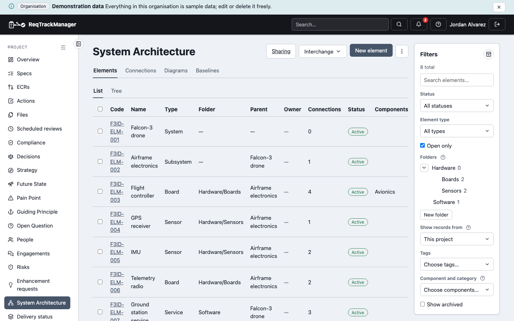
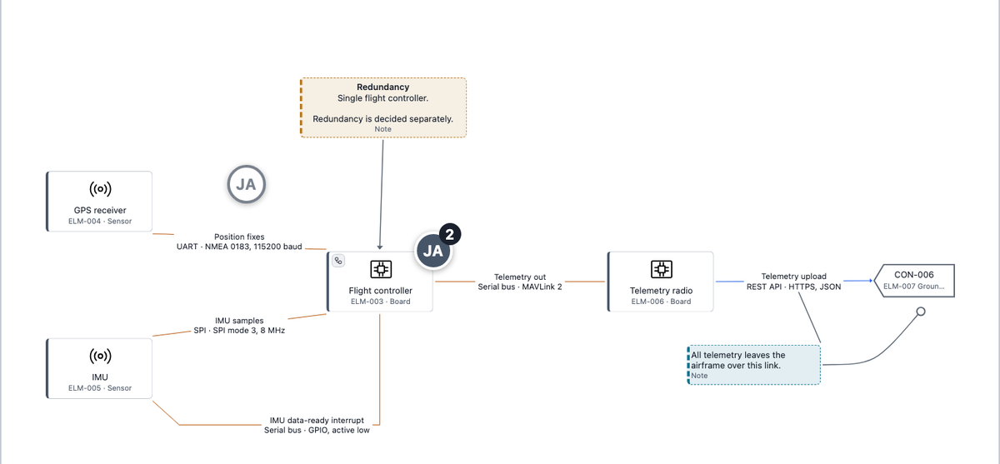
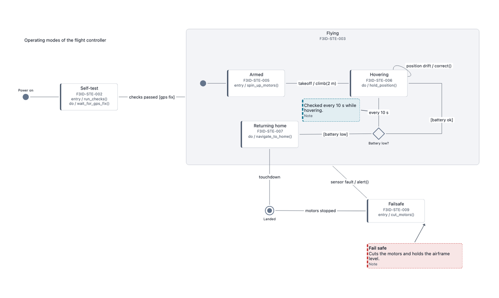
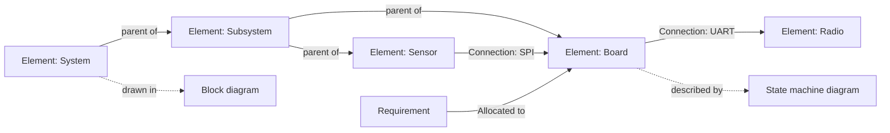

# System Architecture module

The **System Architecture** module records which parts a product is made of and how they connect, so the parts can be named in requirements, decisions and reports. It is a module an organisation switches on; see [Modules](../overview.md).

| Elements | Block diagram | State machine diagram |
| --- | --- | --- |
|  |  |  |

## What is recorded

- **Decomposition.** An [element](elements-ports-and-connections.md) has an optional parent, so a system breaks down into subsystems and parts to 12 levels. A [connection](elements-ports-and-connections.md#connections) joins two elements, optionally at named ports, and has a type.
- **Drawings.** A [block diagram](block-diagram-editor.md) draws a chosen part of the tree. A diagram that shows a parent as one box draws a line between the parent's box and another box for every connection between the elements inside them (a **roll-up**), so a high-level view stays correct as the detail changes. A [state machine diagram](state-machine-diagrams.md) describes the modes of one element.
- **Traceability.** [Allocation](allocation.md) links requirements to the element that answers them, and the coverage report shows requirements with no element.
- **Sharing.** An element can belong to the organisation and be [shared with chosen projects](sharing-and-visibility.md).
- **Change control.** A [baseline](baselines.md) freezes the architecture at a point in time and compares it with the live model.
- **Output.** [Reports and interchange](reports-and-interchange.md) cover the architecture reports and the JSON and Structurizr files, and [AI assistants](ai-assistants.md) can read and change it through the MCP tools.

## Who can do what

| Role | May |
| --- | --- |
| Architect | Create and edit the project's elements, connections and diagrams |
| Architecture Admin | Also manage the project's element types, connection types, domains, symbols and collections |
| Architecture Org Admin | Manage the organisation's types, symbols, elements and collections |

Every record has a project code such as `ELM-001`, `CON-001`, `DGM-001` or `SMD-001`, and is tagged, linked, commented on, searched, exported and imported like the records of the other modules.
