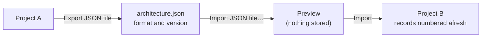

# Reports and interchange

System Architecture offers seven reports, a JSON file that carries a project's architecture to another project, and a Structurizr DSL export for the Structurizr tools.

## Reports

Each report is on the Reports page and is also available as a table in a custom report layout (a widget). A shared element (owned by another project or the organisation) appears as **Shared element**, with no code or name.

| Report | Shows | Parameters |
| --- | --- | --- |
| Boundary coverage | The connections crossing each element's boundary, and whether an inner connection realises each | Element |
| Allocation coverage | Requirements with no allocated element (with the suggested ones), elements and connections with no requirement, leaf elements with no owner | None |
| Interface list | Every connection with both ends, type, protocol, direction and linked requirements | Element, Connection type |
| Element breakdown | The element tree, each element under its parent, with a Level column | Element |
| Diagram | One diagram as a picture, with the elements and lines it shows | Diagram |
| Unconnected elements | Elements with no connection (counting what is inside them), and elements no diagram shows | None |
| State machines | The state machine diagrams, their states and transitions, and one diagram as a picture | Element, State machine diagram |

The picture in the **Diagram** and **State machines** reports is the same drawing the editor exports as SVG. A custom report layout embeds it with the *Diagram drawing* or *State machine diagram drawing* widget; the screen and the CSV carry the table beside it. Without a diagram chosen the report has no picture and says so.

The Engineering Specification starter layout includes the element breakdown and the interface list, and the Review Package starter lists the allocation gaps.

## JSON interchange

**Interchange** on the Elements tab offers **Export JSON file**, **Export Structurizr DSL** and **Import JSON file…**.

The file holds the project's element and connection types, folders, elements (ports, tags, places), connections (realisations), diagrams (boxes, notes, anchors, toggles and their rules, boundary boxes, symbol references) and state machine diagrams with their states and transitions. Records refer to each other by code inside the file, and an import gives every record a new code in the target project.

| Left out of the file | Reason |
| --- | --- |
| Comments, an element's owner, and who created or archived a record | Personal data and discussion do not belong in a file any member can download; the record exports apply the organisation's personal-data policy to an owner column |
| Links to requirements, sharing collections and grants, allocation dismissals | They refer to records or access the file does not hold |
| Uploaded symbol files | A symbol travels by name; the import reports one it cannot find |

- **Preview.** Choosing a file shows the rows it would add by kind and anything it could not resolve (for example a connection whose end belongs to another owner that is not available). **Import** applies the same import.
- **Who can import.** An import creates records and type rows, so it needs the Architect role and the Architecture Admin role. Any project member who can see the elements can export.
- **What is exported.** An end another owner shares is written as a reference only while the person exporting may read it; otherwise it is left empty and the import reports the connection as skipped.
- **Limits.** The file is refused whole when it is over 10 MB, nested more than 40 levels, in another format, or of another major version. A newer minor version of the same major version is read.

## Structurizr DSL

**Export Structurizr DSL** writes a workspace for the Structurizr tools. It cannot be imported; use the JSON file to move a project.

- An element with no parent is a software system, its children are containers and anything deeper is a component. Codes, status and ports are properties.
- A connection is one relationship, with the protocol as its technology. A connection between an element and one inside it is not written, because Structurizr does not allow it.
- Each diagram that is not archived or retired is one view, drawn with the toggle states saved on the diagram. Where its boxes are all systems, all containers of one system, or all components of one container, the view has that type; a mixed diagram is a landscape of the systems that contain its elements. Positions are not carried.
- Only elements the project owns that are not archived, retired or rejected are written.
