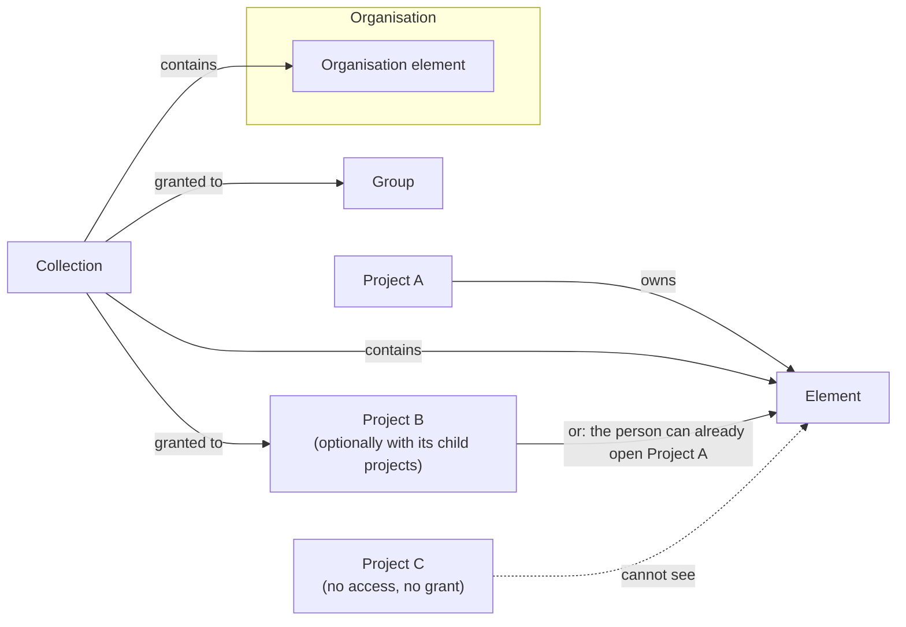

# Sharing and visibility

A product often depends on parts that another team owns: a shared infrastructure project, or a service every product uses. The module lets those parts be **shared** without making them visible to everyone in the organisation.

## Terms used here

| Term | Meaning |
| --- | --- |
| Owner | The project or organisation an element belongs to |
| Organisation element | An element that belongs to the organisation, not to a project |
| Collection | A named group of elements owned by one project or by the organisation, used to grant access |
| Grant | Gives a collection to a project (optionally with its child projects) or to a group |
| Locked placeholder | What a diagram draws for an element the viewer can no longer see: its code only |

## Who can see an element

An element is visible to a person when either route allows it:

| Route | Applies to | Rule |
| --- | --- | --- |
| Owner access | Elements of a project | The person can open the owning project |
| Collection grant | Elements of a project and of the organisation | The element, or one of its ancestors, is in a collection granted to the person's project, or to a group they belong to |
| Organisation administrator | Elements of the organisation | An Architecture Org Admin always sees and edits them |

An organisation element in no granted collection is visible to organisation administrators only. Several collections give the union of what they grant. A grant to a project can include its child projects, current and future; without that setting it reaches only the named project.

## What a recipient may do

A project that is given an element may read it, place it in a diagram, connect to it, allocate requirements to it and link to it. It may never edit, retire, move or add to the owner's tree; only the owner's Architect (project) or Architecture Org Admin (organisation) can.

## Managing sharing

- A project's collections are managed from **Sharing** on the System Architecture page; an organisation's from **Elements and Collections** under **System Architecture** in the organisation settings, which also lists the organisation's elements.
- An element's page has a **Sharing** card that lists the collections it is in.
- Every collection change, grant and revocation is recorded in the audit log by identifier and count, never by name.
- A grant may name only a project or group of the same organisation, and a group of another organisation is refused.
- An element cannot be deleted while it is in a collection that is granted.

## When access is withdrawn

Removing a grant, a membership or a person's access to the owning project hides the element everywhere: pickers, lists, diagrams, search, reports and the MCP tools. A connection or a diagram placement that named it stays, and the hidden end is drawn as a locked placeholder showing only its code. A hidden element behaves exactly as a missing one: a request for it is answered as not found, with no count and no code in a summary.

## Export and import

Collections and their members travel in the owner's project or organisation export. **Grants never do**, so importing a file can never publish an element to another project or group. A connection to an element the importing project cannot read is reported and left out.
