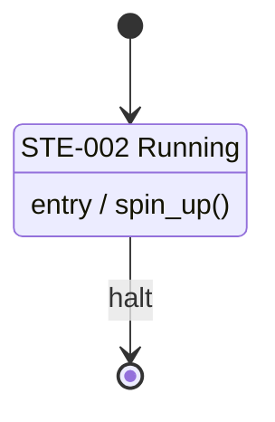

# State machine diagrams

A **state machine diagram** records the behaviour of an element of the product: the **states** it can be in and the **transitions** between them. For example, a pump's "Operating modes" diagram has the states Idle, Running and Fault, and a transition from Running to Fault on the event `overpressure`. Requirements, risks and decisions can then name a single state, such as "the Fault state of the pump", instead of describing it in prose.

A state machine diagram belongs to one element and is listed with the block diagrams on the **Diagrams** tab of System Architecture. Creating a diagram starts with a **Type** choice (Block diagram or State machine diagram); the type cannot change afterwards. The record has the code `SMD-001`, and each state has its own code (`STE-001`), so both can be linked, tagged and searched like any other record.

An element's page has a **Diagrams** card directly under its details. It lists the block diagrams that draw the element (**Placed** when it has its own box, **Inside** when only a parent is drawn) and the state machine diagrams that describe it, each linking to its editor, and a connection's page lists the diagrams that draw its line (**Drawn**, or **Rolled up** when the line joins parents of its ends). **New state machine diagram** is on the element's card.

## Notation

The diagrams use UML state machine notation, which is also the SysML state machine notation.

| Item | Drawn as |
| --- | --- |
| State | Rounded rectangle with its name, code and any `entry /`, `exit /` and `do /` lines |
| Initial state | Filled dot |
| Final state | Ringed dot |
| Choice | Diamond; the conditions (guards) on its outgoing transitions decide the path |
| Composite state | Frame that contains other states |
| Transition | Arrow labelled `event [condition] / action`; a transition from a state to itself is drawn as a loop |

An initial state, final state or choice can carry a **symbol label**, up to 40 characters of text drawn inside the symbol, so a branch can say what it decides ("Battery low?"). The symbol is drawn larger while it has a label, and a long label wraps over up to three lines and ends with an ellipsis; the full text is in the Selection card and the Outline.

Conditions (guards) and actions are text that a person reads. The module does not simulate a diagram or generate code from it.

## Adding and editing states

Choose **Add to diagram**, then Initial state, State, Final state or Choice, or drag the item onto the drawing. The item is added at once with a default name ("State 1", "State 2"; a marker is named for its kind), selected, and its name is ready to type over in the **Selection** card. Dropping an item inside a composite state puts it in that state. Point at **Add to diagram** for a short guide to building a machine.

The Selection card edits the selected state in place: name and kind (the name of an initial state, final state or choice is captioned **Name (Outline and exports)**, because the drawn text is its symbol label); for an ordinary state its description and entry, exit and activity lines; for an initial state, final state or choice its symbol label. Changes are stored when the cursor leaves the card's fields, or with **Save state**; a name cannot be blank. Double-clicking a state opens the same fields in a dialog. The card also holds the state's tags and links.

## Aligning states

The settings button beside **Export** holds **Snap to grid**, off by default. While it is on, a dragged or resized state lands with its edges on a grid, arrow keys move the selected state by one grid step, and a dot grid is drawn. Holding **Shift** while dragging or resizing does the opposite for that move. The choice belongs to the person using the editor: it is kept in the browser, is shared with the block diagram editor, and is not part of the diagram, so it changes nothing for other people and moves no state already placed.

## Adding and editing transitions

Draw a line from one state to another, or select a state and choose a target in **Add transition to** (choosing the state itself draws a loop). The transition is added at once with no event, condition or action, selected in the **Selection** card, with the cursor in its **Event**; for a line leaving a choice the cursor is in **Condition (guard)**, because the lines leaving a choice are told apart by their conditions. The card edits the transition in place: its two states, event, condition (guard), action and description. Changes are stored when the cursor leaves the card's fields, or with **Save transition**. Double-clicking a line opens the same fields in a dialog.

## Checks

The editor lists the findings of the checks beside the drawing. An **error** prevents the diagram from becoming Active; a **warning** never does.

| Severity | Finding |
| --- | --- |
| Error | No initial state at the top level; more than one initial state in a level; an initial state with an incoming transition; a final state with an outgoing transition |
| Warning | A state that cannot be reached; a state that is not final and has no outgoing transition; two transitions from one state with the same event and no condition (guard); a choice with fewer than two outgoing transitions; a composite state with no initial state |

An edit to an Active diagram that introduces an error is still saved and shown, so a diagram is never locked out of repair.

## Export

**Export** in the editor offers the stored diagram as an image or as text. A pending drawing is saved first, so the file always matches the record.

| Export | Result |
| --- | --- |
| PNG image, SVG image | The server's drawing of the diagram in the notation above |
| Download Mermaid text, Copy Mermaid text | `stateDiagram-v2` text for documentation that renders Mermaid |

In the Mermaid text, a composite state is a nested block, and the initial and final states are the start and end marks of their block. Mermaid does not accept entry, exit and do lines on a composite state, so they are omitted for composite states. Several final states in one block share Mermaid's single end mark. Mermaid cannot write text inside a start mark, end mark or choice, so a symbol label is not drawn in the Mermaid text (a choice's label is written as a comment line); the image exports and the project bundle keep it.
