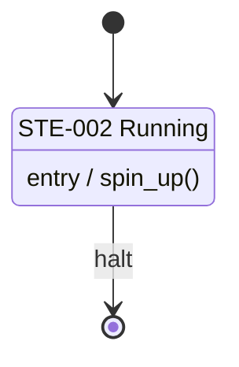

# State machine diagrams

A **state machine diagram** records the behaviour of an element of the product: the **states** it can be in and the **transitions** between them. For example, a pump's "Operating modes" diagram has the states Idle, Running and Fault, and a transition from Running to Fault on the event `overpressure`. Requirements, risks and decisions can then name a single state, such as "the Fault state of the pump", instead of describing it in prose.

A state machine diagram belongs to one element and is listed with the block diagrams on the **Diagrams** tab of System Architecture. Creating a diagram starts with a **Type** choice (Block diagram or State machine diagram); the type cannot change afterwards. The record has the code `SMD-001`, and each state has its own code (`STE-001`), so both can be linked, tagged and searched like any other record.

## Notation

The diagrams use UML state machine notation, which is also the SysML state machine notation.

| Item | Drawn as |
| --- | --- |
| State | Rounded rectangle with its name, code and any `entry /`, `exit /` and `do /` lines |
| Initial state | Filled dot |
| Final state | Ringed dot |
| Choice | Diamond; the guards on its outgoing transitions decide the path |
| Composite state | Frame that contains other states |
| Transition | Arrow labelled `event [guard] / action`; a transition from a state to itself is drawn as a loop |

Guards and actions are text that a person reads. The module does not simulate a diagram or generate code from it.

## Checks

The editor lists the findings of the checks beside the drawing. An **error** prevents the diagram from becoming Active; a **warning** never does.

| Severity | Finding |
| --- | --- |
| Error | No initial state at the top level; more than one initial state in a level; an initial state with an incoming transition; a final state with an outgoing transition |
| Warning | A state that cannot be reached; a state that is not final and has no outgoing transition; two transitions from one state with the same event and no guard; a choice with fewer than two outgoing transitions; a composite state with no initial state |

An edit to an Active diagram that introduces an error is still saved and shown, so a diagram is never locked out of repair.

## Export

**Export** in the editor offers the stored diagram as an image or as text. A pending drawing is saved first, so the file always matches the record.

| Export | Result |
| --- | --- |
| PNG image, SVG image | The server's drawing of the diagram in the notation above |
| Download Mermaid text, Copy Mermaid text | `stateDiagram-v2` text for documentation that renders Mermaid |

In the Mermaid text, a composite state is a nested block, and the initial and final states are the start and end marks of their block. Mermaid does not accept entry, exit and do lines on a composite state, so they are omitted for composite states. Several final states in one block share Mermaid's single end mark.
