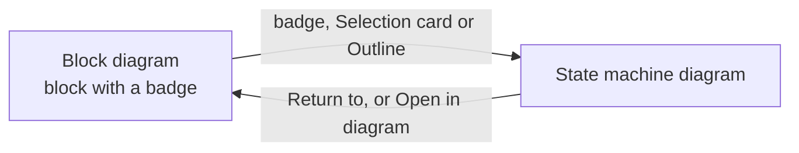
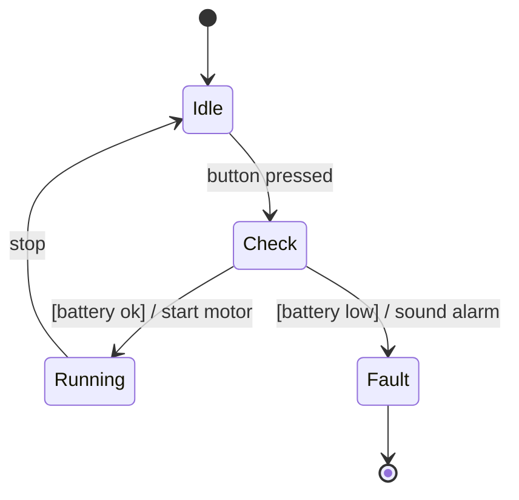
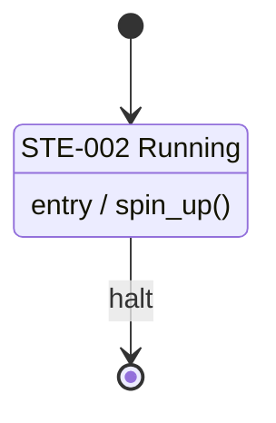

# State machine diagrams

A **state machine diagram** records the behaviour of an element of the product: the **states** it can be in and the **transitions** between them. For example, a pump's "Operating modes" diagram has the states Idle, Running and Fault, and a transition from Running to Fault on the event `overpressure`. Requirements, risks and decisions can then name a single state, such as "the Fault state of the pump", instead of describing it in prose.

A state machine diagram belongs to one element and is listed with the block diagrams on the **Diagrams** tab of System Architecture. Creating a diagram starts with a **Type** choice (Block diagram or State machine diagram); the type cannot change afterwards. The record has the code `SMD-001`, and each state has its own code (`STE-001`), so both can be linked, tagged and searched like any other record.

An element's page has a **Diagrams** card directly under its details. It lists the block diagrams that draw the element (**Placed** when it has its own box, **Inside** when only a parent is drawn) and the state machine diagrams that describe it, each linking to its editor, and a connection's page lists the diagrams that draw its line (**Drawn**, or **Rolled up** when the line joins parents of its ends). **New state machine diagram** is on the element's card.

## Terms used here

| Term | Meaning |
| --- | --- |
| [State](../../reference/glossary.md#state) | A mode the element can be in |
| [Composite state](../../reference/glossary.md#composite-state) | A state that holds other states |
| [Transition](../../reference/glossary.md#transition) | A line from one state to another |
| [Event](../../reference/glossary.md#event) | What triggers a transition |
| [Condition (guard)](../../reference/glossary.md#condition-guard) | What must be true for a transition to be taken |
| [Action](../../reference/glossary.md#action) | What happens as a transition is taken |
| [Entry action](../../reference/glossary.md#entry-action), [Exit action](../../reference/glossary.md#exit-action), [Activity](../../reference/glossary.md#activity) | What happens on entering a state, on leaving it, and while it is active |
| [Initial state](../../reference/glossary.md#initial-state), [Final state](../../reference/glossary.md#final-state), [Choice](../../reference/glossary.md#choice) | The start, the end and a branch |

## Moving between a block and its state machine diagram

A block on a block diagram whose element has at least one state machine diagram shows a small **state machine badge** on its top left corner. Pressing it opens the diagram; when the element has several, the badge shows their number and opens a list to choose from. The same action is available without the pointer: the Selection card's **Open state machine diagram** (several diagrams are entries of its **More actions** menu), and a column and buttons in the **Outline**. The badge is reached with Tab straight after its box. If the block diagram has unsaved changes, you are asked before leaving.

On the state machine diagram, **Return to** (the block diagram's code and name) sits beside the **Diagrams** link and goes back to the block diagram with the element's box selected and in view. When the page was opened another way (a list, a pasted address, after a reload that lost the origin), an **Open in diagram** menu lists the block diagrams that draw the element instead, so the way back does not depend on the browser history. A diagram you cannot read is never listed.

## Notation

The diagrams use UML state machine notation, which is also the SysML state machine notation.

| Item | Drawn as |
| --- | --- |
| State | Rounded rectangle with its name, code and any `entry /`, `exit /` and `do /` lines |
| Initial state | Filled dot |
| Final state | Ringed dot |
| Choice | Diamond; the conditions (guards) on its outgoing transitions decide the path |
| Composite state | Frame that contains other states |
| Transition | Arrow labelled `event [condition] / action`; a transition from a state to itself is drawn as a loop, and several loops on one state take its corners in turn |

An initial state, final state or choice can carry a **symbol label**, up to 256 characters of text drawn with the symbol, so a branch can say what it decides ("Battery low?"). The text breaks between words, after a hyphen or at a line break typed in the field, never inside a word. A long remark reads better as a note. The screen, the SVG and PNG exports break the text at the same words; the full text is also in the Selection card and the Outline.

The **Label position** chooses where the text is drawn:

| Position | The text is drawn | The symbol |
|----------|-------------------|------------|
| Inside (default) | In the symbol | Grows to hold the text, so a long label makes a large symbol. A single word longer than the largest symbol holds is drawn whole on one line and extends past the symbol, and the field warns about it |
| Left, Right, Above, Below | Beside the symbol, 4 units from its edge, in lines of at most 160 units | Keeps its plain size |

A line left to choose its own ends does not end on the side the text is on, so it does not run through the text; an end set to that side in the Selection card is kept as chosen.

Conditions (guards) and actions are text that a person reads. The module does not simulate a diagram or generate code from it.

## Event, condition and action

A transition is labelled `event [condition] / action`, and every part is optional. The **event** is what triggers it, the **condition** (called a guard in UML) must be true for it to be taken, and the **action** is what happens as it is taken. A transition with no event is taken when the state's activity completes.

A **choice** is a branch: the lines leaving it are told apart by their conditions, so each needs its own. The condition is the label of such a line.

Here "button pressed" is an event, "battery ok" and "battery low" are conditions, and "start motor" and "sound alarm" are actions.

## Adding and editing states

Choose **Add to diagram**, then Initial state, State, Final state or Choice, or drag the item onto the drawing. The item is added at once with a default name ("State 1", "State 2"; a marker is named for its kind), selected, and its name is ready to type over in the **Selection** card. Dropping an item inside a composite state puts it in that state. Point at **Add to diagram** for a short guide to building a machine.

The Selection card edits the selected state in place: name and kind (the name of an initial state, final state or choice is captioned **Name (Outline and exports)**, because the drawn text is its symbol label); for an ordinary state its description and entry, exit and activity lines; for an initial state, final state or choice its symbol label and label position. Changes are stored when the cursor leaves the card's fields, or with **Save**; a name cannot be blank. Double-clicking a state opens the same fields in a dialog. The card also holds the state's tags and links.

## Notes

A note is text placed on this state machine diagram only, with a tone and any number of **leaders**. It works as on a block diagram (see [Block diagram editor](block-diagram-editor.md)): a **Title**, **Note text** with its line breaks, **Alignment**, **Tone** (None draws the words alone) and **Size** (Automatic or Manual). A leader is a line from the note to a **state**, a **transition** or a spot; a selected leader shows **Points at** (the diagram's states and transitions, or a spot with X and Y), **Starts at**, a **Start style** and an **End style** (None, Arrow or Dot) and the same **Vertices** and **Smooth curve** as a transition. Drag from an attach point of the note onto a state, a line or empty canvas to draw one, or use **Add leader** in the note's card without a pointer.

Choose **Add note** in the **Add to diagram** menu, or turn on **Note** in the toolbar beside **Comment** and click empty canvas to place a note there; Escape or the same button turns the mode off, and Note and Comment are never on together. A note is part of the drawing, so it is saved with **Save**, and **Undo** and **Redo** act on it. The **Delete** key removes a selected note or leader at once (no question is asked, as Undo brings it back). Deleting the state or transition a leader points at removes that leader and keeps the note. A note is a remark about the drawing: the checks do not read it, and it does not change the behaviour described. The **Outline** lists the notes and what each leader points at.

## Undo and Redo

**Undo** and **Redo** act on the unsaved drawing (positions, sizes, nesting, attach points and vertices). The keys are Cmd+Z and Cmd+Shift+Z on a Mac, and Ctrl+Z with Ctrl+Shift+Z or Ctrl+Y elsewhere. They work when the cursor is not in a text box and no dialog is open. A state or transition added from the diagram is created at once, so Undo does not remove it.

**Delete** (or Backspace, which is the key labelled Delete on a Mac) deletes the selected state or transition after asking, in the same confirmation as the **Delete** button: a state names what goes with it and needs its code typed, and **Cancel** keeps everything. A selected note or note line is removed at once and **Undo** puts it back. The key works wherever the cursor is except in a text box or while a dialog is open; after adding a state and typing its name, press **Escape** to leave the text box with the state still selected, then Delete.

## Aligning states

The settings button beside **Export** holds **Line hops**, **Default line shape** and **Snap to grid**. **Line hops** is a setting of the diagram, off by default: where one transition crosses another, the one that sorts later (by its identifier) is drawn with a small arc over the other, so a crossing is not read as a junction. No arc is drawn near a line's end, between two lines that share an end, or where the arc would not fit between two vertices. Everyone who opens the diagram, and the PNG and SVG exports, show the same arcs; the Mermaid text has none. **Default line shape** is also a setting of the diagram (new diagrams start at Straight): every transition and note leader with no shape of its own is drawn Straight, Curved or as a Spline, and a transition's Selection card has a **Line shape** field to give it its own, or **Diagram default** to follow the diagram. A self-transition keeps its fixed loop. See [Line shape](../../reference/glossary.md#line-shape). **Snap to grid** is off by default. While it is on, a dragged or resized state lands with its edges on a grid, arrow keys move the selected state by one grid step, and a dot grid is drawn. Holding **Shift** while dragging or resizing does the opposite for that move. With it off, a state or symbol stays exactly where it is dropped. The choice belongs to the person using the editor: it is kept in the browser, is shared with the block diagram editor, and is not part of the diagram, so it changes nothing for other people and moves no state already placed.

The same button holds **Always show attach points**, off by default: a state then draws its attach points all the time instead of only while the pointer is near it, while it is selected and while a line is drawn nearby. It is kept in your account and shared with the block diagram editor.

## Adding and editing transitions

Draw a line from one state to another, or select a state and choose a target in **Add transition to** (choosing the state itself draws a loop). The transition is added at once with no event, condition or action, selected in the **Selection** card, with the cursor in its **Event**; for a line leaving a choice the cursor is in **Condition (guard)**, because the lines leaving a choice are told apart by their conditions. The card edits the transition in place: its two states, event, condition (guard), action and description. A transition can be routed with **vertices** like a line on a block diagram (see [Block diagram editor](block-diagram-editor.md)): drag the dot on the middle of the selected line, or use the card's **Vertices** list and **Smooth curve** switch; a transition from a state to itself keeps its fixed loop. Transitions never draw over one another: a transition each way between two states, or a line back out of a choice, takes the next free attach points (see [Block diagram editor](block-diagram-editor.md)), and several loops on one state take its corners in turn. The Outline's **Vertices** column counts them. Changes are stored when the cursor leaves the card's fields, or with **Save**. Double-clicking a line opens the same fields in a dialog.

## Validation

**Validation** in the toolbar, beside **Comment** and **Note**, shows how many **errors** the checks found (or, with none, how many **warnings**; with neither it shows no count) and opens a list of every one. A row that concerns a state selects it on the canvas, and a row about the whole diagram is plain text. A selected state or transition that has issues shows one line in the **Selection** card, **N issues**, which opens the list at that state. An error prevents the diagram from becoming Active; a warning never does.

| Severity | Issue |
| --- | --- |
| Error | No initial state at the top level; more than one initial state in a level; an initial state with an incoming transition; a final state with an outgoing transition |
| Warning | A state that cannot be reached; a state that is not final and has no outgoing transition; two transitions from one state with the same event and no condition (guard); a choice with fewer than two outgoing transitions; a composite state with no initial state |

An edit to an Active diagram that introduces an error is still saved and shown, so a diagram is never locked out of repair.

## Export

**Export** in the editor offers the stored diagram as an image or as text. A pending drawing is saved first, so the file always matches the record.

| Export | Result |
| --- | --- |
| PNG image, SVG image | The server's drawing of the diagram in the notation above, with its notes and leaders |
| Download Mermaid text, Copy Mermaid text | `stateDiagram-v2` text for documentation that renders Mermaid |

In the Mermaid text, a note is written beside the first state its leaders point at (`note left of` or `note right of`, on the side the note lies on), so a note with no leader to a state, one that points only at a transition or a spot, and one that points at an initial or final state (which Mermaid cannot name) are left out; the SVG and PNG keep every note. Vertices and line hops are left out (Mermaid routes the lines itself), a composite state is a nested block, and the initial and final states are the start and end marks of their block. Mermaid does not accept entry, exit and do lines on a composite state, so they are omitted for composite states. Several final states in one block share Mermaid's single end mark. Mermaid cannot write text inside a start mark, end mark or choice, so a symbol label and its position are not drawn in the Mermaid text (a choice's label is written as a comment line); the image exports and the project bundle keep them.
