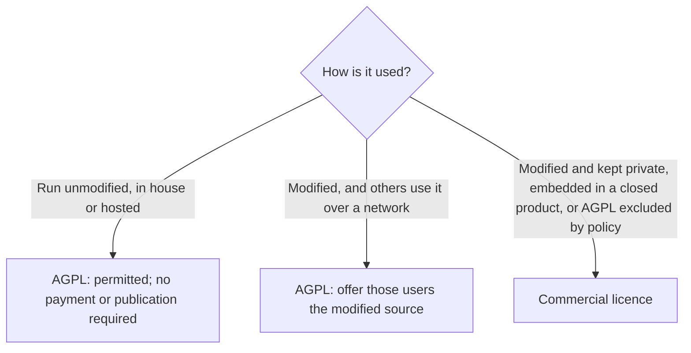

# Licensing

ReqTrackManager is offered under two licences. The licence of everything the product ships is also shown in the **Licences** group of the in-app Policies page, which is readable without signing in.

| Licence | For | Terms |
|---------|-----|-------|
| **GNU Affero General Public License, version 3** (`AGPL-3.0-only`) | Everyone | Free to use, modify and host. A person who modifies the software and lets others use it over a network must offer those users the modified source code. |
| **Commercial licence** | Organisations that cannot or do not wish to meet the AGPL terms | The same software under terms agreed with the licensor. |

## Points to know

- The AGPL permits running the unmodified product for a fee. It does not require payment.
- A host who modifies the product and offers it to others must point the Source code link on the Licences page to the host's own modified source.
- Releases published before the move to AGPLv3 remain available under the GNU General Public License, version 3.
- Each third-party component keeps its own licence, listed under **Third-party components** on the Licences page.

## Commercial licence enquiries

Open an issue titled "Commercial licence enquiry" in the [repository](https://github.com/ballardr/reqtrackmanager/issues). Do not include confidential information.

## Contributing

Contributors sign the contributor licence agreement, which allows both licences to apply to their contributions. See [Contributing](contributing.md).
