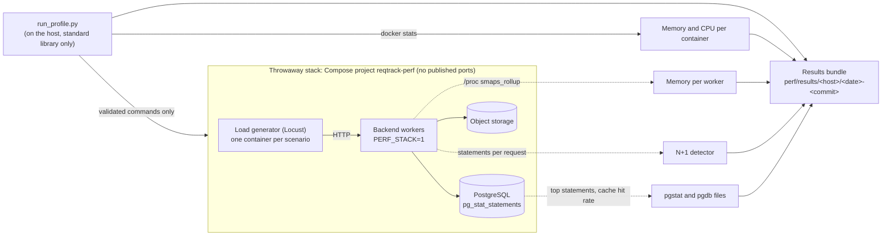
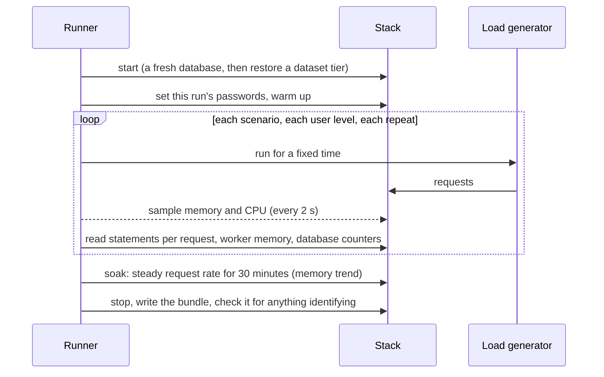
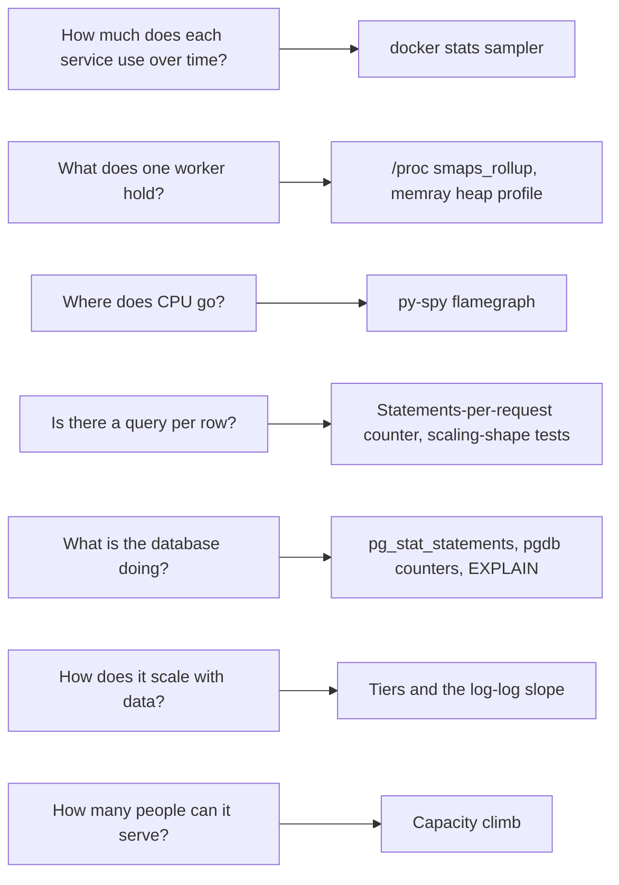

# Performance testing method

The sizing figures in [Sizing and performance](../installation-deployment/sizing-and-performance.mdx) come from a repeatable profile that runs on any host with Docker: a Mac, a Linux server, a Windows workstation or a Raspberry Pi. One command per host writes an anonymised results bundle; hosts are compared relatively, because their CPUs differ.

## What is tested, and from where



The profile never takes a URL or a database as input, creates its own stack with throwaway credentials, and removes only what it created. The numbers come from different collectors: container memory and CPU from `docker stats`, each worker's private memory from the kernel, statements per request from the backend's profile mode, and the slowest statements from the database.

## A run



## Datasets

Every scenario runs against a **tier** of generated data, so the result is a scaling curve and not one number. A generator writes the records of every registered type, linked, with versions, comments and tags, directly into the database (deterministic from a seed, so a tier is the same on every host and commit); a test checks that a generated record has the same columns as one created through the API.

| Tier | Requirements in one project | Purpose |
|------|-----------------------------|---------|
| T0 | 30 | What the end-to-end tests see |
| T1 | 100 | A typical small project |
| T2 | 1,000 | A large project, where per-row costs first show |
| T3 | 5,000 | A very large project |
| T4 | 20,000 | The stress ceiling |

Other axes: link density (sparse, typical, dense), many projects per organisation, and nested projects. Capacity runs use ten projects so that writes are not limited by one project's counter.

## Scenarios

Browse and search; edit (create and update with versions and audit); lists, links and search across every record type; exports and imports per type; project and organisation bundles; reports; attachments; a soak; and **capacity**, which steps simulated clients up (each makes about one request a second) until the stack cannot keep up. A level is *usable* when 90% of the offered requests were delivered, with p95 under one second and under 1% failures.

## Tools and what each answers



Profilers are optional because they slow the backend, and none is installed in the production image or exposes an endpoint.

## Reading the results

- **Scaling shape.** Latency against requirements per project on log-log axes: a slope near 0 is flat, near 1 linear, above 1.3 superlinear. A request that returns a fixed-size page and is not flat is a finding by definition; so is a statement count that grows with the data.
- **Soak plot.** Memory after the first 20% of the run: a flat or slightly falling line is normal; a steady rise is a leak. The stack restarts after the last scenario of each tier, so the analysis stops the trace at that gap.
- **Per-worker memory.** A worker's private memory only goes up until it restarts; read the largest value after the heaviest scenario.
- **Hosts.** Memory per service is comparable across hosts; latency is not unless both are dedicated and the commit, worker count and database pool match. A bundle from a host that also serves production is flagged `shared_host`.

## Running it

```sh
perf/run_profile.sh <host-label> --plan                 # what it will create and what it will not touch
perf/run_profile.sh <host-label> --quick                # T0 and T1, one repeat, minutes
perf/run_baseline.sh <host-label>                       # the sizing baseline: capacity by worker count, T3, T0-T4 with soak
python3 perf/compare.py perf/results/<host>/<bundle>    # diff against the last comparable run
python3 perf/plot_results.py                            # redraw the figures from the bundles in perf/results/
```

A server that also serves production should be run in a quiet window with a health URL to watch, `--allow-heavy`, and a load limit; the run stops itself if the host comes under pressure. The full set of options, the safety rules and the run recipes are in [`perf/README.md`](https://github.com/ballardr/reqtrackmanager/blob/main/perf/README.md).

## Known limits

- The data is synthetic; real text and edit histories are clumpier.
- A Docker Desktop host reports the Linux virtual machine's resources, not the Mac's.
- Raspberry Pi results depend on cooling and storage (use NVMe and watch for throttling), and its load generator shares the board's four cores.
- Performance tests are not part of continuous integration. Tests that pin behaviour (statement counts at two data sizes, the generator's parity with the API, the anonymisation check, the memory limits) run in the main suite.
