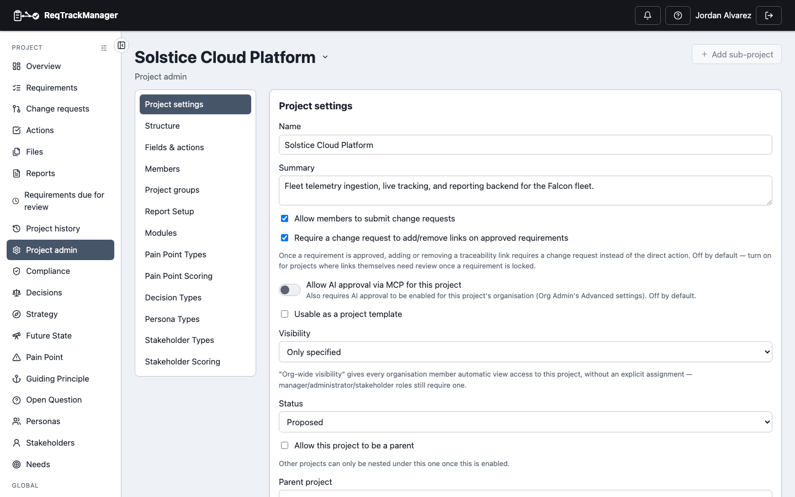
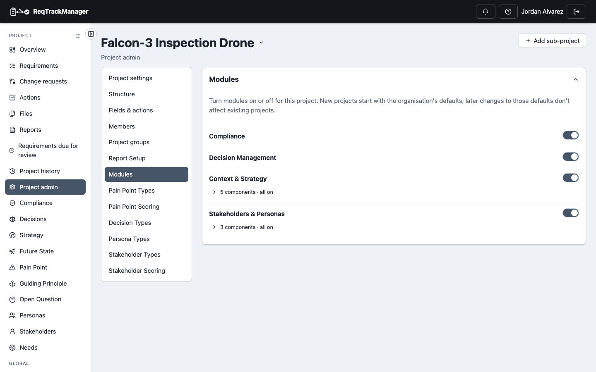

# Administering a project

**Project Admin** (in a project's nav) is where a project manager or administrator configures everything about the project short of its actual requirement content.

| Project admin |
| --- |
| Settings tab: project template flag, bundle export, and other project-wide settings |
|  |

## Components and categories

**Project Admin → Categories** shows the two-level tree — each category belongs to exactly one component, and its prefix only needs to be unique within that component. Both can be renamed inline (renaming never changes already-issued requirement IDs, only new ones going forward). Deleting a category requires picking another to reassign its requirements to; deleting a component requires it to have no categories left under it first.

## Custom fields

**Project Admin → Custom fields** defines additional attributes on requirements or change requests — short text, long text, checkbox, or a fixed list of options. These appear automatically on the create/edit forms and are versioned along with everything else.

## Link types

**Project Admin → Fields & actions → Link types** lists the organisation's link types (and any a parent project defined) with a **Hide** toggle each, and lets the project add link types of its own. The organisation can switch this off, which shows the list read-only. See [Links and traceability → Link types for one project](../core-features/links-and-traceability.md#link-types-for-one-project).

## Tags

**Project Admin → Tags** sets whether anyone who can tag a record may coin a new tag or only the listed ones, and lets you add, rename, colour, merge, reclassify and delete the project's tags, with a usage table per kind of record. A child project follows its parent's list until it adds a tag of its own. See [Tags](../core-features/tags.md#keeping-the-list-tidy-project-admin--tags).

## Report setup

**Project Admin → Report Setup** holds the project's report layouts, report packs and where each report appears. Introductions, chapters and appendices are written in a layout; there is no default report template per project (pick a branding template when generating). See [Reports and export](../core-features/reports-and-export.md#introductions-chapters-and-appendices).

## Terminology

**Project Admin → Terminology** renames how a fixed set of nouns (project, stage, component, category, requirement, change request) are labelled in this project's UI, for a team with different internal vocabulary — the override reaches the nav, list-page headings, and every other surface those words appear on, not just the settings page itself.

## Project groups

**Project Admin → Project groups** lists the project's four fixed role groups — Members, Project Administrators, Project Managers, Stakeholders — each showing its actual members by name/email, with a picker to add and a button to remove. Rather than assigning roles one person at a time, add someone (or a whole organisation-level group) to the group matching the access they need.

## Adding external users

The picker used to add someone (or an organisation-level group) directly to the project normally only searches your organisation's own members. Typing a full email address that isn't already a member can also surface a result — **Add** for an existing account elsewhere in the system, or **Invite** for a brand-new one — if the organisation's admin has enabled it (**Advanced settings → External users on projects**, see [Administering an organisation](./administering-an-organisation.md)). Picking a person, group, or email match stages it in a list rather than granting anything immediately — set (or change) each staged entry's own role, add as many more as you need, then commit them all with one button press. An existing account is added right away once committed; a brand-new one gets an email to finish signing up — either way, the project role you picked is waiting for them as soon as they can sign in.

## Modules

**Project Admin → Modules** has one on/off switch per module (sub-components behind a collapsed summary). A new project starts with the organisation's defaults; later changes to those defaults don't affect it. A hint shows when this project differs from the organisation's default for new projects. A module or sub-component the organisation has turned **Off** is greyed out with an explanation — only an org admin can make it available again.

| Project admin: Modules |
| --- |
| One switch per module; sub-components collapsed behind a summary |
|  |

See [Administering an organisation → Modules](./administering-an-organisation.md#modules) for the organisation's availability settings, and [Modules → Overview](../modules/overview.md) for the full gating mechanics.

## Settings

**Project Admin → Settings** holds project-wide flags: whether ordinary members (not just stakeholders/administrators/managers) can submit [change requests](./change-requests.md), whether the project is **usable as a project template** for new projects, and the **Export project bundle** action for backing up or migrating a project. See [Core Features → Project templates](../core-features/project-templates.md) and [Core Features → Zip export/import](../core-features/zip-export-import.md).

## Archiving a project

**Project Admin → Archive project** hides it from the default project list (it still appears with the Archived filter applied) without deleting any data.

## Where this fits

See [Custom fields, terminology, and templates](../concepts/custom-fields-terminology-and-templates.md) for why these live at the project level rather than a global setting, [Stages, baselining, and reviews](./stages-baselining-and-reviews.md) for the stage-sequence configuration also reached from Project Admin, and [Administering an organisation](./administering-an-organisation.md) for the organisation-level counterpart.
