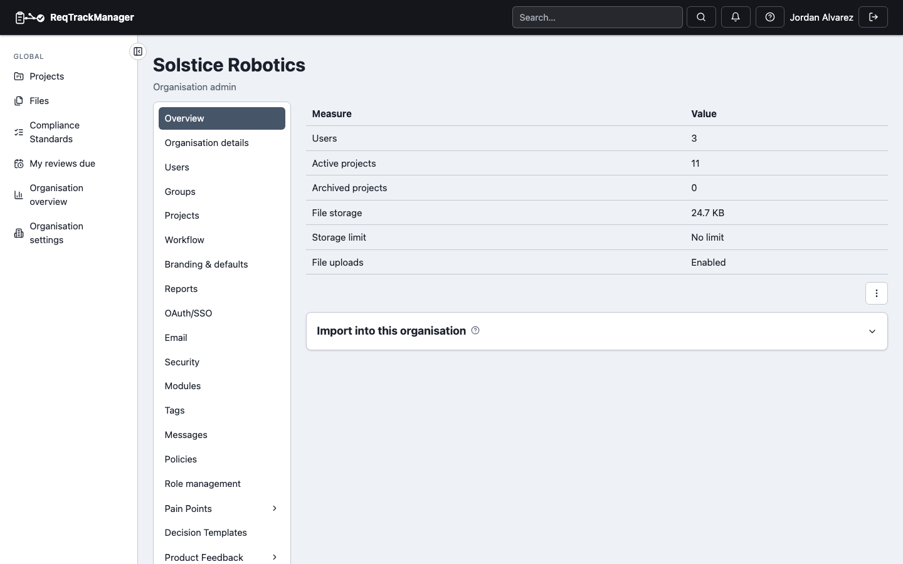
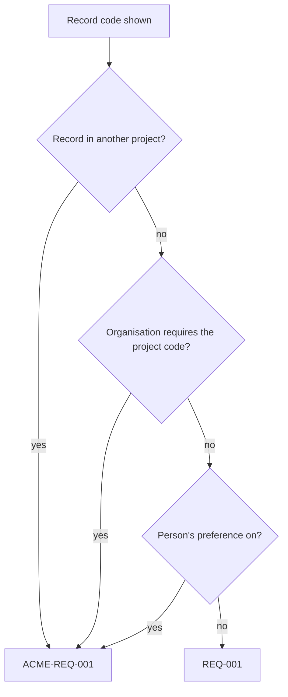
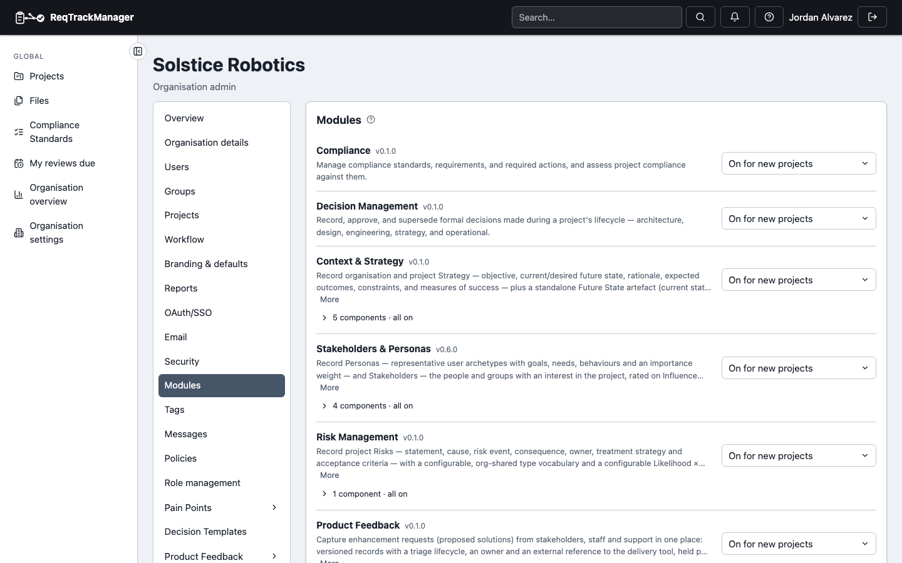
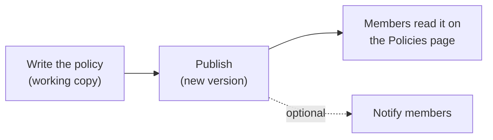
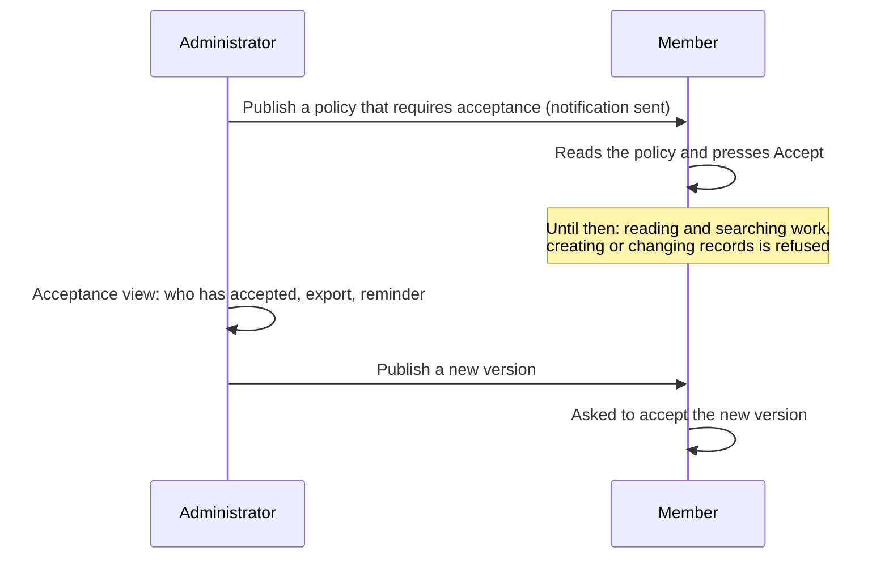

# Administering an organisation

Reach an organisation's admin page via **Organisation settings** in the nav, or from **Preferences → Your access**'s **Manage organisation** link — see [Organisations and projects](./organisations-and-projects.md#finding-your-organisations) for both routes in context.

| Organisation admin |
| --- |
| Users, groups, and organisation-wide settings |
|  |

## Usage

The **Overview** group of the settings opens with a table of **Usage**: the number of users, the number of active and archived projects, and the file storage the organisation uses, with its **Storage limit** and whether **File uploads** are enabled. The limit and the switch are set by the platform operator (see [Organisation storage](./server-administration.md#organisation-storage)) and are read-only here; at 90% of the limit a warning appears and you are notified once. It shows the organisation's real totals and is shown to organisation administrators only; the same figures are available as widgets on the [organisation overview](./organisations-and-projects.md#organisation-overview).

## Managing users

A member who is locked out can be sent a password reset link from their **⋮** menu (**Send password reset link**): it goes to their own address, so you never see it. See [Password resets and credential recovery](./password-reset-and-credential-recovery.md).

**Add user ▾** (the same menu as Server Management) offers **Invite user** (emails a sign-up link so the person chooses their own password) and **New user** (an account you create now, with a password you set).

The **Users** section lists every member, with access-review filters useful for periodic review: stale logins (180+ days), accounts without 2FA, and accounts with no project access at all. Once an accepted email domain is set (see below), it also lists existing accounts elsewhere in the system matching that domain but not yet members.

## Managing groups

**Groups** let you assign organisation-level roles to a set of users at once rather than one at a time — the same building block [project groups](./administering-a-project.md#project-groups) use one level down.

To delete a group, open it from **Groups** and choose **Delete group**. Its members lose every role and project access the group gave them, and it's removed from any group it was nested in. Access they hold some other way is unaffected. Deletion can't be undone. It's refused when an enabled module depends on the group: for example, Compliance blocks deleting the organisation's fallback compliance-managers group while a standard relies on it. A group that is still named as an owner or assignee on records can't be deleted outright: the dialog lists what names it, and you either hand all of it to another person or group, or (when none of the fields is required) clear the optional ones. The same applies to a project's groups.

Deleting a group never leaves a project without a Project Manager. Every project always keeps at least one manager who holds the role directly, and group-granted managers don't count toward that minimum.

## Shared resource files

**Shared resources** are files that aren't specific to one requirement or change request — a standards document, a reference spec — available to link into any project in the organisation and to append as an extra section on a generated report. They are uploaded, listed and deleted on the organisation's **Files** page (the **Shared resources** tab), not in Organisation administration. See [Core Features → File attachments and shared resources](../core-features/file-attachments-and-shared-resources.md).

## Organisation details

The **Organisation details** group (beside **Overview**) holds the organisation's identity: its **logo**, its **name** and the **company details** printed in the footer of its outgoing email (company name, website and postal address). The logo acts at once (upload, or **Remove** to return to the platform logo); the name and the company details are saved together with **Save**, which sends only what changed. An empty company field uses the platform's value, shown as the field's placeholder, so emptying a field and saving returns to it. These fields are separate from the appearance settings below, and saving one page never changes the other.

## Branding and the report look

An organisation has **one report look**. On **Branding & defaults**, set the login page background, the header title, the accent colour, an optional **report accent colour** (reports follow the organisation's accent colour until you give them their own) and whether reports carry the logo (the logo itself is on **Organisation details**). **Report colours** are named colours (such as `primary` or `warning`) that report layouts without colours of their own use by name; change one and every layout that uses the name changes with it (see [Colours](../core-features/custom-reports/designing-a-layout.md#colours)). Under **Reports → Configuration**, set the default **footer text**, whether built-in reports have a **cover page** and whether the requirements report starts a **chapter for each component**. The built-in reports use all of it; a [report layout](../core-features/custom-reports/designing-a-layout.md) uses only what it asks for, so a client with its own look gets its own layout. Introductions, chapters and appendices are written in report layouts. See [Core Features → Reports and export](../core-features/reports-and-export.md).

### Company settings and the platform values

The header title and the company details on **Organisation details** use the platform's values until the organisation sets its own. An empty field shows the platform value as its placeholder, so emptying a field and saving returns to it. The logo and the login page background are files: **Remove** appears while the organisation has its own, and the platform picture is shown dimmed when it has none.

Each **Save** button under **Email**, **Security** (including **Save token lifetime**) and **Reports → Configuration** saves only the settings on its own page; an unsaved change on another page is neither saved nor lost.

## Tags

**Org admin → Tags** holds the tags used by records the organisation itself owns (organisation personas, stakeholders, strategies and so on) and the setting for who may add a new one. A project's own records use that project's tags. See [Tags](../core-features/tags.md#child-projects-and-the-organisation).

## Link types

Under **Workflow → Link types**, define the vocabulary of links between records: each link type's name in both directions, its direction (upstream, downstream or none), which kinds of record it may join (**Can link from** / **Can link to**), and, in the **By artefact type** tab, which link types each kind of record may use. Deleting a link type that is in use opens a dialog to move its links to another type or delete them too. A switch on the same page decides whether project admins may add link types of their own and hide the organisation's. See [Links and traceability](../core-features/links-and-traceability.md#link-types).

## Stage workflows

Under **Workflow → Stage workflows**, define the phases a project stage can move through. A workflow is a name and an ordered list of phases; each phase has a name of your choosing and a **kind** (Open, Review, Locked, On hold or Closed) that decides what entering it does. The first phase is where a new stage starts. New organisations begin with a **Standard** workflow (Scoping, Review, Approved, Completed, Archived), which you can edit or replace. Every project can use your workflows, hide the ones it does not want and add its own; a workflow that a stage follows cannot be deleted, and a phase a stage is in can be renamed but not removed or given another kind. See [Stages and baselining](../core-features/stages-and-baselining.md#workflows-and-phases).

## Default overview

Under **Projects → Default overview**, the row shows whether the organisation has its own default or the built-in layout applies. **Edit overview default** opens a dialog to arrange the project overview that every project of the organisation shows unless it, or a parent project, has its own. It is the same editor as a project's **Customise overview** (see [Project overview](../core-features/project-overview.md)); **Restore default** removes the organisation's overview so the built-in layout applies. Only the modules the organisation has enabled offer metrics, record types and widgets.

## Navigation names

Under **Workflow → Navigation names**, set the name each project navigation entry uses by default (for example Decisions as ADRs). A project uses the organisation's name unless a parent project or the project itself names the entry differently, and a project manager can still override it under **Project Admin → Settings**. The entries listed are the core entries and those of the modules the organisation has enabled. A name affects the navigation, the page title and the back link of that entry's records only; **Restore** returns a row to its built-in name.

## Project codes

Under **Projects → Project codes**, decide how a project's short code is formed: which **characters** (letters, digits, or both), the **shortest** and **longest** length, and whether the code is **assigned automatically** (from the project's name, with a number added on a clash) or **chosen by the creator**. A code is unique within the organisation, never equal to the organisation's own code, and never contains a hyphen. A change applies to codes created from now on; existing codes are never rewritten.

Tick **Lock codes after creation** to stop anyone but an organisation administrator changing a project's code once it exists, for example when a service account creates your projects and the code is an identifier owned by that automation. Project managers and project administrators then see the code read-only in project settings, and the server refuses a change from any other route. Creating a project with a code is never blocked, and the lock applies when codes are assigned manually (an automatically assigned code cannot be changed by anyone).

The code qualifies record codes: `REQ-001` exists in every project, so a record seen outside its own project (in a link to a parent or child project, say) shows as `ACME-REQ-001`. Inside its own project each person chooses in **Preferences** whether to see the project code (on by default), unless you tick **Always show the project code**.

### Organisation code

Records the organisation itself owns and every project shares (Personas, Stakeholders, Stakeholder groups, Strategies, Future states and Guiding principles that you created at organisation level) are numbered within the organisation and qualified by the **organisation's** code: `ACME-PER-001`. They always show qualified, because a bare `PER-001` could equally be a project's own Persona. A project's own records of the same type follow the project-code rule above.

Under **Projects → Organisation code**, change the organisation's code (letters and digits only, no hyphen, and different from every project code). You are asked to confirm: a qualified code already written down under the old code (in a document or a ticket) stops finding its record, though the records keep their own codes. The change is recorded in the audit log.

A qualified code can be looked up from the API (`GET /api/v1/orgs/{id}/records/by-code/{code}`) and by AI assistants through the `get_record_by_code` MCP tool; both return only records the caller may see.

## Single sign-on

Under **Advanced settings → Security**, **Keep approval state on imported projects** (on by default) decides whether a project imported from a bundle keeps its approvals, decisions and votes; switched off, imported records return to drafts. The SCIM token, single sign-on settings, advanced settings, role grants and account creation with a typed password are interactive actions: a personal access token cannot perform them. An account you create with a typed password must change it at its first sign-in.

Configure an identity provider for the organisation under **SSO** — see [API & Integrations → Single sign-on](../api-integrations/single-sign-on.md) for the full setup.

## Modules

**Modules** lists every optional feature module this deployment offers, each with one availability dropdown (a module your plan doesn't include is not listed):

- **Off** — no project in the organisation can use it; takes effect in every project immediately.
- **Available, off for new projects** — projects start without it but a project admin can turn it on.
- **On for new projects** — projects start with it; a project admin can turn it off.

A default only applies to projects created afterwards — changing it never switches a module on or off in an existing project. Sub-components (as of this writing, only [Context & Strategy](../modules/context-strategy-module/overview.md)'s, one per artefact type) sit behind a collapsed summary under their module, each with the same dropdown.

| Organisation admin: Modules |
| --- |
| One availability dropdown per module; Context & Strategy's sub-components collapsed behind a summary |
|  |

See [Administering a project → Modules](./administering-a-project.md#modules) for the per-project switch, and [Modules → Overview](../modules/overview.md) for the full gating mechanics.

## Messages

Under **Messages**, write announcements for the people of your organisation: a closure, a change of process, a reminder. A message has a **title**, a plain-text **message**, a **severity** (Information, Warning or Critical) and a **Show from** and **Show until** time in your local time (a new message starts now and has no end). It appears as a banner above the top bar, dismissible unless you clear **Can be dismissed**, for members of the organisation, beside any [platform message](./server-administration.md#messages), and, with **Show on the login pages**, on the organisation's branded login page (`/login/<slug>`) before anyone signs in, so keep it free of anything confidential.

- A message is plain text and cannot contain a web address, so it cannot be used to send people to another site.
- **Current** and **Previous** views, a search and **Duplicate** work as for [platform messages](./server-administration.md#messages).
- **Send as notification** sends the message once to every active member of the organisation (each person's notification preferences apply, and you are not notified of your own send). The row records how many people it reached, and it cannot be sent again.
- You see and change only your organisation's messages. Messages are included when you export the organisation (without the record of the send) and again when you import it; platform messages are not.

## Policies

Under **Policies**, publish your organisation's own written policies: an access policy, a confidentiality agreement, an acceptable use policy, a code of conduct, or any other. Your members read them on the **Policies** page beside the deployment's own policies, under your organisation's name. They are never public: nobody outside the organisation can read them, even with the address.

- **New policy** takes a title (suggestions such as *Access policy* and *Confidentiality agreement* fill the field for you) and the text, written in the same visual editor as the server's policies. An organisation has no built-in policies.
- **Audience** limits who may read a policy. Empty means every member of the organisation; naming people or organisation groups (including their nested groups) limits it to them and to the organisation's administrators, who always see every policy. Anyone else does not see it listed and cannot open it.
- **Save** stores the working copy only. Members keep reading the published version until you press **Publish**, which records a new version with its date and an optional **Change note** that only administrators see. **Notify members** (off unless you choose it) tells everyone who may read the policy; you are not notified of your own publication.
- **Version history** lists every published version. **Unpublish** removes a policy from members' page and keeps its versions; a policy can also be deleted, with its versions.
- **Allow web addresses in organisation policies** (off by default) decides whether policy text may contain links, for example to an external standard. With it off, a link is refused when the policy is saved or published; turning it off later does not change a version that is already published.
- Policies are included when you export the organisation (the working copy, the audience and every published version) and arrive as **drafts** when the bundle is imported, so an import never publishes text in the new organisation's name before someone has reviewed it. The deployment's own policies are not part of a bundle.
- Publishing, unpublishing and audience changes are recorded in the audit log with the policy's key, version and counts, never its text.

### Requiring acceptance

Switch on **Require acceptance** in the policy editor when members must accept a policy, for example a confidentiality agreement. It applies to everyone who may read the policy (the whole organisation, or the audience you chose, with group members counted individually).

- A member who has not accepted sees a notice on every page and a dialog with the text when they sign in. Until they accept, they can read and search and can sign out, but they cannot create or change records.
- **Accept** records the person, the version, a fingerprint of the text accepted and the time. It is a record of acceptance by an account, not a signature, and it can be made only from a signed-in session, never with an access token.
- A policy with acceptance required shows **Acceptance required** in the list and an **Acceptance** action that lists everyone the policy applies to: accepted, accepted an earlier version, or not accepted. **Export** downloads the list as a CSV file, and **Send reminder** notifies everyone who has not accepted the current version (except you).
- Publishing a new version asks everyone again. Publishing a required policy notifies the people who have not accepted it; this replaces the **Notify members** choice for that policy, so no one receives two messages.
- Switching **Require acceptance** off takes effect at once, without publishing, so a mistaken requirement can be lifted immediately. Administrators can always reach the policy settings, even before they have accepted.
- Acceptances are not included in the organisation export, because they identify the people of this deployment. The setting itself is included.

## Role management

Under **Role management**, define custom roles and grant fixed, module, or custom roles to users and groups — see [Core Features → Role Management](../core-features/role-management.md).

## Advanced settings

**Advanced settings** controls organisation-wide policy:

- Whether every member is **required to have 2FA enabled** — a member who hasn't enrolled can still sign in but can't use anything else in the organisation until they do.
- Whether **self-signup** is allowed for an accepted email domain, on top of the server-wide sign-up mode a server admin controls (see [Server administration](./server-administration.md)).
- Whether and how **external users** can be added to the organisation's projects — see [Administering a project → Adding external users](./administering-a-project.md#adding-external-users).

## Personal data in exports and imports

**Security → Personal data in exports and imports** decides whether record columns that hold personal data may leave the application in a record export, or be written by an import. Each kind of column is its own row:

| Kind | What it covers |
|------|----------------|
| Names and identifiers | A stakeholder's name, a participant label |
| Contact details | Email addresses, phone numbers, and the people named as owners or assignees |
| Free text that can quote people | Notes and descriptions such as an engagement's notes |

A row **follows the server** unless you change it, and a fresh server excludes everything until a [server admin allows it](./server-administration.md#personal-data-in-exports-and-imports). Switching a row shows the **Custom** badge; **Follow the server again** removes your choice. Allowing a kind asks for confirmation, excluding one does not, and every change is recorded in the audit log.

The setting is only half of the rule. A person also needs the **Export personal data** permission to include or import these columns: organisation admins have it, project administrators and managers have it in their project, and you can grant it to anyone (a user or a group) through a [custom role](../core-features/role-management.md). A column the setting or the permission rules out is left out of the file, and an import ignores it and says why.

## Seeing every project in the organisation

An org admin can list every project belonging to the organisation — including ones without a direct role on them — from the main [project list](./organisations-and-projects.md#browsing-and-finding-projects): tick **Include projects I am not a member of** (off by default). These projects appear muted, labelled **Not a member**, with the name and organisation only and no link. The gear on a row opens **Manage users** for that project, the same members table as the project's own Members page. This is visibility into which projects exist and who has access, not a grant of access to their requirements or change requests; see [Roles, groups, and access control](../concepts/roles-groups-and-access-control.md) for why that distinction is deliberate.

## Organisation overview isn't here

The read-only **Organisation overview** stats page (project/requirement/member counts, storage used) is visible to any member, not just admins, so it's covered under [Organisations and projects → Organisation overview](./organisations-and-projects.md#organisation-overview) instead of here.

## Where this fits

See [Organisations and projects](../concepts/organisations-and-projects.md) for the containment model this page administers, and [Administering a project](./administering-a-project.md) for the project-level counterpart to everything here.
