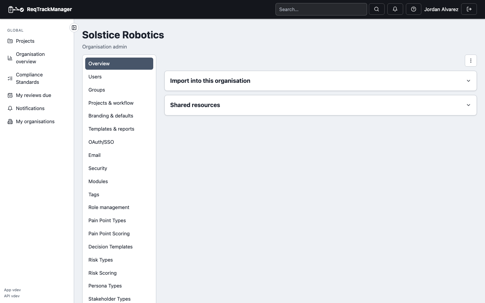
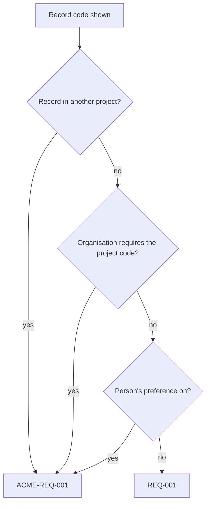
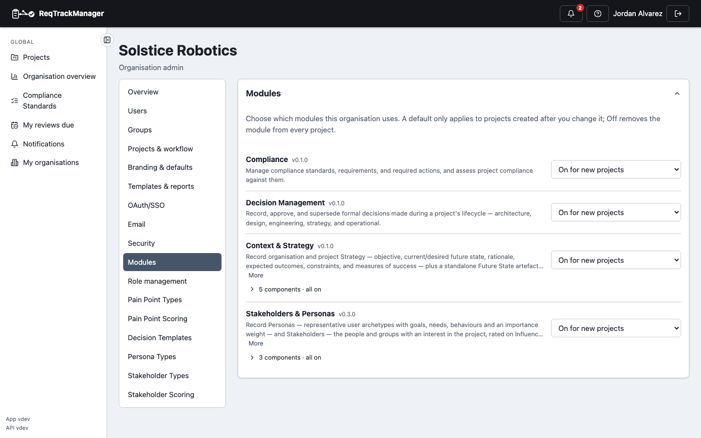

# Administering an organisation

Reach an organisation's admin page via **My organisations** in the nav, or from **Preferences → Your access**'s **Manage organisation** link — see [Organisations and projects](./organisations-and-projects.md#finding-your-organisations) for both routes in context.

| Organisation admin |
| --- |
| Users, groups, and organisation-wide settings |
|  |

## Managing users

A member who is locked out can be sent a password reset link from their **⋮** menu (**Send password reset link**): it goes to their own address, so you never see it. See [Password resets and credential recovery](./password-reset-and-credential-recovery.md).

**Add user ▾** (the same menu as Server Management) offers **Invite user** (emails a sign-up link so the person chooses their own password) and **New user** (an account you create now, with a password you set).

The **Users** section lists every member, with access-review filters useful for periodic review: stale logins (180+ days), accounts without 2FA, and accounts with no project access at all. Once an accepted email domain is set (see below), it also lists existing accounts elsewhere in the system matching that domain but not yet members.

## Managing groups

**Groups** let you assign organisation-level roles to a set of users at once rather than one at a time — the same building block [project groups](./administering-a-project.md#project-groups) use one level down.

To delete a group, open it from **Groups** and choose **Delete group**. Its members lose every role and project access the group gave them, and it's removed from any group it was nested in. Access they hold some other way is unaffected. Deletion can't be undone. It's refused when an enabled module depends on the group: for example, Compliance blocks deleting the organisation's fallback compliance-managers group while a standard relies on it. A group that is still named as an owner or assignee on records can't be deleted outright: the dialog lists what names it, and you either hand all of it to another person or group, or (when none of the fields is required) clear the optional ones. The same applies to a project's groups.

Deleting a group never leaves a project without a Project Manager. Every project always keeps at least one manager who holds the role directly, and group-granted managers don't count toward that minimum.

## Shared resource files

**Shared resources** are files that aren't specific to one requirement or change request — a standards document, a reference spec — available to link into any project in the organisation and to append as an extra section on a generated report. See [Core Features → File attachments and shared resources](../core-features/file-attachments-and-shared-resources.md).

## Branding and report templates

Set the organisation's logo and, under **Templates & reports**, define **report templates** (accent colour, cover page, logo and footer text). Introductions, chapters and appendices are written in report layouts, not in a template. See [Core Features → Reports and export](../core-features/reports-and-export.md).

## Tags

**Org admin → Tags** holds the tags used by records the organisation itself owns (organisation personas, stakeholders, strategies and so on) and the setting for who may add a new one. A project's own records use that project's tags. See [Tags](../core-features/tags.md#child-projects-and-the-organisation).

## Link types

Under **Projects & workflow → Link types**, define the vocabulary of links between records: each link type's name in both directions, its direction (upstream, downstream or none), which kinds of record it may join (**Can link from** / **Can link to**), and, in the **By artefact type** tab, which link types each kind of record may use. Deleting a link type that is in use opens a dialog to move its links to another type or delete them too. A switch on the same page decides whether project admins may add link types of their own and hide the organisation's. See [Links and traceability](../core-features/links-and-traceability.md#link-types).

## Project codes

Under **Projects & workflow → Project codes**, decide how a project's short code is formed: which **characters** (letters, digits, or both), the **shortest** and **longest** length, and whether the code is **assigned automatically** (from the project's name, with a number added on a clash) or **chosen by the creator**. A code is unique within the organisation, never equal to the organisation's own code, and never contains a hyphen. A change applies to codes created from now on; existing codes are never rewritten.

The code qualifies record codes: `REQ-001` exists in every project, so a record seen outside its own project (in a link to a parent or child project, say) shows as `ACME-REQ-001`. Inside its own project each person chooses in **Preferences** whether to see the project code (on by default), unless you tick **Always show the project code**.

### Organisation code

Records the organisation itself owns and every project shares (Personas, Stakeholders, Stakeholder groups, Strategies, Future states and Guiding principles that you created at organisation level) are numbered within the organisation and qualified by the **organisation's** code: `ACME-PER-001`. They always show qualified, because a bare `PER-001` could equally be a project's own Persona. A project's own records of the same type follow the project-code rule above.

Under **Projects & workflow → Organisation code**, change the organisation's code (letters and digits only, no hyphen, and different from every project code). You are asked to confirm: a qualified code already written down under the old code (in a document or a ticket) stops finding its record, though the records keep their own codes. The change is recorded in the audit log.

A qualified code can be looked up from the API (`GET /api/v1/orgs/{id}/records/by-code/{code}`) and by AI assistants through the `get_record_by_code` MCP tool; both return only records the caller may see.

## Single sign-on

Configure an identity provider for the organisation under **SSO** — see [API & Integrations → Single sign-on](../api-integrations/single-sign-on.md) for the full setup.

## Modules

**Modules** lists every optional feature module this deployment offers, each with one availability dropdown (a module your plan doesn't include shows greyed out with a note):

- **Off** — no project in the organisation can use it; takes effect in every project immediately.
- **Available, off for new projects** — projects start without it but a project admin can turn it on.
- **On for new projects** — projects start with it; a project admin can turn it off.

A default only applies to projects created afterwards — changing it never switches a module on or off in an existing project. Sub-components (as of this writing, only [Context & Strategy](../modules/context-strategy-module/overview.md)'s, one per artefact type) sit behind a collapsed summary under their module, each with the same dropdown.

| Organisation admin: Modules |
| --- |
| One availability dropdown per module; Context & Strategy's sub-components collapsed behind a summary |
|  |

See [Administering a project → Modules](./administering-a-project.md#modules) for the per-project switch, and [Modules → Overview](../modules/overview.md) for the full gating mechanics.

## Role management

Under **Role management**, define custom roles and grant fixed, module, or custom roles to users and groups — see [Core Features → Role Management](../core-features/role-management.md).

## Advanced settings

**Advanced settings** controls organisation-wide policy:

- Whether every member is **required to have 2FA enabled** — a member who hasn't enrolled can still sign in but can't use anything else in the organisation until they do.
- Whether **self-signup** is allowed for an accepted email domain, on top of the server-wide sign-up mode a server admin controls (see [Server administration](./server-administration.md)).
- Whether and how **external users** can be added to the organisation's projects — see [Administering a project → Adding external users](./administering-a-project.md#adding-external-users).

## Personal data in exports and imports

**Security → Personal data in exports and imports** decides whether record columns that hold personal data may leave the application in a record export, or be written by an import. Each kind of column is its own row:

| Kind | What it covers |
|------|----------------|
| Names and identifiers | A stakeholder's name, a participant label |
| Contact details | Email addresses, phone numbers, and the people named as owners or assignees |
| Free text that can quote people | Notes and descriptions such as an engagement's notes |

A row **follows the server** unless you change it, and a fresh server excludes everything until a [server admin allows it](./server-administration.md#personal-data-in-exports-and-imports). Switching a row shows the **Custom** badge; **Follow the server again** removes your choice. Allowing a kind asks for confirmation, excluding one does not, and every change is recorded in the audit log.

The setting is only half of the rule. A person also needs the **Export personal data** permission to include or import these columns: organisation admins have it, project administrators and managers have it in their project, and you can grant it to anyone (a user or a group) through a [custom role](../core-features/role-management.md). A column the setting or the permission rules out is left out of the file, and an import ignores it and says why.

## Seeing every project in the organisation

An org admin can see every project belonging to the organisation — including ones without a direct role on them — from the admin page's **Projects** section. This is visibility into which projects exist, not a grant of access to their requirements or change requests; see [Roles, groups, and access control](../concepts/roles-groups-and-access-control.md) for why that distinction is deliberate.

## Organisation overview isn't here

The read-only **Organisation overview** stats page (project/requirement/member counts, storage used) is visible to any member, not just admins, so it's covered under [Organisations and projects → Organisation overview](./organisations-and-projects.md#organisation-overview) instead of here.

## Where this fits

See [Organisations and projects](../concepts/organisations-and-projects.md) for the containment model this page administers, and [Administering a project](./administering-a-project.md) for the project-level counterpart to everything here.
