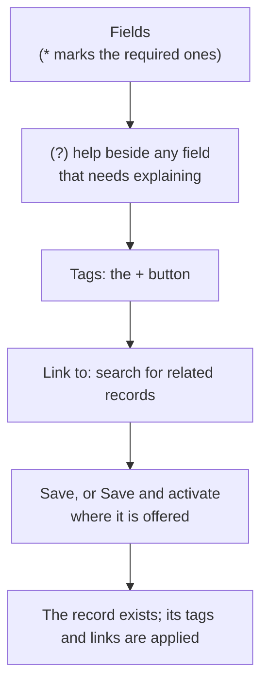

# Creating records: the form conventions

Every create form in the product, whatever the kind of record, is built from the same parts, so once you have filled in one you have filled in them all. This page lists them in the order they appear.

Reading the diagram: you fill in fields top to bottom, optionally tag and link the new record in the same visit, then save. The tags and links are applied just after the record is created, so the record and its relationships arrive together.

## Required fields

A field with a **\*** after its name must be filled in before you can save; the form shows "\* required" once at its foot. A field with no star is optional. Forms never say "(optional)" on the others. The two sign-in pages are the only forms that show no star, because both fields there are always needed.

## The (?) help button

A **(?)** after a field's name explains what the field is, what it changes and a typical value, for example how a persona's importance weight alters a Pain Point's score. Hover over it, tab to it, or select it to read the text in a small bubble that never moves the fields around it; select it again, press Escape, or click elsewhere to close it. Self-explanatory fields (a title, a comment) have no button.

## Tags and Link to

- **Tags** works as on a record's page: select **+**, type or pick a tag, press **Enter** to add it and keep going. See [Tags](../core-features/tags.md).
- **Link to** relates the new record to existing ones now, instead of opening its Links panel afterwards. Type two or more characters of a record's code or title, pick it, and, where more than one relationship is possible, choose which. Links are made in one step once the record is saved; if one is refused (for example you may not link that kind of record) the record is still created and a message says what failed, so you can add it from the Links panel. Links to a record in a parent or child project are added from the Links panel, not here. The field is absent where you may not link, or where the form already collects its own links (a change request's proposed links apply on approval).

## Save and activate

Some records start as a draft: Personas, Stakeholders and Stakeholder Needs. Where you are allowed to activate them, the form offers **Save and activate** beside **Save**, so a record you will use at once is not left in draft. It is one step: either the record is created and active, or nothing is stored. Records that need another person's approval (requirements, change requests, decisions, strategies, future states, guiding principles) never offer it, so nobody can approve their own work. See [The People page](../modules/stakeholders-personas-module/people-page.md).

## Where this fits

Long forms that you open from a list appear in a side panel or a dialog; the same fields appear on the record's page when you edit it, so a field you could set on creation is also one you can change later.
