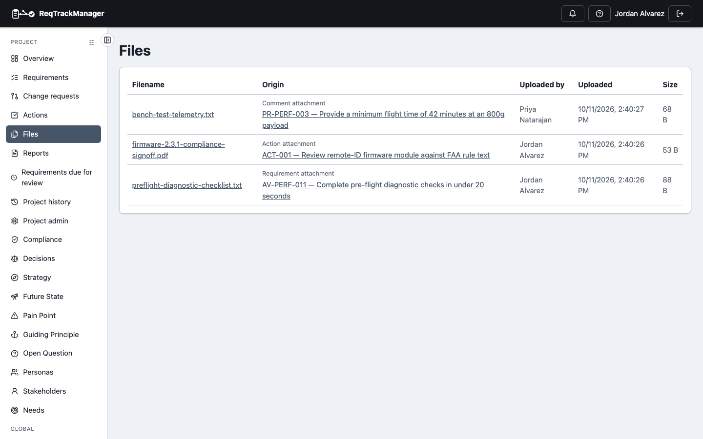
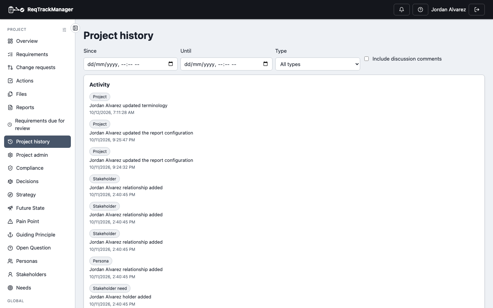
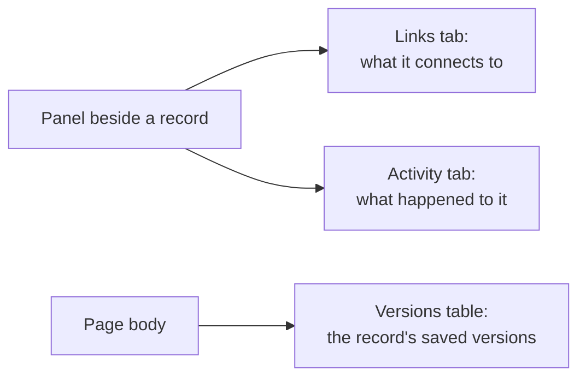

# Files, comments, and history

## Attaching a file

Use the file picker at the bottom of a requirement's (or action's) Attachments card to upload a supporting document; click a filename to download it, or the trash icon to remove it. See [Core Features → File attachments and shared resources](../core-features/file-attachments-and-shared-resources.md) for what changes once a requirement is locked, and for organisation-wide shared resources.

## Commenting and editing comments

Add a comment to a requirement's or change request's discussion thread for informal back-and-forth, distinct from the formal change log. Attach a file with the paperclip icon while writing a comment, or while editing your own existing one — there's no way to attach a file to someone else's comment, or to an already-posted comment you're not editing. Edit your own comment with **Edit**; an edited comment shows "(edited)" next to its timestamp.

## Archiving, deleting and subscribing to a record

On every record's page (a requirement, action, change request, or a module record such as a Decision, Risk or Persona) the same controls sit in the same place: the **Edit** pencil and a **⋮ "\{Record\} actions"** menu at the right of the title.

| In the menu | What it does |
| --- | --- |
| **Archive** / **Restore** | Moves the record out of, or back into, the active list. Archiving asks for confirmation; restoring does not. |
| **Delete permanently** | Only on records that can be erased (an Engagement, a Stakeholder). Asks you to type the record's name first. |
| **Subscribe** / **Unsubscribe** | On requirements and change requests; the page shows a **Subscribed** pill while you are. |

Steps that move a record through its lifecycle (Approve, Activate, Retire, Submit for review, Withdraw) stay as buttons under the title, next to the status. You only see the menu items you are allowed to use; if you have none, there is no menu.

## Browsing every file in a project

A project's **Files** page lists every file attached anywhere within it — requirements, change requests, and actions — in one combined list, since a file has no single natural home of its own otherwise.

| Project files |
| --- |
| Every file attached within a project, in one list |
|  |

## Reviewing project history

A project's **Project history** page is a unified timeline of everything that's happened — requirement and change-request version history, plus other audit events (stage transitions, group membership changes, and more) — filterable by date range and entity type.

| Project history |
| --- |
| A unified activity timeline, filterable by date range and entity type |
|  |

Discussion comments are excluded from the timeline by default, since they're informal discussion rather than the formal change log — tick **Include discussion comments** to bring them into view alongside everything else.

## One record's timeline

Every record's detail page, whatever its type, has a panel beside the content with two tabs: **Links** and **Activity**. Activity is that one record's own timeline, newest first: who created, edited, archived or moved it through its lifecycle, and which links were added or removed. It loads 25 entries at a time; **Show more** fetches the next page. Which tab you last used is remembered for you.

The timeline follows the same access rules as the record: you see it only if you can open the record, and a link entry appears only if you can also open the record at the other end. Discussion comments are not part of it (their text lives in the discussion thread). The wide **Versions** table stays in the page body.

## Where this fits

See [Core Features → File attachments and shared resources](../core-features/file-attachments-and-shared-resources.md) for organisation-wide shared resource files, and [Change requests and baselines](../concepts/change-requests-and-baselines.md) for why the version history this page surfaces exists in the first place.
