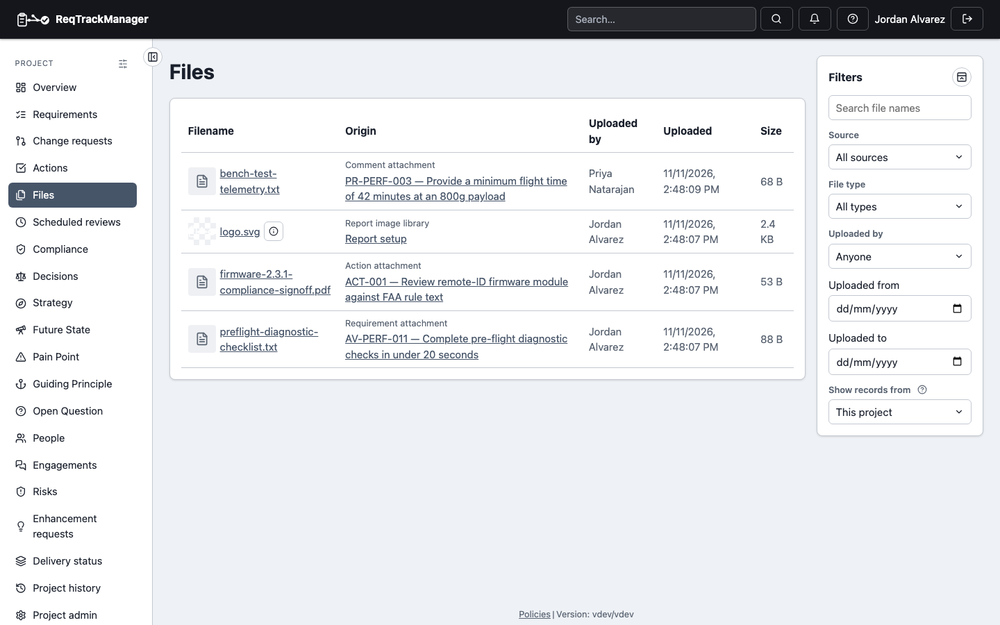
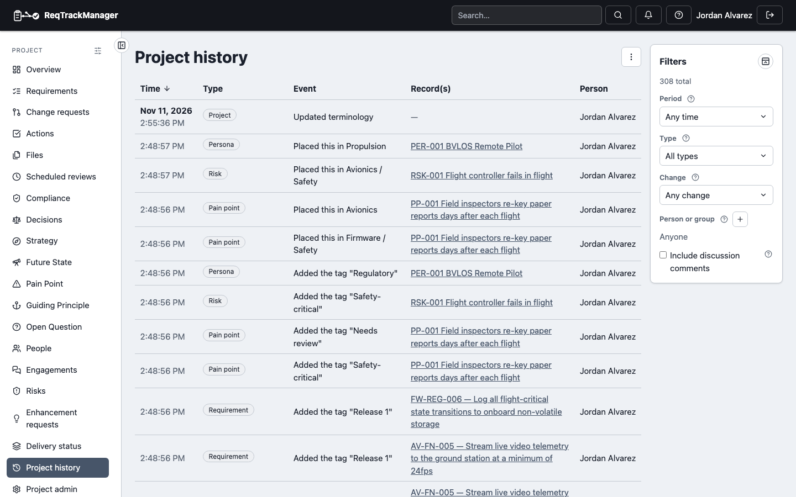
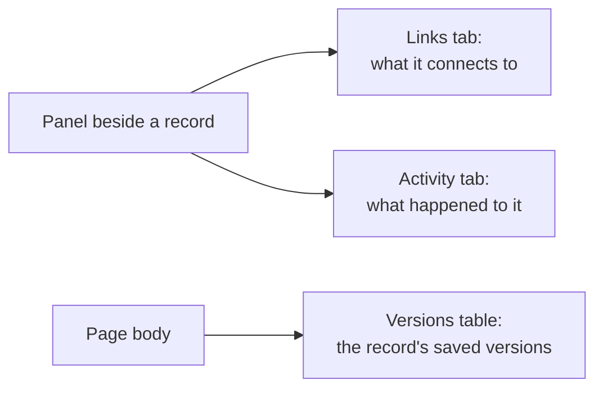

# Files, comments, and history

## Attaching a file

Use the file picker at the bottom of a requirement's (or action's) Attachments card to upload a supporting document; click a filename to download it, or the trash icon to remove it. See [Core Features → File attachments and shared resources](../core-features/file-attachments-and-shared-resources.md) for what changes once a requirement is locked, and for organisation-wide shared resources.

## Commenting and editing comments

Add a comment to a requirement's or change request's discussion thread for informal back-and-forth, distinct from the formal change log. Attach a file with the paperclip icon while writing a comment, or while editing your own existing one — there's no way to attach a file to someone else's comment, or to an already-posted comment you're not editing. Edit your own comment with **Edit**; an edited comment shows "(edited)" next to its timestamp.

## Archiving, deleting and subscribing to a record

On every record's page (a requirement, action, change request, or a module record such as a Decision, Risk or Persona) the same controls sit in the same place: the **Edit** pencil and a **⋮ "\{Record\} actions"** menu at the right of the title.

| In the menu | What it does |
| --- | --- |
| **Archive** / **Restore** | Moves the record out of, or back into, the active list. Archiving asks for confirmation; restoring does not. |
| **Delete permanently** | Only on records that can be erased (an Engagement, a Stakeholder). Asks you to type the record's name first. |
| **Subscribe** / **Unsubscribe** | On requirements and change requests; the page shows a **Subscribed** pill while you are. |

Steps that move a record through its lifecycle (Approve, Activate, Retire, Submit for review, Withdraw) stay as buttons under the title, next to the status. You only see the menu items you are allowed to use; if you have none, there is no menu.

## Browsing every file in a project

A project's **Files** page lists every file the project holds — attached to requirements, change requests and actions, on discussion comments, and in the report image library — in one combined list with previews, since a file has no single natural home of its own otherwise. Its filter panel narrows the list by file name, source, type, uploader and upload day; see [File attachments](../core-features/file-attachments-and-shared-resources.md#project-files).

| Project files |
| --- |
| Every file attached within a project, in one list |
|  |

## Reviewing project history

A project's **Project history** page is a unified timeline of everything that's happened — requirement and change-request version history, plus other audit events (stage transitions, group membership changes, and more). It is a table with one line per event: **Time** (the day is written once, on the first event of each day), **Type**, **Event**, **Record(s)** and **Person**. A requirement, a change request, an action or any other record you may open is named by its code and title, and links to its page. Click **Time** to put the oldest events first.

A link event reads **Created a link (Depends on)** or **Removed a link (Depends on)** in the **Event** column: the verb and the relationship. The **Record(s)** column names the two records it joins, the source above the target, each opening its own page. A record from another project is followed by that project's name. A record you may not open is shown by its type only, for example *Decision (unavailable)*, so the event is still listed without revealing the record.

The filter panel on the right narrows the table; every filter is kept in the address, so a reload, the browser's Back button and a copied link restore the same view.

| Filter | What it does |
| --- | --- |
| **Period** | Any time, Today, Last 7 days, Last 30 days, or a Custom range. A custom range uses your own time zone, and the **To** time includes the whole minute you pick. |
| **Type** | A two-level list; several types or groups may be chosen, and choosing a heading chooses all its types. **Records** has one heading per module, with Core first. **Metadata** holds what surrounds the records: Links and files, Tags and places, Access, Structure and settings, and Other. Only types the project has events for are listed. |
| **Change** | One or more of Created, Edited, Status changes (submitted, approved, rejected, completed, archived and similar) and Deleted. A link, tag, role or group event is a metadata event, so it is never counted as Created or Deleted; find it under **Type**, Metadata. |
| **Person or group** | Only what these people did. A group stands for its current members, including members of groups nested in it. |
| **Include discussion comments** | Discussion comments are left out unless ticked. |

**List actions** (the menu beside the title) downloads the filtered history as CSV, PDF, Word, ODT or ODS. The **Person** column is included only where your organisation's policy and your permission to export personal data allow it, as for every record list, and each download is recorded in the audit trail with its counts and filter names, never the entries.

| Project history |
| --- |
| A table of events with Time, Type, Event and Record, filterable by period, type, change and person or group |
|  |

Discussion comments are excluded from the timeline by default, since they're informal discussion rather than the formal change log — tick **Include discussion comments** to bring them into view alongside everything else.

## One record's timeline

Every record's detail page, whatever its type, has a panel beside the content (below it on a narrow screen), one card whose two tabs, **Links** and **Activity**, are its title. A record's own fields sit in a **Details** card under its header, with a **Version n** label beside its status badges when it keeps versions; attachments, versions and comments each have a card of their own. Activity is that one record's own timeline, newest first: who created, edited, archived or moved it through its lifecycle, and which links were added or removed. A comment typed with a step (approving a decision, addressing a Pain Point, rejecting a change request) or a change note typed with an edit is shown in quotes under that entry, cut to three lines with **Show more** when it is long; the same text appears on the project overview and the project history page. It loads 25 entries at a time; **Show more** fetches the next page. Which tab you last used is remembered for you.

The timeline follows the same access rules as the record: you see it only if you can open the record, and a link entry appears only if you can also open the record at the other end. Discussion comments are not part of it (their text lives in the discussion thread). The wide **Versions** table stays in the page body.

## Where this fits

See [Core Features → File attachments and shared resources](../core-features/file-attachments-and-shared-resources.md) for organisation-wide shared resource files, and [Change requests and baselines](../concepts/change-requests-and-baselines.md) for why the version history this page surfaces exists in the first place.
