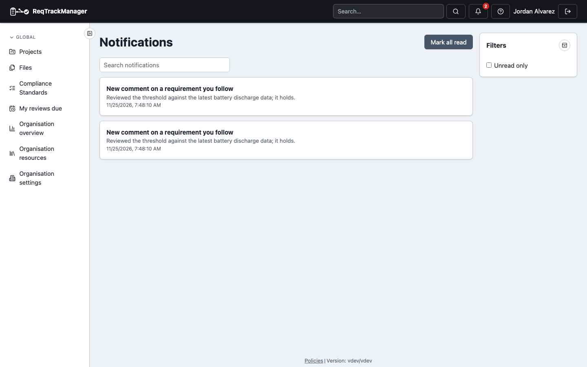

# Notifications

## The bell icon

The bell icon in the top bar shows your recent notifications, with an unread count badge — see [Core Features → Notifications and email](../core-features/notifications-and-email.md) for the full list of what triggers one. Click a notification to mark it read and, for anything tied to a specific requirement, change request, or project, jump straight to it. **Mark all read** clears every unread one without navigating anywhere.

## What a notification opens

The bell, the Notifications page, the instant email and each item of the daily digest all open the same address, `/notifications/{id}`, which marks the notification read and goes to the page it concerns. **Back** returns to where you were. If you are signed out, you sign in first and then arrive at the notification (see [Signing in](./signing-in.md#returning-to-the-page-you-were-on)).

| Notification about | Opens |
| --- | --- |
| A requirement, change request, risk, decision, comment or review | The record |
| A stage or phase (a phase overdue, a stage moved) | **Delivery status** of the project. A person who may change stages and phases sees a settings (gear) link there to **Project Admin → Stages and phases** |
| Access granted to an organisation, a project or a standard | That organisation, project or standard. If the access was later removed, the page says you no longer have access to it instead of showing an error |
| A Compliance assignment, target date, project review or new standard version | The project's **Compliance** page |
| A standard-level review or a standard access grant | The standard |
| A policy | The [Policies page](./administering-an-organisation.md#policies) |
| A message with no page of its own (a password change, storage warning, announcement) | The full message |

A notification stored before its destination was known opens its full message. If the record was deleted, the record page says it was not found. A notification is only ever opened by the person it was sent to.

## The Notifications page

For your full notification history — searchable, and not limited to the dropdown's recent slice — choose **View all** at the foot of the bell's dropdown in the header. The same click-to-open behaviour applies, plus an **Unread only** filter.

| Notifications page |
| --- |
| Full notification history with search and an unread-only filter |
|  |

## Announcements

A server administrator or your organisation's administrator can send an [announcement](../reference/glossary.md#announcement) as a notification. It appears here and in the bell like any other, under the type *Announcement from the platform or your organisation*, and follows your preferences for that type.

## Choosing how you're notified

**Preferences → Notification preferences** sets, per notification type, whether you want it in-app, by email, or both, and whether email notifications go out instantly or are batched into a daily digest. See [Preferences and help](./preferences-and-help.md).

## Where this fits

See [Discussions, notifications, and audit](../concepts/discussions-notifications-and-audit.md) for the model behind what gets notified and why, and [Core Features → Notifications and email](../core-features/notifications-and-email.md) for the full type-by-type reference and unsubscribe mechanics.

## Storage

When your organisation's stored files reach 90% of its storage limit, its administrators receive one notification of the type *Organisation file storage is nearly full*. It is sent again only after usage has fallen below 90% and risen back. It follows your preferences for that type.

## Policies

When your organisation's administrator publishes a policy and chooses **Notify members**, you receive a notification of the type *Policy published in your organisation* (if you may read that policy). Opening it goes to the [Policies page](./administering-an-organisation.md#policies). It follows your preferences for that type.

When a policy requires your acceptance, you receive a notification of the type *A policy needs your acceptance* when it is published, when a new version is published and when an administrator sends a reminder. Opening it goes to the policy, where you can accept it. See [Requiring acceptance](./administering-an-organisation.md#requiring-acceptance).
