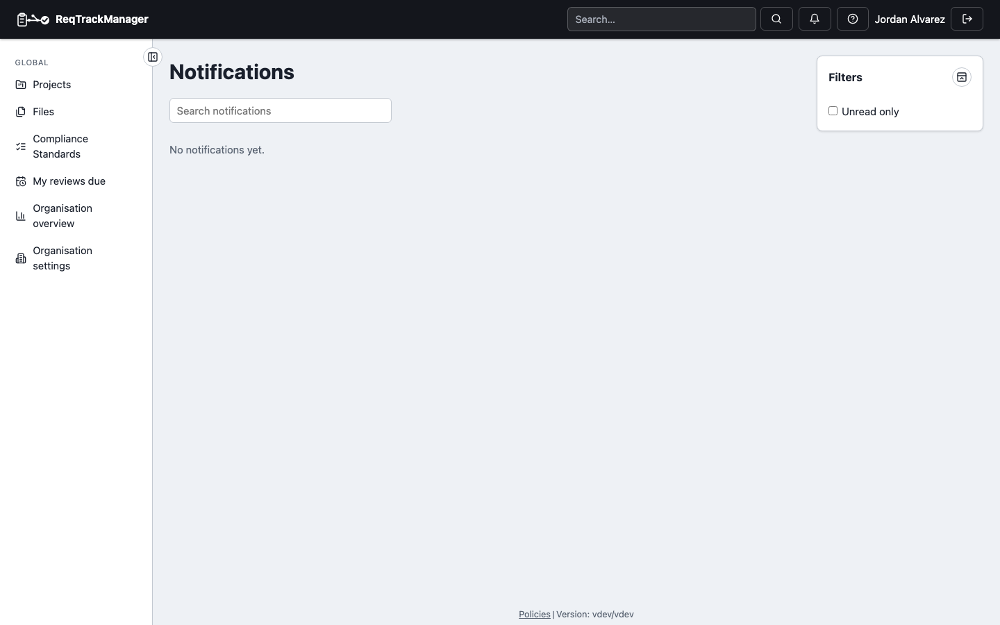

# Notifications

## The bell icon

The bell icon in the top bar shows your recent notifications, with an unread count badge — see [Core Features → Notifications and email](../core-features/notifications-and-email.md) for the full list of what triggers one. Click a notification to mark it read and, for anything tied to a specific requirement, change request, or project, jump straight to it. **Mark all read** clears every unread one without navigating anywhere.

## The Notifications page

For your full notification history — searchable, and not limited to the dropdown's recent slice — choose **View all** at the foot of the bell's dropdown in the header. The same click-to-open behaviour applies, plus an **Unread only** filter.

| Notifications page |
| --- |
| Full notification history with search and an unread-only filter |
|  |

## Announcements

A server administrator or your organisation's administrator can send an [announcement](../reference/glossary.md#announcement) as a notification. It appears here and in the bell like any other, under the type *Announcement from the platform or your organisation*, and follows your preferences for that type.

## Choosing how you're notified

**Preferences → Notification preferences** sets, per notification type, whether you want it in-app, by email, or both, and whether email notifications go out instantly or are batched into a daily digest. See [Preferences and help](./preferences-and-help.md).

## Where this fits

See [Discussions, notifications, and audit](../concepts/discussions-notifications-and-audit.md) for the model behind what gets notified and why, and [Core Features → Notifications and email](../core-features/notifications-and-email.md) for the full type-by-type reference and unsubscribe mechanics.

## Storage

When your organisation's stored files reach 90% of its storage limit, its administrators receive one notification of the type *Organisation file storage is nearly full*. It is sent again only after usage has fallen below 90% and risen back. It follows your preferences for that type.

## Policies

When your organisation's administrator publishes a policy and chooses **Notify members**, you receive a notification of the type *Policy published in your organisation* (if you may read that policy). Opening it goes to the [Policies page](./administering-an-organisation.md#policies). It follows your preferences for that type.

When a policy requires your acceptance, you receive a notification of the type *A policy needs your acceptance* when it is published, when a new version is published and when an administrator sends a reminder. Opening it goes to the policy, where you can accept it. See [Requiring acceptance](./administering-an-organisation.md#requiring-acceptance).
